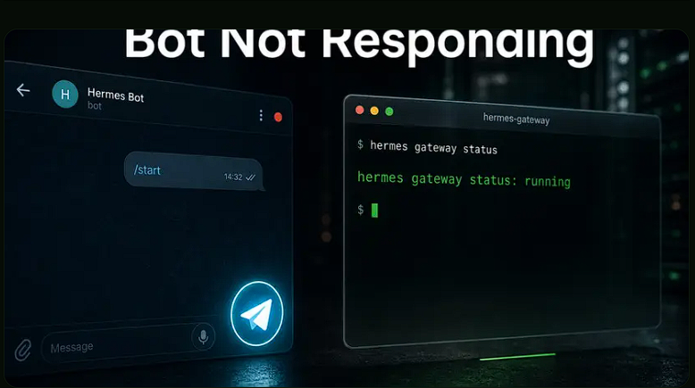

# Hermes Agent não responde no Telegram: soluções rápidas




**Tags:** Hermes · Telegram · Troubleshooting

---

Seu bot do Hermes Agent no Telegram ficou mudo. Percorra as checagens que resolvem as causas mais comuns: allowed-users, token revogado, 409, modo privado, gateway caído.

## O bot funcionava e agora não

Você manda uma mensagem. Nada volta. O bot ainda está no seu chat, o avatar continua lá, mas a resposta não chega. É o problema mais comum do Hermes Agent no Telegram, e o motivo de as pessoas passarem uma hora nele é quase sempre o mesmo: começam a chutar consertos antes de saber qual camada quebrou.

O Hermes no Telegram são na verdade três coisas empilhadas:

1. O processo do agente Hermes (raciocínio e ferramentas).
2. O gateway do Hermes (long-polling contra o Telegram).
3. O próprio Telegram (config do BotFather, allowed users, modo privado).

Quando o bot fica mudo, a falha vive em exatamente uma dessas camadas, e o caminho mais rápido de volta é isolar qual antes de mexer em qualquer coisa.

Este guia caminha pelas checagens na ordem que pega as causas mais rápidas primeiro. Se você já seguiu o guia geral de troubleshooting do Telegram, esta é a versão curta e por sintoma para o caso específico de "não responde nada".

## Checagem 1: seu user ID está mesmo na lista permitida?

Nove em cada dez vezes é isso. O Hermes não vai responder para ninguém cujo ID numérico do Telegram não esteja em `telegram_allowed_users`. O bot recebe a mensagem, o gateway roteia, e o Hermes derruba em silêncio. Do seu lado parece igual a um bot morto.

Duas coisas costumam dar errado aqui:

- **Você colocou `@usuario` em vez do ID numérico.** `@usuario` não é o que o Hermes quer. Mande `/start` para o `@userinfobot` no Telegram, copie o número que ele responde e use esse.
- **Você adicionou um usuário novo depois do último restart e não recarregou a config.** O Hermes lê `telegram_allowed_users` no startup. Muda e reinicia o gateway.

A config fica em `config.yaml`:

```yaml
telegram_allowed_users: "123456789,987654321"
```

Se você está na Hermify, o campo equivalente está no formulário de credenciais do dashboard.

## Checagem 2: prove que o gateway está rodando

Antes de culpar o Telegram, prove que o gateway está no ar.

```bash
hermes gateway status
```

Se não estiver rodando, esse é o seu bug. Sobe:

```bash
hermes gateway start
```

Se está rodando mas o bot continua mudo, acompanhe o log enquanto manda uma mensagem de teste:

```bash
tail -f ~/.hermes/logs/agent.log
```

Você está procurando uma de três coisas:

- Uma linha **"message received"** significa que o gateway faz o dele e é o Hermes derrubando em silêncio (volta pra Checagem 1).
- Uma linha **"409 Conflict"** significa que dois processos estão fazendo polling do mesmo token (ver Checagem 4).
- **Nada de nada** significa que o gateway não está alcançando o Telegram (ver Checagem 5).

## Checagem 3: o bot token ainda é válido?

O BotFather deixa você revogar tokens e é fácil revogar um de um bot de teste antigo, esquecer e ficar se perguntando por que nada funciona.

Abra o Telegram, mande mensagem pro `@BotFather`, envie `/mybots`, escolha seu bot, toque em **API Token** e compare a string exibida com a que está na config do Hermes. Precisam bater caractere por caractere. Se não bater, ou você cola a atual no Hermes e reinicia, ou clica em **Revoke current token** no BotFather para gerar uma nova e cola essa.

Um token inválido aparece como um erro **"Unauthorized"** no log do Hermes no startup. Se você vê esse erro, é sempre o token.

## Checagem 4: dois processos estão fazendo polling do mesmo bot?

A Bot API do Telegram permite exatamente **um** consumidor de long-poll por token. Se dois processos chamam `getUpdates` ao mesmo tempo, o Telegram retorna **"409 Conflict: terminated by other getUpdates request"** e os updates começam a ir para o processo que ganhar cada ciclo, ou para nenhum. Do seu lado, o bot parece que perde uma mensagem sim, outra também.

O jeito mais comum de isso acontecer não é exótico:

- Uma unit do systemd roda o Hermes e você também subiu uma sessão do Hermes na mão no tmux.
- Você está testando um bot de dev no seu laptop mas a instância de produção usa o mesmo token.
- Você levantou um worker em background e esqueceu que o container antigo continua no ar.

Ache o duplicado:

```bash
ps aux | grep -E 'telegram|hermes' | grep -v grep
```

Mate o que você não queria manter e reinicie o que sobrou. Os 409 param em segundos porque o Telegram libera a sessão de long-poll obsoleta assim que o cliente perdedor desconecta.

## Checagem 5: silêncio em grupo geralmente é o modo privado

Se o bot funciona no DM mas não em um grupo, o culpado quase sempre é o **modo privado de bots do Telegram**, não o Hermes.

Modo privado vem ligado por padrão em todo bot novo. Significa que o bot só vê mensagens que o mencionam diretamente, que respondem a alguma mensagem dele ou que chegam como comandos. O papo comum do grupo nunca chega ao seu gateway do Hermes.

Duas formas de resolver:

- **Torne o bot admin do grupo.** Bots admin veem tudo, e é a opção menos surpreendente.
- **Desligue o modo privado.** No BotFather envie `/setprivacy`, escolha o bot, marque **Disable**. Depois tire o bot do grupo e adicione de novo. Mudanças de modo privado só valem no próximo add.

Se você roda o bot em um topic ou thread de fórum, confirme também que a config do Hermes cobre aquele thread específico em `allowed_chats` e nos IDs de topic. Um bot com permissão pra falar no canal geral vai continuar mudo em uma thread de operações se aquele topic ID não estiver na lista.

## Checagem 6: sua rede está matando o long-poll

Se o bot responde uma vez no começo e depois fica mudo pela mesma duração toda vez antes de reviver, sua rede está fechando o long-poll ocioso antes de o Telegram conseguir empurrar um update por ele. Roteadores domésticos, VPS baratas e redes corporativas fazem muito isso com timeouts de NAT.

Ligue logs de debug e observe:

```bash
export HERMES_LOG_LEVEL=debug
hermes gateway restart
```

Entradas **"connection reset"** repetidas em intervalo fixo confirmam o diagnóstico. Encurte o poll timeout do Hermes para ele reconectar mais rápido do que o idle timeout da sua rede:

```bash
hermes config set messaging.telegram.poll_timeout 30
```

O default é 60. Baixa pra 30 ou menos e o problema do reset some, porque você fecha e reabre o long-poll antes de a rede se entediar. É a mesma raiz de muitos "funciona local, quebra depois do deploy" em infraestrutura barata.

## Checagem 7: o loop do agente caiu em silêncio por erro do provider

O gateway está no ar, o token está certo, a lista de permitidos está ok, mas as respostas continuam não chegando. Procure no log um erro do provider do modelo perto da última resposta que deu certo. Rate limits, quotas esgotadas e respostas 5xx do provider do LLM podem derrubar o loop do agente em algumas versões do Hermes sem reiniciar. O gateway continua fazendo polling, recebe sua mensagem nova, passa adiante, e do outro lado não tem ninguém para responder.

O conserto é um restart mais checar o dashboard do provider pelo problema subjacente. Se você está no tier grátis de um provider e estourou a quota diária no meio da conversa, o bot vai parecer "não responde" até a janela de quota rodar. Passa pro plano pago ou troca de provider na config do Hermes para outro backend e reinicia o gateway.

## Uma ordem de diagnóstico de dois minutos que funciona

Quando você está com pressa, siga essa ordem e vai chegar à causa em menos de dois minutos em todos os casos reais que vimos:

1. `hermes gateway status` — está no ar?
2. `tail -f ~/.hermes/logs/agent.log` — uma mensagem nova sequer chega ao Hermes?
3. Se sim, revisa o `telegram_allowed_users`.
4. Se não, procura **"409 Conflict"** (poller duplicado) ou **"Unauthorized"** (token revogado) no log.
5. Se nada disso e o bot só está mudo em grupo, é modo privado.
6. Se nada disso e ele se cala em intervalos regulares, é idle timeout da sua rede.
7. Se nada disso e ficou mudo depois de funcionar bem, é crash do provider lá em cima.

## Pule o loop de debug de vez

Cada checagem acima existe porque Telegram, gateway, Hermes e provider são quatro peças móveis que podem falhar de forma independente. Quando todas vivem na sua infraestrutura, você é quem recebe o alarme toda vez que uma escorrega.