# Agendamento de Tarefas no Hermes

## Index

<!-- toc -->

- [1. Tarefas Programadas (Cron)](#1-tarefas-programadas-cron)
- [2. O que o cron pode fazer](#2-o-que-o-cron-pode-fazer)
- [3. Entendendo o Fluxo de um Cron](#3-entendendo-o-fluxo-de-um-cron)
- [4. Criação de tarefas agendadas - Tick](#4-criacao-de-tarefas-agendadas---tick)
- [5. Como rodar o Cron](#5-como-rodar-o-cron)
- [6. Recuperando um Cron atrazaado](#6-recuperando-um-cron-atrazaado)
- [7. Editando uma Tarefa Agendada - Tick](#7-editando-uma-tarefa-agendada---tick)
- [8. Ações durante o Ciclo de Vida de uma Tarefa Agendada](#8-acoes-durante-o-ciclo-de-vida-de-uma-tarefa-agendada)
- [9. Opções de Entrga após execução do Cron](#9-opcoes-de-entrga-apos-execucao-do-cron)
- [5. Custos de Agendamento](#5-custos-de-agendamento)

<!-- tocstop -->

## 1. Tarefas Programadas (Cron)
Programe tarefas para serem executadas automaticamente com linguagem natural ou expressões cron. O Hermes expõe o gerenciamento de crons por meio de uma única ferramenta com operações no estilo de ação, em vez de ferramentas separadas de agendamento/lista/remoção.

## 2. O que o cron pode fazer

- Agende tarefas one-shot ou recorrentes
- pausar, retomar, editar, acionar e remover tarefas
- Interrompa uma atividade que já está em execução, sem mexer na agenda do trabalho
- Podemos deixar o cron sem, uma ou múltiplas habilidades (skill) a uma tarefa
- Retornar o resultado ao chat de origem, arquivos locais ou ferramentas configurados da plataforma
- Execute sessões novas de agentes com a lista normal de ferramentas estáticas
- É possível a execução do cron no modo sem agente — um script em um cronograma, seu stdout entregue literalmente, sem envolvimento com LLM.
- disparar em eventos externos — uma rota de webhook com set dispara o trabalho no momento em que algo acontece (um PR recebe feedback, um serviço posta um alerta) em vez de esperar pelo próximo tick agendado. 

Tudo isso está disponível para o próprio Hermes através da ferramenta, então você pode criar, pausar, editar e remover trabalhos perguntando em linguagem simples — sem necessidade de CLI.

## 3. Entendendo o Fluxo de um Cron

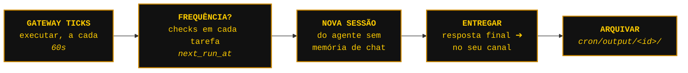
</br>

## 4. Criação de tarefas agendadas - Tick
[Creating scheduled tasks](https://hermes-agent.nousresearch.com/docs/user-guide/features/cron#creating-scheduled-tasks)
Temos vários caminhos para iniciar ou preparar um cron, seja para um agente ou simplesmente uma automação de uma tarefa agendada que será executada por um script.

<div align="left">
  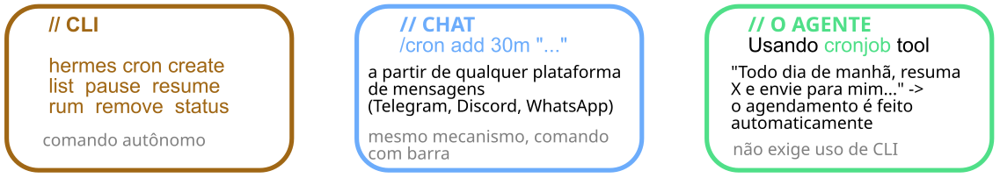
</div><br>

- Podemos iniciar um Cron diretamente em um chat usando o comando `/cron`. Este chate pode ser no painel de controle, Dashboard, Telegram,...
```bash
/cron add "in 30m" "Remind me to check the build"
/cron add "every 2h" "Check server status"
/cron add "every 1h" "Summarize new feed items" --skill blogwatcher
/cron add "every 1h" "Use both skills and combine the result" --skill blogwatcher --skill maps
```

- Através do terminal CLI independente
```bash
hermes cron create "every 2h" "Check server status"
hermes cron create "every 1h" "Summarize new feed items" --skill blogwatcher
hermes cron create "every 1h" "Use both skills and combine the result" \
  --skill blogwatcher \
  --skill maps \
  --name "Skill combo"
```

- Por meio da conversa natural, simplesmente pedimos ao Hermes o que queremos e que seja executado para um agendamento de tarefas. Talvés esta é a forma mais fácil onde é passado as instruções ao agente desejado e ele prepara e configura todo o cron para nós, mas se cisermos ser mais detalhista podemos criar o agendamento pelo dashbord desktop ou dashboard do servidor.

<div align="left">
  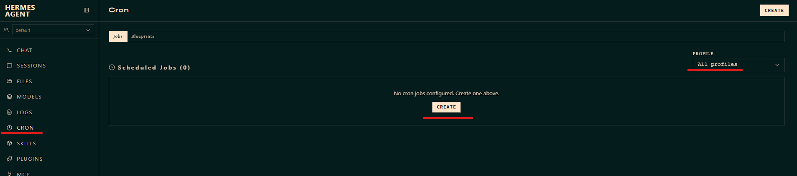<br>
  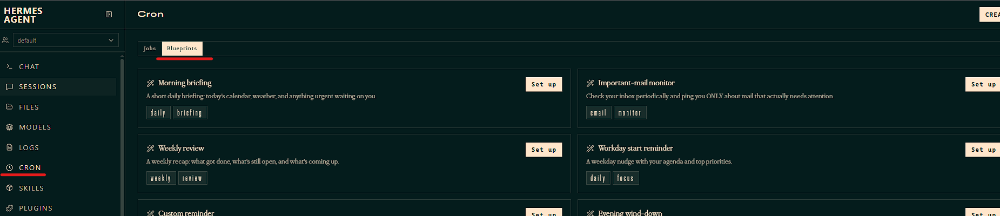
</div><br>

Na primeira imagem podemos ver onde acessar o agendador de tarefas, já na segunda imagem podemos utilizar templates (chamado aqui de blueprints) e partir para um agendamento pre-formatado
Depois é só criarmos em **Create** e teremos a janela com as opções que queros dar ao nosso agente.
Na primeira imagem temos do Dashboard do servidor e na segunda imagem do Dashboard Desktop.
<div align="left">
  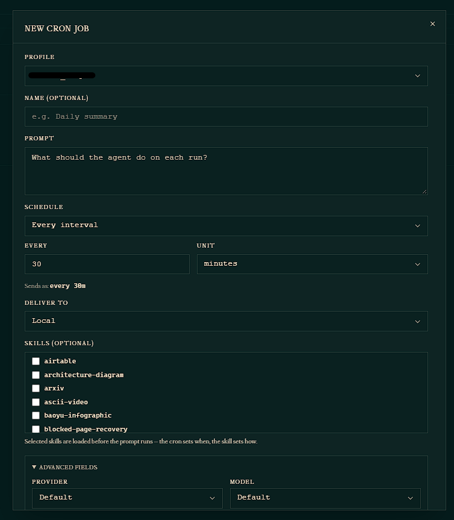
  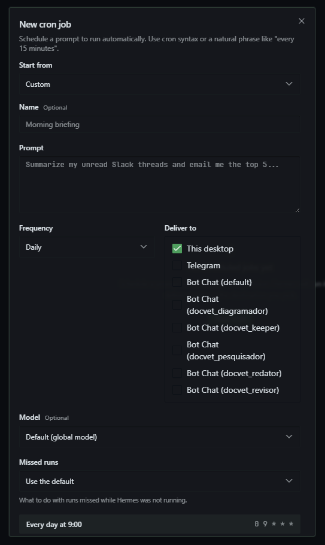
</div><br>

*Proteção de limite*
:  Uma sessão agendada (cron run) em execução não pode criar mais agendamentos (cron) de trabalhos. Evitando desta forma loops de agendamento fora de controle.

## 5. Como rodar o Cron
Para executarmos uma tarefa agendada podemos atribuir para um agente ou simplesmente fazer a configuração de uma automação agendada, pois a atividade padrão de um Cron pode rodar independente de agente, pois para a execução de um Cron não é necessário que ele tenha que carregar um `AGENTS.md`, `HERMES.md`, `SOUL.md`, ou qualquer outro contexto. A unica exigência é que o gateway deve estar rodando para que a tarefa agendada (cron) posso ser executada - isto seria o que chamamos de **Pulsação** (heartbeat).

Para verificar se nosso gateway esta ativo, podemos executar o comando:

```bash
hermes gateway status

# saída
✓ Gateway is running (PID: 237)
  (Running manually, not as a system service)

Inbound callback URLs on the shared listener:
  profile_name-1/api_server: http://127.0.0.1:8642/p/profile_name-1/v1
  profile_name-2/api_server: http://127.0.0.1:8642/p/profile_name-2/v1
  profile_name-3/api_server: http://127.0.0.1:8642/p/profile_name-3/v1

To install as a service:
  hermes gateway install
  sudo hermes gateway install --system
```

Agora podemos ver que o gateway esta operando e podemos solicitar o status do cron para conferir:
```bash
hermes cron status

## saída
Scheduler host: the host gateway (PID 237) serving profiles default, profile_name-1, profile_name-2, profile_name-3,...
✓ Gateway is running — cron jobs will fire automatically
  PID: 237
  Ticker heartbeat: 15s ago

  No active jobs
```

## 6. Recuperando um Cron atrazaado
[Catch-up window](https://hermes-agent.nousresearch.com/docs/user-guide/features/cron#catch-up-window)

Pode ocorrer de o cron não ser executado por alguns motivos, o principal seria:
- no momento em que o cron deveria iniciar o gateway estava parado
- hove uma queda no servidor
- o PC estava desligado

Para contornar este problema, podemos configurar uma janela de recuperação para que o cron possa rodar, eliminando desta forma a perda ou atrazo de uma atividade agendada
```bash
hermes cron edit <job-id> --grace-minutes 0    # nunca recupere a janela de recuperação: ignore uma ocorrencia perdida
hermes cron edit <job-id> --grace-minutes 180  # rode em até 3h depois do agendamento
```
Vamos ver na prática como isso ocorre.
Primeiro vamos rodar um comando para descubrir qual o job-id do cron que queremos editar. Este comando lista todos os cron criados dentro do Hermes, independente de qual profile estamos.

<div align="left">
  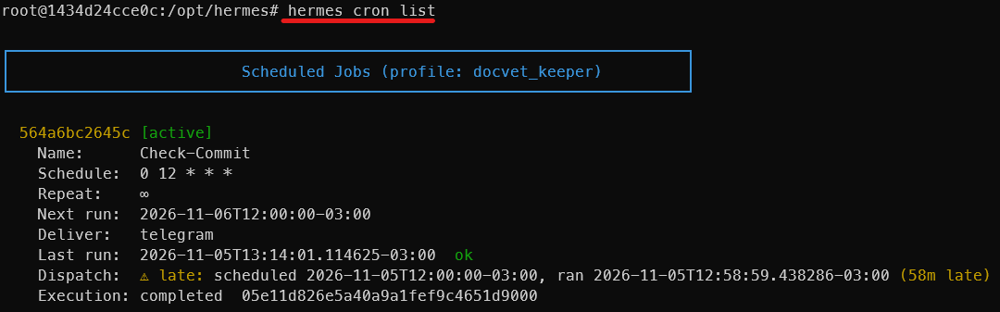
</div><br>

Aqui podemos notar que temos uma atividade agendada (cron) com o nome de `Check-Commit` e o sei `job-id` é a sequência de números que esta acima do nome, neste caso `job-id = 564a6bc2645c`
Vamos editar este cron e informa-lo que caso tenha algum atraso na execução da tarefa, o cron poderá executar dentro de uma janela de até 180 minutos.

<div align="left">
  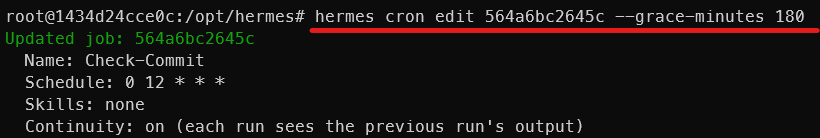
</div><br>

Podemos notar que o cron recebeu a atualização.
Agora vamos listar novamente a atividade agendada para vermos como ficou a descrição do cron.
Note que agora temos a indicação de `Grace: 180 min`

<div align="left">
  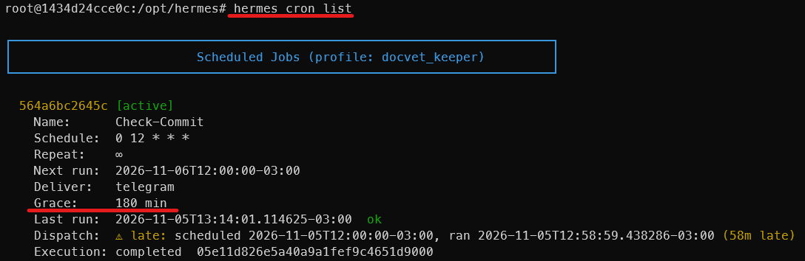
</div><br>

Você pode estar se perguntando sobre o que são aqueles números estranhos na linha onde menciona `Schedule:...`. Bem o cron tem uma syntax particular para lidar com o agendamento, esta syntax é criada a partir das informações que configuramos, mas podemos utiliza-la em um script também para rodar um cron.

<div align="left">
  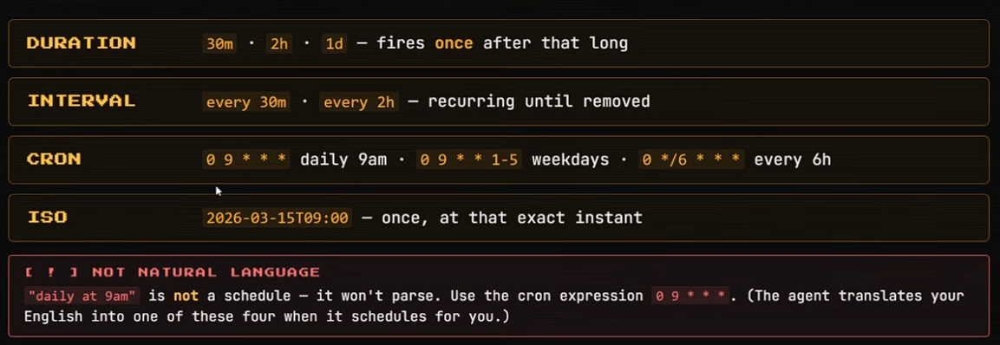
</div><br>

## 7. Editando uma Tarefa Agendada - Tick
[Editing jobs](https://hermes-agent.nousresearch.com/docs/user-guide/features/cron#editing-jobs)
Nós não precisamos apagar ou criar um novo cron, podemos simplesmente editar os existentes e aproveitar as configurações para uma nova tarefa agendada.
Assim como na criação de uma nova tarefa agendada que podemos utilizar alguns caminhos para criar o cron, para editar também podemos utilizar dois caminhos que são **Chat** e o **CLI**

<div align="left">
  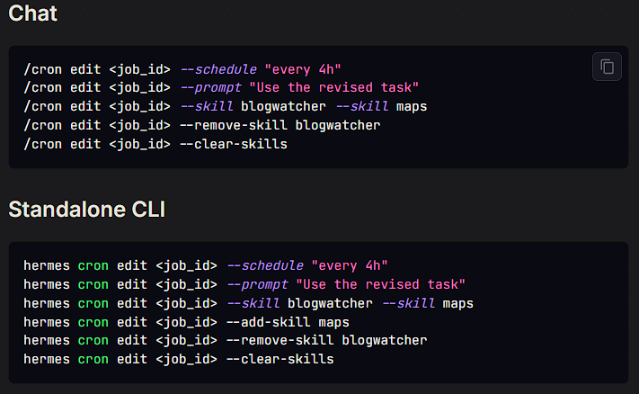
</div><br>

## 8. Ações durante o Ciclo de Vida de uma Tarefa Agendada
[Lifecycle actions](https://hermes-agent.nousresearch.com/docs/user-guide/features/cron#lifecycle-actions)
Depois que criamos, editamos, temos um ciclo de vida deste cron que podemos controlar com alguns comandos. Este comandos serve para listarmos a situação do cron, pausar, reiniciar, etc...

<div align="left">
  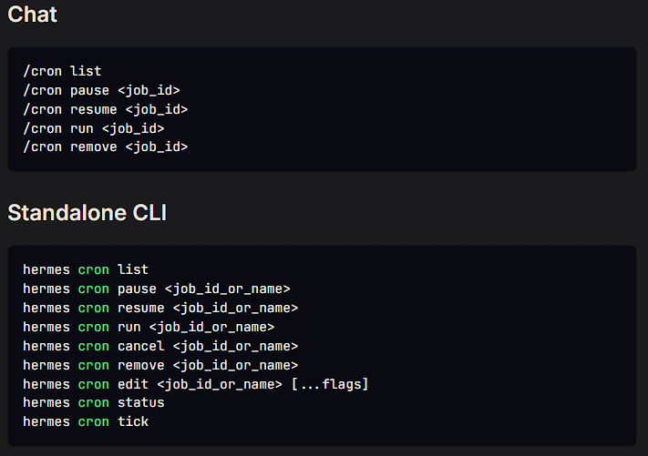
</div><br>

## 9. Opções de Entrga após execução do Cron
[Delivery options](https://hermes-agent.nousresearch.com/docs/user-guide/features/cron#delivery-options)
A entrega de um relatório após o término de uma tarefa agendada pode ser definido para alguns canais de comunicação do agente e o usuário.

| Opção | Descrição | Exemplo |
|---|---|---|
| `"origin"` | De volta ao local onde o job foi criado | Padrão em plataformas de mensagem |
| `"local"` | Salva apenas em arquivos locais (`~/.hermes/cron/output/`) | Padrão no CLI |
| `"telegram"` | Canal principal do Telegram | Usa `TELEGRAM_HOME_CHANNEL` |
| `"telegram:123456"` | Chat específico do Telegram por ID | Entrega direta |
| `"telegram:-100123:17585"` | Tópico específico do Telegram | Formato `chat_id:thread_id` |
| `"discord"` | Canal principal do Discord | Usa `DISCORD_HOME_CHANNEL` |
| `"discord:#engineering"` | Canal específico do Discord | Por nome do canal |
| `"slack"` | Canal principal do Slack | — |
| `"whatsapp"` | WhatsApp principal | — |
| `"signal"` | Signal | — |
| `"matrix"` | Sala principal do Matrix | — |
| `"mattermost"` | Canal principal do Mattermost | — |
| `"email"` | E-mail | — |
| `"sms"` | SMS via Twilio | — |
| `"homeassistant"` | Home Assistant (plugin) | Usa `HASS_HOME_CHANNEL`; requer o plugin `homeassistant` |
| `"dingtalk"` | DingTalk | — |
| `"feishu"` | Feishu/Lark | — |
| `"wecom"` | WeCom | — |
| `"weixin"` | Weixin (WeChat) | — |
| `"bluebubbles"` | BlueBubbles (iMessage) | — |
| `"qqbot"` | QQ Bot (Tencent QQ) | — |
| `"bot-chat"` | Bot Chat canônico deste perfil — o bot lê a saída e responde | Local à máquina |
| `"bot-chat:research"` | Bot Chat de outro perfil local | Validado na criação |
| `"all"` | Distribui para todos os canais principais conectados | Resolvido no momento do disparo |
| `"telegram,discord"` | Distribui para um conjunto específico de canais | Lista separada por vírgulas |
| `"origin,all"` | Entrega na origem mais todos os outros canais conectados | Combina quaisquer tokens |

A resposta final do agente é entregue automaticamente ao alvo configurado — o agente não envia mensagens por conta própria, então não há nada para chamar no prompt cron.
Por padrão, a saída cron entregue é encapsulada com um cabeçalho e rodapé para que o destinatário saiba que veio de uma tarefa agendada:
```bash
Cronjob Response: Morning feeds
-------------

<agent output here>

Note: The agent cannot see this message, and therefore cannot respond to it.
```
Mas caso queremos ter uma entrega bruta do que foi realizado no cron temos que editar o arquivo `config.yaml` do agente responsável pela aquela tarefa
```bash
# ~/.hermes/config.yaml
cron:
  wrap_response: false
```

A saída do cron é uma entrega final, não uma mensagem de progresso, então por padrão é enviado para o canal de notificação da plataforma definida. Mas podemos também silenciar esta entrega de relatório mesmo que fizemos a configuração do canal durante a criação do cron, para isso temos que alterar o arquivo `config.yaml` e adicionar:
```bash
# ~/.hermes/config.yaml
cron:
  delivery:
    notify: false   # default: true
```
> [!NOTE]
> Como podemos ver na tabela são várias formas de configurarmos a entrega da tarefa agendada, como temos muitas opções vale a pena iniciar com opções simples e básicas e conforme a necessidade retornar a esta seção para verificar outras opções mais especificas.

## 5. Custos de Agendamento

Dentro da execução de um tarefa agendada, podemos ter um custo se atribuirmos o cron para um agente, então quando este agentente for solicitado a executar o cron, ele estará utilizando um modelo e consequentemente gerando um gasto dentro do fluxo.
Mas dependendo do tipo de atividade agendada, como já comentamos anteriormente, podemos simplesmente configurar um cron com script que será rodado independendte de ter um modelo ou não. Desta forma podemos economizar Tokens e reduzir as despezas.