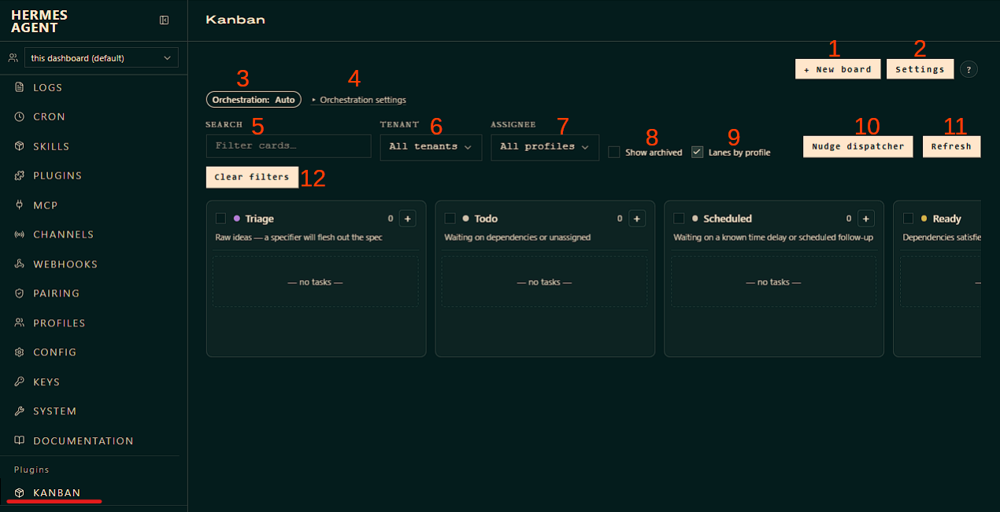
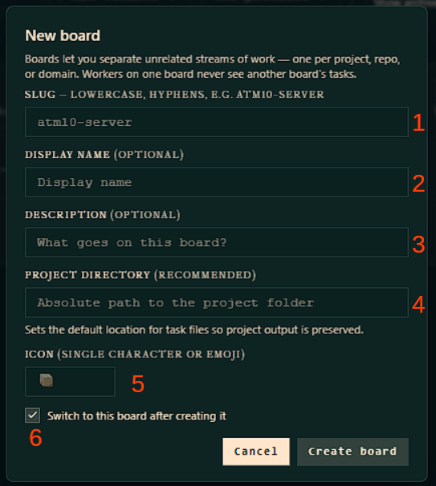
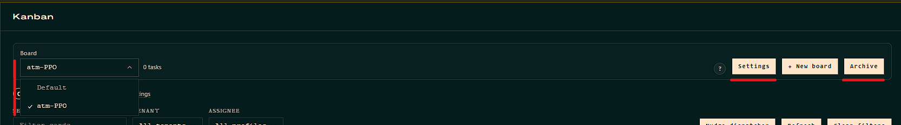
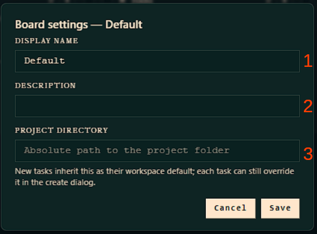
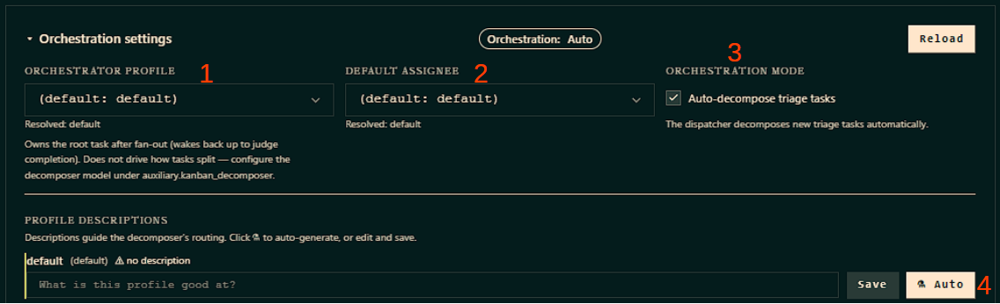
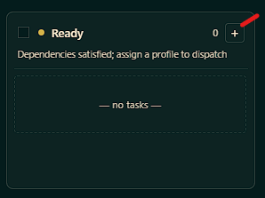
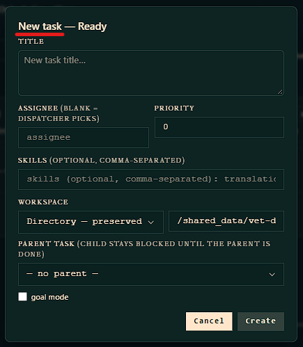
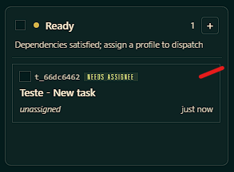
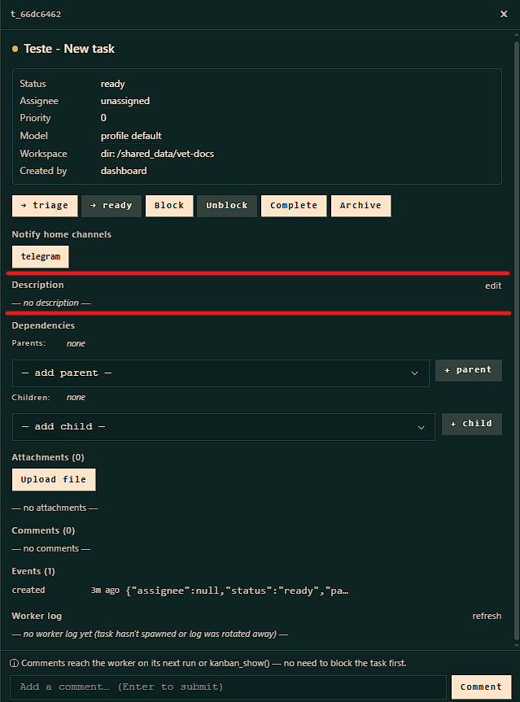

# Kanban — Colaboração de Multi-Agent
[Kanban — Multi-Agent Profile Collaboration](https://hermes-agent.nousresearch.com/docs/user-guide/features/kanban)

## Conteúdo
<!-- toc -->

<!-- tocstop -->

## 1. Introdução
Hermes Kanban é um quadro com cartões de tarefas durável, compartilhado com todos os seus perfis Hermes, que permite que vários agentes nomeados colaborem no trabalho sem um encadeamento frágeil de subagentes em processo. Podemos interpretar cada tarefa como sendo uma linha; e dentro do base de dados do kanban `~/.hermes/kanban.db` cada transferência de tarefa (atividade) é uma linha que qualquer um pode ler e escrever;
O grande virada de chave no Kanban é o ponto de verificação de conclusão antes do limite do processo de repetição de uma ou mais ações, seja para aproximar um resultado desejado, percorrer estruturas de dados ou refinar soluções.
 

## 2. - Acesso ao sistema Kanban
Para acessar e interagir com o Kanban podemos utilizar 2 modelos de acesso:

### 1. O Modelo de ferramentas dedicadas
O Agente se desloca nos cards do Kanban através de ferramentas dedicadas `kanban_*` as toolset.

A seguir está a tabela com as ferramentas `kanban_*` utilizadas pelos agentes workers no Hermes Agent, acompanhadas de uma breve explicação sobre a finalidade de cada uma no fluxo de trabalho do quadro.

| Ferramenta | Explicação breve |
| :--- | :--- |
| `kanban_show` | **(Re)orientação do Worker.** Usada no início (ou retomada) de uma tarefa para ler os detalhes do cartão: título, corpo, contexto do worker (`worker_context`), tentativas anteriores, comentários e IDs de tarefas dependentes (pais/filhos). |
| `kanban_list` | **Listagem de tarefas.** Permite ao agente visualizar os cartões disponíveis no quadro, geralmente com filtros por status, responsável ou outros critérios, para decidir qual tarefa pegar ou inspecionar. |
| `kanban_complete` | **Conclusão bem-sucedida.** Encerra a execução atual com sucesso, alterando o status do cartão para `done`. Deve incluir um `summary` (resumo do que foi feito) e pode incluir `metadata` (dados estruturados) e `artifacts` (arquivos gerados). |
| `kanban_request_review` | **Solicitação de revisão (mesmo cartão).** Usada quando a implementação está pronta e precisa ser revisada. O cartão entra no status `review` e um revisor (definido no parâmetro `reviewer`) é acionado. O worker de implementação encerra sua execução com o resultado `review_requested`. |
| `kanban_request_changes` | **Devolução para correção (pelo revisor).** Chamada pelo revisor para rejeitar a implementação e devolver o cartão ao implementador original com um motivo (`reason`). O status retorna para `ready`/`todo` para uma nova tentativa. |
| `kanban_block` | **Bloqueio por dependência externa.** Usada quando o worker não pode prosseguir e precisa de intervenção humana ou de outro agente (ex.: falta de acesso, decisão de produto, infraestrutura indisponível). O status muda para `blocked`. **Não deve ser usado para feedback normal de revisão**. |
| `kanban_heartbeat` | **Sinal de vida.** Ferramenta de keep-alive que o worker envia periodicamente para indicar que ainda está trabalhando ativamente em uma tarefa longa, evitando que o dispatcher a considere travada ou a recupere por inatividade. |
| `kanban_comment` | **Comentário no cartão.** Permite ao agente adicionar uma mensagem ao histórico do cartão. Isso é essencial para a comunicação entre agentes (ex.: um revisor deixa observações, ou um worker registra uma decisão intermediária). O próximo worker a ser acionado lerá toda a thread de comentários. |
| `kanban_attach` | **Anexar arquivo.** Faz o upload de um arquivo local do workspace do worker para o armazenamento durável de anexos do cartão, garantindo que o artefato não seja perdido quando o workspace temporário (`scratch`) for limpo. |
| `kanban_attach_url` | **Anexar por URL.** Associa um recurso externo (link) ao cartão, registrando a URL como um anexo sem a necessidade de fazer upload de um arquivo local. |
| `kanban_attachments` | **Listar anexos.** Recupera a lista de arquivos e links já anexados ao cartão, permitindo que o agente saiba quais artefatos estão disponíveis para consulta ou uso. |
| `kanban_create` | **Criar tarefa.** Permite que um agente crie um novo cartão no quadro. É a ferramenta usada, por exemplo, por um agente "orquestrador" para decompor uma tarefa grande em subtarefas menores para outros especialistas. |
| `kanban_link` | **Criar dependência.** Estabelece uma relação de pai → filho entre dois cartões. O cartão filho só será promovido para `ready` (e subsequentemente executado) depois que o cartão pai for concluído (`done`). |
| `kanban_unblock` | **Desbloquear tarefa.** Ferramenta para remover o status `blocked` de um cartão, devolvendo-o ao fluxo de trabalho (`ready`). **Atenção:** A documentação indica que esta ferramenta é tipicamente **restrita ao orquestrador** (ou operador humano), não sendo uma ação de lifecycle que um worker comum deva executar em si mesmo. |

*Observações sobre o uso do Kanban no Hermes Agent*
:  1.  **Ciclo de vida obrigatório:** Todo worker acionado pelo dispatcher **deve** encerrar sua execução chamando exatamente uma ferramenta de terminação: `kanban_complete`, `kanban_request_review` ou `kanban_block`. Se o processo morrer sem chamar nenhuma delas, o sistema tratará como um crash (`crashed` ou `timed_out`).
:  2.  **Modelos de revisão:** Existem dois padrões principais. No **mesmo cartão**, usa-se `kanban_request_review` e o revisor usa `kanban_complete` (para aprovar) ou `kanban_request_changes` (para rejeitar). No modelo de **cartão downstream**, cria-se um cartão filho para a revisão; nesse caso, o implementador usa `kanban_complete` no cartão pai para permitir que o cartão de revisão seja promovido.
:  3.  **Workspace efêmero:** O workspace padrão (`scratch`) é apagado após a conclusão da tarefa. Para garantir que um arquivo gerado sobreviva, ele deve ser declarado explicitamente no parâmetro `artifacts` de `kanban_complete`/`kanban_request_review` ou enviado via `kanban_attach`.
 

### 2. O Modelo de Interação por comando
O Usuário interage com o sistema Kanban usando (**scripts e cron**) comandos `hermes kanban...` via **terminal CLI**, através do comando de barra conhecido como **slash command** `/kanban...` ou acessando o dashboard do Hermes Kanban.

As duas formas de usar o quadro (linha de comando e chamadas de ferramentas pelo modelo) passam pela **mesma camada de dados** (`kanban_db`). Isso significa que:
- **As leituras são sempre consistentes** — todo mundo vê a mesma coisa.
- **As escritas não se desencontram** — não há risco de uma visão ficar diferente da outra.

Vale lembrar que para **cada comando tem uma ferramenta equivalente** que o agente usa.

**Em resumo:** o quadro Kanban é a espinha dorsal compartilhada; CLI e ferramentas do modelo são só duas portas de entrada para ele. E ele foi feito para fluxos de trabalho mais longos, paralelos e persistentes do que a simples delegação de tarefas consegue suportar.

---

## 3. Criando o Painel (Board) no Kanban
Vamos entender como funciona o painel para aplicarmos as configurações para uma automação orquestrada. Um ponto que já comentamos é a forma de acessar o painel do kanban que pode ser via terminal CLI ou pelo Dashboard do Hermes Kanban. Para tornar o entendimento mais fácil e intuitivo vamos iniciar pelo acesso via Dashboard.

  

 

###  Configurando o Board Kanban - Dashboard

1. **New board**
Define a criação de um novo quadro de tarefas, com os seguintes campos:

  
  

    <b>1- Slug</b>: Identificador único do quadro (obrigatório), usado como nome do diretório. Deve ser minúsculo, com hífens ou underscores, e começar com letra/número (ex.: `atm10-server`). 
    <b>2- Display Name (Optional)</b>: Nome amigável exibido na interface. Se deixado em branco, o sistema gera um nome a partir do slug. 
    <b>3- Description (Optional)</b>: Texto livre para descrever o propósito do quadro (ex.: "Operações do servidor Minecraft"). 
    <b>4- Project Directory (Recommended)</b>: Caminho absoluto para a pasta do projeto no computador. Define o local padrão onde os arquivos gerados pelas tarefas serão salvos. 
    <b>5- Icon (Single Character or Emoji)</b>: Um caractere ou emoji para identificar o quadro visualmente na lista. 
    <b>6- Switch to this board after creating it</b>: Caixa de seleção para abrir o quadro recém-criado automaticamente após a confirmação.
  

 

Após a criação do **Board**, podemos ver que agora aparece o campo suspenso com os Boards criados além da opção de arquivamento de um board

  

 

2. **Board settings - Default**
Permite editar as configurações de um quadro já existente. Cada campo tem a seguinte função:

  
  

    <b>1- Display Name</b>: Nome amigável do quadro, exibido na interface (neste caso, definido como "Default"). 
    <b>2- Description</b>: Campo de texto opcional para descrever o propósito ou contexto do quadro. 
    <b>3- Project Directory</b>: Caminho absoluto para a pasta do projeto no sistema de arquivos. Conforme a nota abaixo do campo, novas tarefas herdam esse diretório como local de trabalho padrão (workspace default), mas cada tarefa individual ainda pode sobrescrever esse caminho no momento da criação.
  

 

3. **Orchestration:**
    - **Auto**: Indicador do modo atual de orquestração (automático). O despachante decompõe novas tarefas de gatilho automaticamente a cada ciclo..
    - **Manual**: Indicador do modo atual de orquestração (manual). As tarefas em triagem permanecem na triagem até que você clique nelas. Realize a decomposição em cada cartão.

4. **Orchestration settings**: Link/botão para acessar as configurações detalhadas do modo de orquestração.

  
  

    <b>1. Orchestrator Profile</b>: Menu suspenso para selecionar o perfil do orquestrador (o agente ou modelo responsável por gerenciar e supervisionar o fluxo de trabalho). O agente assume a tarefa raiz após a ramificação e julga a conclusão, mas não conduz a divisão de tarefas. 
    <b>2. Default Assignee</b>: Menu suspenso para definir o responsável padrão (perfil ou agente) que receberá as tarefas quando nenhum outro for especificado. 
    <b>3. Orchestration Mode (Auto-decompose triage tasks)</b>: Caixa de seleção que ativa ou desativa a decomposição automática. Quando marcada, o despachante (dispatcher) divide automaticamente novas tarefas de triagem em subtarefas. 
    <b>4. Profile Description</b>: Se tivermos um profile já em uso, será mostrado a descrição deste agente, caso contrário podemos utilizar o botão (Auto) para gerar uma descrição automática, auxiliando no roteamento do decompositor.
  

 

5. **Search (Filter cards...)**: Campo de texto para buscar e filtrar cartões (tarefas) específicos no quadro.

6. **Tenant (All tenants)**: Menu suspenso para filtrar os cartões por "inquilino" ou ambiente/instância (ex.: separar projetos ou clientes diferentes).

7. **Assignee (All profiles)**: Menu suspenso para filtrar os cartões pelo responsável (perfil de usuário ou agente) atribuído à tarefa.

8. **Show archived**: Caixa de seleção para exibir ou ocultar cartões que já foram arquivados.

9. **Lanes by profile**: Caixa de seleção que altera a visualização do quadro, organizando as raias (colunas) com base nos perfis/responsáveis.

10. **Nudge dispatcher**: Botão de ação para forçar ou "empurrar" o despachante (dispatcher), provavelmente para reprocessar a fila de tarefas ou atualizar o status do sistema imediatamente.

11. **Refresh**: Botão para recarregar a página/quadro e atualizar os dados exibidos.

12. **Clear filters**: Botão para limpar todos os filtros aplicados (busca, tenant, assignee, etc.) e retornar à visualização padrão.

---

## 4. Contrato de Conclusão com PR (Pull Request)

### 1. Entendendo o que é PR - Pull Request

**PR** é a abreviação de **Pull Request** (em português: "pedido de pull" ou "solicitação de auteração").
Portanto o Pull Request é um mecanismo muito utilizado e difundido no GitHub (e de outras plataformas como GitLab, Bitbucket) usado para **propor mudanças em um repositório de código**. Em vez de alterar diretamente o projeto principal, você:

1. Cria uma **branch** (ramo) separada com suas alterações.
2. Abre um **PR** pedindo que essas alterações sejam revisadas e incorporadas (merged) na branch principal.
3. Outras pessoas (ou agentes, no caso do Hermes) **revisam, comentam e aprovam**.
4. Se aprovado, o PR é **mergeado** (incorporado) e a auteração entra no projeto (processo).

O nome **Pull Request PR** vem do fluxo do Git: você está **pedindo que o mantenedor do projeto "puxe" (pull)** as suas mudanças da sua branch para a branch dele. É uma solicitação de incorporação.

No contexto dentro do Hermes Kanban, quando sitamos  **"PR - Contrato de Conclusão"** e em `metadata.published_pr`, está se referindo a:

- **Publicar o PR** = abrir o pull request no GitHub com as mudanças feitas pelo worker.
- **Contrato de conclusão** = definir qual repositório (e qual PR específico) precisa estar com os checks verdes para que o cartão Kanban possa ser marcado como concluído.
- **`published_pr`** = a URL do PR publicado, que fica vinculada ao cartão.

Ou seja: o worker implementa algo, **publica como PR**, e só pode fechar o cartão quando o PR estiver aceitável segundo as regras do repositório (checks obrigatórios verdes, etc.).

### 2. Entendendo o Funcionamento do Contrato de Conclusão
[PR completion contracts](https://hermes-agent.nousresearch.com/docs/user-guide/features/kanban#pr-completion-contracts)

De uma forma abrangente a documentação do Hermes define que o **corpo do cartão Kanban** já é por sí só um contrato de objetivos a ser executado. Mas para definirmos parámetros de qualidade de execução injetamos no corpo do cartão um **contrato de conclusão** que define o que precisa estar "verde" (concluido) no processo de uma tarefa para que um cartão possa ser marcado como concluído. Sem um contrato de conclusão, o cartão de atividade passa a ter um status de trabalho local, similar a ferramenta `delegate_task`, e neste ponto podemos entrar com uma pergunta **Kanban vs delegate_task**: Quando usar uma ou outra?, irá depender do pipeline que estamos desenvolvendo.
O importante é que o **Contrato de Conclusão amarra o cartão a um PR específico** e só deixa ele virar "done" quando os checks obrigatórios daquele contrato estiverem verdes (aceito), do contrario se temos alguma falha durante a execução da tarefa o cartão é deixando em espera na coluna **Blocked** (mas ainda ativo/vivo) com o motivo da falha registrada, aguardando uma ação humana.
Mas onde fica este **Contrato de Conclusão**? Fica na seção de configuração da nova **task**, primeiro temos que criar a task em uma das colunas de status do kanban no sinal de **+** no canto superior direito, será aberto um box para colocarmos as informações da nova task, após criarmos, podemos clicar nesta task que se encontra na coluna de status onde abrirá o painel de configuração. O **Contrato de Conclusão** é o campo onde temos que colocar a descrição da task.

  
  
  
  

 

#### 1. Como declarar

1. **Descrever claramente o objetivo da task e os critérios de aceitação**. A ferramenta `hermes kanban specify` da documentação oficial gera uma especificação de task incluindo quatro partes obrigatórias: **Goal, Approach, Acceptance criteria, Out of scope** . Isso significa que o campo de descrição deve permitir que um worker assuma a task e a execute sem precisar fazer perguntas adicionais.
2. **Servir como "fonte da verdade" para handoff entre agentes**. O worker lê o conteúdo da task através de `kanban_show()`, e não depende de histórico de chat ou mensagens do Telegram . Experiências da comunidade também apontam que "caminhos de artefatos são mais importantes do que resumos em linguagem natural", e o downstream deve executar com base nos artefatos entregues pelo upstream .
3. **Definir o estado final da task, não o processo**. A task em si não deve orquestrar "primeiro faça A, depois B, então notifique C"; isso deve ser garantido pela lógica do dispatcher, dependencies (links) ou perfil do agente. A descrição da task deve focar em "o que fazer" e "como saber que está feito".
4. **Descrições relacionadas a perfil geralmente ficam em `AGENTS.md` ou no system prompt do perfil**, não em cada task. Por exemplo, "leia AGENTS.md", "siga as instruções de workflow", essas instruções pertencem ao conhecimento estático do agente, não ao conteúdo dinâmico da task.

*Sugestões de uma estrutura de pipeline, divida o conteúdo do contrato de conclusão em duas partes:*
: **1. Manter no perfil (estático):**
: - Sua função é `agente-A`, ao receber a task primeiro verifique `./source`, depois complemente com pesquisa web.
: - Após concluir a (tarefa X), chame `kanban_complete`, no summary escreva o caminho do artefato e conclusões principais, e através de comment notifique os perfis downstream relevantes.
: - Se não conseguir obter material suficiente, chame `kanban_block` e escreva o motivo.
: **2. Escrever na `body` da task (dinâmico, por task):**
: - **Goal**: Completar o material de pesquisa do documento `<id-doc>`, salvar em `./drafts/<work-folder>/`.
: - **Approach**: 1) Verificar `./source`; 2) Pesquisa web complementar; 3) Organizar em formato markdown.
: - **Acceptance criteria**: [ ] Arquivo markdown existe e contém pelo menos 3 fontes; [ ] Caminho do artefato escrito no summary.
: - **Out of scope**: Não escrever o documento final, não fazer diagramação.
: - **Handoff**: Após conclusão, através de comment no card notificar `agente-B` e `agent-C`.

Assim a descrição da task se torna um **contrato de execução verificável**, e não um script de conversa. O dispatcher e o mecanismo de dependencies do Kanban já garantem a ordem do fluxo, você só precisa garantir que cada task tenha objetivos e limites claros.

>[!WARNING]
> Não utilize o campo "**New task title**" para fazer a descrição da atividade. No Hermes Kanban, **Title** e **Body** (ou seja, o campo Description) são dois campos com responsabilidades completamente diferentes. A documentação oficial define explicitamente "Title" como "**título curto da tarefa**" e "Body" como "**corpo opcional em markdown**". Colocar o contrato de conclusão/descrição de atividade no campo title viola a intenção de design.

**Definição oficial dos dois campos**

| Campo | Definição oficial | Uso pretendido |
|------|---------|---------|
| **Title** | "Short task title (required)" — título curto da tarefa (obrigatório) | Identificação e exibição, para que os humanos e o dispatcher possam distinguir rapidamente as tarefas |
| **Body / Description** | "Optional task body markdown" — corpo da tarefa opcional em markdown | Carregar o contrato de trabalho completo: objetivo, abordagem, critérios de aceitação, etc. |

#### 2. Depois de publicar o PR

Ao concluir, passe `metadata.published_pr` com a URL do PR. A **primeira URL que casar com o contrato fica vinculada ao cartão para sempre** — tentativas seguintes não podem trocar por outro PR "verde".

#### 3. O que a verificação checa

Quando você chama `complete_task` (seja por ferramenta, CLI, aprovação de revisão ou dashboard), o sistema:

1. Lê as **regras de proteção de branch** e os *required checks* ativos.
2. Consulta os check runs e statuses daquele commit específico (com paginação).
3. Relê o head e a base do PR para confirmar que nada mudou no meio.

**Pode concluir** quando todos os checks obrigatórios passaram (falhas opcionais ou skips em checks não obrigatórios não impedem).

**Não pode concluir** quando faltam evidências obrigatórias: ausente, pendente, falhou, cancelado, timeout, obsoleto, skipped ou neutro. Também não conclui se não houver nenhum run, se a política for ilegível ou se a API do GitHub falhar. Repositório sem required checks exige contrato `local-only`.

#### 4. Quando a conclusão é rejeitada

- O cartão e o workspace **permanecem ativos**.
- Eventos duráveis `pr_acceptance` guardam: URL do PR, SHA, contexts obrigatórios, IDs/URLs dos checks, classificações e instruções de recuperação.
- `last_failure_error` mostra o próximo passo.
- Fluxo de recuperação: corrija, rode de novo checks de infraestrutura (ou espere), e tente concluir novamente.
- Se precisar de ação humana, use `kanban_block`.
- Falha genérica do GitHub não diz se foi um teste ou um upload de artefato que quebrou — **inspecione a URL retida**. Conclusões explícitas de infraestrutura e falhas de API são classificadas separadamente.
- Nenhum worker extra é criado.

#### 5. Garantias e limites

- A gravação do recibo e a rechecagem final de **run / status / dono do contrato** acontecem sob **um único lock SQLite**: um worker "reclaimado" não consegue concluir nem anexar aceitação ao novo run.
- A leitura final no GitHub é um **retrato do momento da conclusão**, não uma transação distribuída nem um monitor contínuo pós-conclusão.
- É uma **proteção de ciclo de vida para uso single-user**, não isolamento de SO contra escritas arbitrárias diretas no banco.
- **GitHub Enterprise não é coberto.**
- Trabalhos relacionados: #91230, #84254, #52311.
- **Verificação local e publicação sozinhas não equivalem a aceitação remota.**

