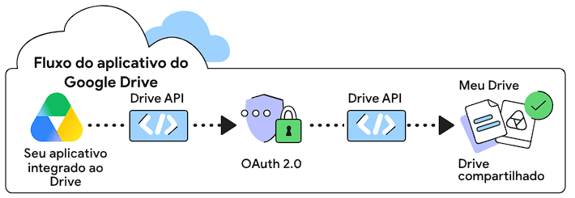
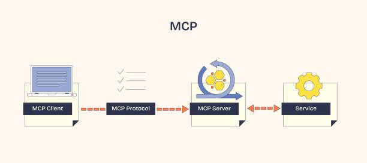
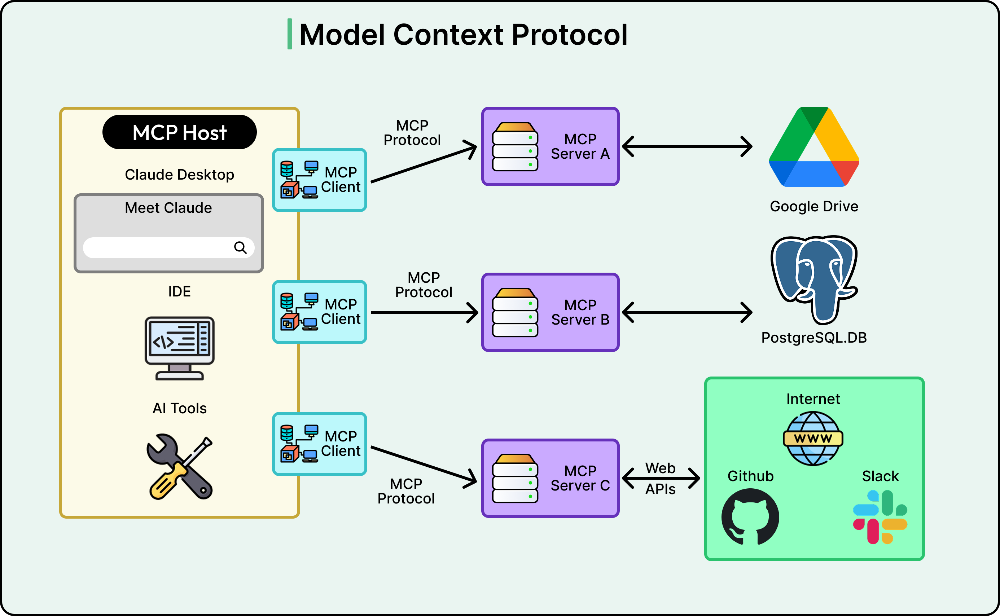
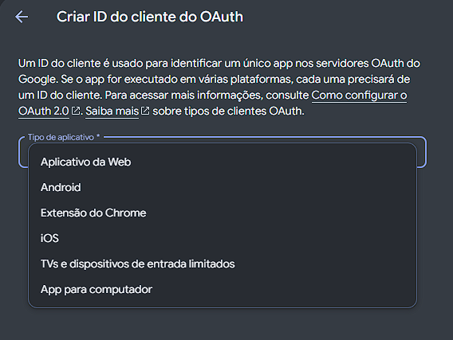
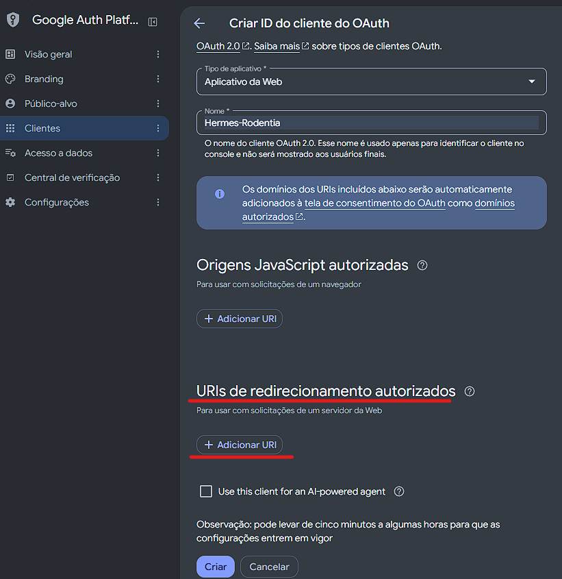
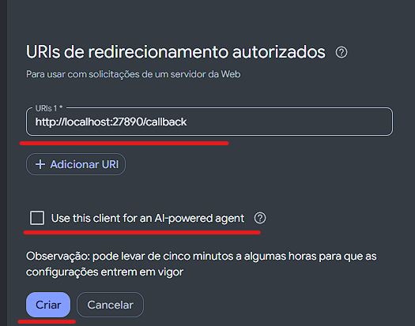
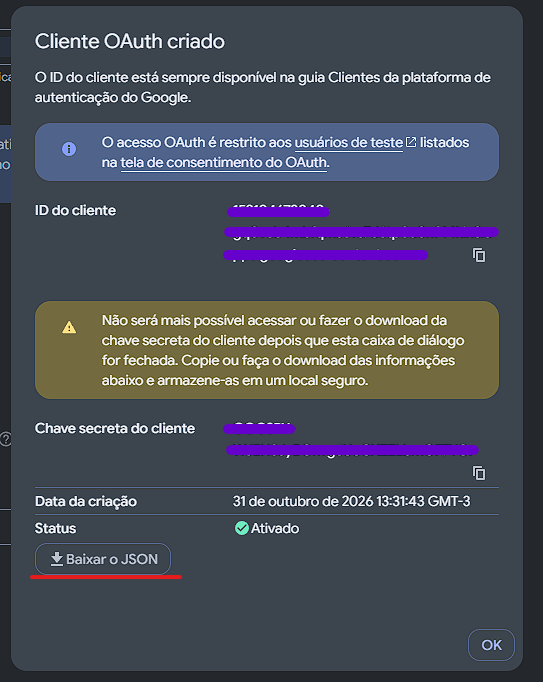
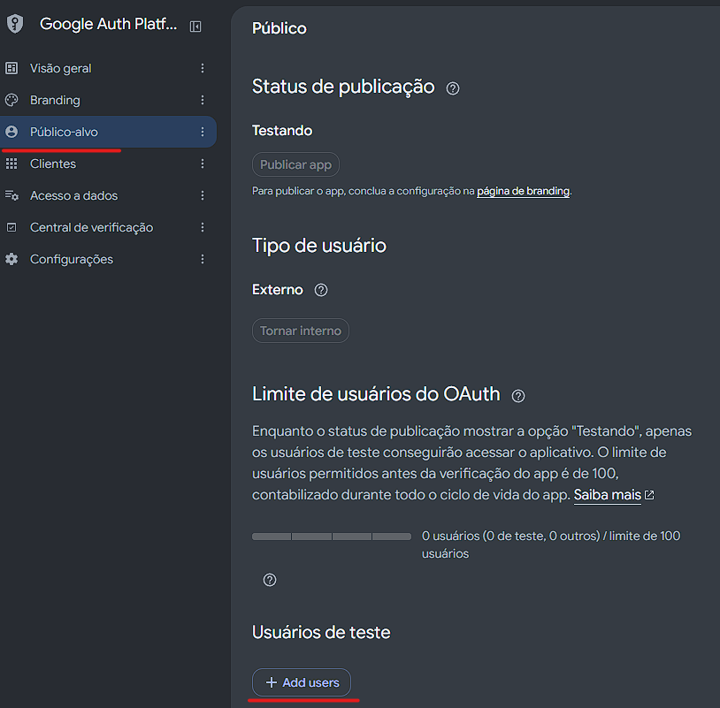
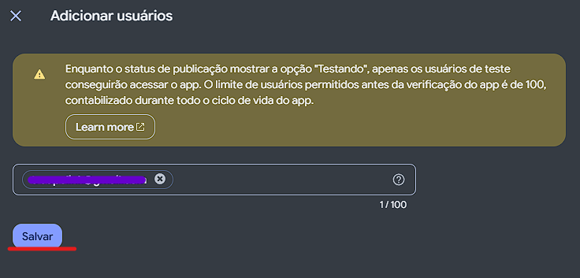

# Configuração do Google Cloud Platform

## Conteúdo

<!-- toc -->

- [API Vs MCP](#api-vs-mcp)
  * [Visão geral da API Google Drive](#visao-geral-da-api-google-drive)
  * [Visão geral do MCP Google Drive](#visao-geral-do-mcp-google-drive)
- [Step 1 — Criando Projeto no Google Cloude](#step-1--criando-projeto-no-google-cloude)
- [Step 2 — Conectar o Drive ao Hermes](#step-2--conectar-o-drive-ao-hermes)
- [Step 3 — Adicionar outros serviços](#step-3--adicionar-outros-servicos)
  * [Se aparecer um erro](#se-aparecer-um-erro)
- [Tendo acesso pelo Composio](#tendo-acesso-pelo-composio)

<!-- tocstop -->

## API Vs MCP

**API**:
:   é a interface do Google Drive. Seu programa faz chamadas HTTP, cuida da autenticação OAuth, dos escopos de acesso, da paginação e dos erros. Habilitar a Drive API no Google Cloud permite que um aplicativo a use, mas não conecta o Hermes por si só. Referência da Drive API

**MCP**:
:   Uma ferramenta MCP é uma função ou capacidade executável que um servidor MCP expõe a um LLM ou aplicativo de IA para realizar uma ação no mundo real. Os conjuntos de ferramentas são um grupo de ferramentas úteis para uma tarefa específica. O uso de conjuntos de ferramentas pode ajudar seu agente a ter um desempenho melhor, porque diminui o número de ferramentas disponíveis para ele. O Hermes conecta-se ao servidor MCP, descobre as ferramentas disponíveis e pode chamá-las. No caso do servidor oficial do Google Drive, ele faz a ponte entre o Hermes e os serviços do Google Workspace, que incluem APIs do Google. Google: servidores MCP do Workspace · Hermes: MCP

*Em resumo:* 
:   API fornece as operações do Drive;
:   MCP fornece ao Hermes uma maneira de usá-las como ferramentas. Para chamar a API REST diretamente, você precisaria criar ou usar um programa adaptador — o Hermes não ganha essa integração só por ter uma URL da API.

### Visão geral da API Google Drive

A API do Google Drive permite criar aplicativos que utilizam o armazenamento em nuvem do Google Drive. Você pode desenvolver aplicações que se integram ao Drive e criar funcionalidades robustas em seu aplicativo usando a API do Drive.

ESte diagrama mostra o fluxo de integração entre seu Drive-integrated app,
the Drive API, and Drive:

<br>

### Visão geral do MCP Google Drive

O servidor MCP `drivemcp.googleapis.com` tem os seguintes conjuntos de ferramentas:

|   | Conjuntos de ferramentas MCP |   |
|---|------------------------------|---|
| Endpoint | Descrição | Ferramentas |
| /mcp/v1 |	Conjunto de ferramentas para o serviço MCP do Drive. | copy_file <br> create_file <br> download_file_content <br> get_file_metadata <br> get_file_permissions <br> list_recent_files <br> read_file_content <br> search_files |

   <div align="left">
     
     
   </div><br>


---

## Step 1 — Criando Projeto no Google Cloude

> **Antes de começar:** Além disso, o Hermes avisa que o Google Drive não aceita o cadastro OAuth automático: é preciso criar um cliente OAuth próprio. [Google: configuração dos servidores MCP](https://developers.google.com/workspace/guides/configure-mcp-servers) · [Hermes: integração MCP e Google Drive](https://hermes-agent.nousresearch.com/docs/user-guide/features/mcp)

1. **Acessando a Google Cloud Platform**  
   Acesse [Google Cloud](https://cloud.google.com/), faça o login

2. **Crie ou selecione um projeto no Google Cloud.**
   Acesse o menu lateral esquerdo em `GOOGLE CLOUD -> IAM e admin -> Criar um projeto`
   * Dê o nome para o seu projeto e confirme em `criar`

3. **Habilite os serviços do Google que pretende conectar.** 
   Acesse o menu lateral esquerdo em `GOOGLE CLOUD -> APIs e serviços -> APIs e serviços ativados`
   Na parte superior da tela clique no botão `+ Ativar APIs e serviços`
   Para começar só com Drive, habilite a **Google Drive API**. Cada produto tem suas próprias APIs. Para Gmail, Docs, Sheets e Calendar, habilite os serviços correspondentes quando for adicioná-los. [Lista oficial de APIs e serviços](https://developers.google.com/workspace/guides/configure-mcp-servers)
   Depois clique na parte superior em retornar em `Bibliotéca de APIs`

4. **Configure a tela de consentimento OAuth.**
   Acesse novamente o menu lateral esquerdo em `GOOGLE CLOUD -> APIs e serviços -> Credênciais`
   Será mostrado um aviso solicitando a configuração da tela de permissão OAuth, clique no botão `Configurar tela de concentimento`
   No Google Cloud, abra **Google Auth Platform** e configure `Informações do App, Público, Contact Information`.
   - Informação do App
      * Nome do app: Hermes
      * Email para suporte do usuário: cadastre o seu
         * clique em avançar
   - Público
      * Selecione **Externo**
         * clique em avançar
   - Dados de contato
      * insira o seu endereço de email
         * clique em avançar
   - Concluir
      * marque a caixa para aceitar os termos
         * clique em avançar
         * criar

5. **Criando as Credenciais**
Acesse novamente o menu lateral esquerdo em `GOOGLE CLOUD -> APIs e serviços -> Credênciais`
   - Na parte superior da tela clique no botão `Criar credenciais` e escolha `ID do cliente OAuth`
   Para o Hermes conectar ao servidor MCP remoto do Google Drive, vamos criar um cliente:
   - No campo `Tipo de aplicativo` selecione
      1. Escolha Aplicativo da Web.
   <div align="left">
     
   </div><br>
      2. Dê um nome, por exemplo, Hermes Drive MCP.
      3. Em URIs de redirecionamento autorizados, adicione:
   - Em seguida de um nome a esta credencial `Hermes` e depois clique em `criar`
   - Para o dominio da URI vamos optar por **URIs de redirecionamento autorizados**, portanto clique no botão `Adicionar IRI`
   
   <div align="left">
     
     
   </div><br>

   - Agora será apresntado o **ID do Cliente** e o **Chave secreta do cliente**, faça o download do arquivo `JSON`

   <div align="left">
     
   </div><br>

> [!WARNING] Não revele estas informações é um Token de acesso

*O que significa cada variável no arquivo json*
:   Verifiquei a **estrutura** do arquivo sem mostrar os valores das credenciais. Ele é um JSON de cliente OAuth do tipo `installed` (“aplicativo instalado”) e contém:

| Campo | O que significa | Precisa entrar no `config.yaml`? |
|---|---|---|
| `client_id` | Identifica o cliente OAuth criado no Google Cloud. | Sim, como referência a uma variável no `.env`. |
| `client_secret` | Segredo usado pelo cliente durante o OAuth. | Sim, também por referência ao `.env`. |
| `project_id` | Identifica o projeto no Google Cloud. | Não, não é usado nesse bloco de conexão do Hermes. |
| `auth_uri`, `token_uri` | Endereços do Google para iniciar e concluir o fluxo OAuth. | Não; o Hermes usa a configuração OAuth e trata o fluxo. |
| `auth_provider_x509_cert_url` | Endereço de certificados públicos do provedor OAuth. | Não. |
| `redirect_uris` | Endereços para onde o Google devolve o navegador após a autorização. | Não se copia como campo do Hermes; precisa corresponder ao redirecionamento configurado no Hermes. |


6. **Status de publicação**
Vamos configurar um usuário como teste, pois não vamos publicar este app, será para uso interno, temos que informar qual será o **Publico auvo**.
   - Acesse novamente o menu lateral esquerdo em `GOOGLE CLOUD -> APIs e serviços -> Tela de permisão OAuth` e depois clique em `Público-alvo` no menu lateral
   - Role a pagina até encontrar `Usuário de teste` e clique em `+ Add users`
   - adicione o seu email e precione `Enter` para confirmar e em seguida salvar
   <div align="left">
     
     
   </div><br>

## Step 2 — Conectar o Drive ao Hermes

7. **Abra o arquivo de configuração do Hermes** em um editor de texto:

   ```text
   %USERPROFILE%\.hermes\config.yaml
   ```

   Se você usa um perfil Hermes específico, a configuração pode estar na pasta desse perfil. Faça uma cópia de segurança do arquivo antes de editar.

8. **Adicione esta configuração** para usar o **servidor MCP oficial do Google Drive**, a configuração do Hermes fica assim:

   ```yaml
   mcp_servers:
     googledrive:
       url: "https://drivemcp.googleapis.com/mcp/v1"
       auth: oauth
       oauth:
         client_id: "${GOOGLE_DRIVE_CLIENT_ID}"
         client_secret: "${GOOGLE_DRIVE_CLIENT_SECRET}"
         redirect_host: http://localhost:27890/callback
         redirect_port: 27890
   ```

   No `config.yaml`, use as referências `${...}` mostradas acima. O Hermes resolve essas referências usando o `.env` do perfil ativo. Também aceita `${env:NOME_DA_VARIAVEL}`. [Hermes: referências a variáveis de ambiente](https://hermes-agent.nousresearch.com/docs/reference/mcp-config-reference)

   *Observação*
   :   O Hermes documenta que o Google Drive não aceita o cadastro OAuth automático usado por alguns servidores MCP. Por isso, é necessário fornecer um cliente OAuth próprio. A porta fixa acima permite registrar no cliente OAuth o endereço de retorno correspondente: `http://localhost:27890/callback`. [Instruções do Hermes para Google Drive](https://hermes-agent.nousresearch.com/docs/user-guide/features/mcp/)

9. **Guardar os Tokens de acesso**

   No arquivo `.env` do Hermes, vamos adicionar informações para guaradar as variáveis de `client_id` e `client_secret`, defina como:

   ```dotenv
   GOOGLE_DRIVE_CLIENT_ID=seu-client-id
   GOOGLE_DRIVE_CLIENT_SECRET=seu-client-secret
   ```

10. **Fazendo o Login no serviço.**  
   Dentro do docker do Hermes execute:

   ```powershell
   hermes mcp login googledrive
   ```
   O Google pede a autorização da conta; o Hermes guarda os tokens OAuth para reutilizá-los nas sessões seguintes. Peça inicialmente uma operação de leitura, como listar arquivos, para confirmar que a conexão funciona.
   O Hermes deve abrir uma página do Google para você entrar e autorizar o acesso. Confira a conta Google exibida antes de aprovar.

11. **Teste com uma pergunta simples**, por exemplo:  
   “Liste alguns arquivos do meu Google Drive.”  
   Para o primeiro teste, prefira uma consulta de leitura. Depois, confirme no Hermes que as ferramentas do Drive estão disponíveis.

## Step 3 — Adicionar outros serviços

12. **Repita a configuração para cada produto**, dando a cada servidor um nome próprio. Por exemplo, para Google Calendar:

   ```yaml
   mcp_servers:
     googlecalendar:
       url: "https://calendarmcp.googleapis.com/mcp/v1"
       auth: oauth
       oauth:
         client_id: "${GOOGLE_CALENDAR_CLIENT_ID}"
         client_secret: "${GOOGLE_CALENDAR_CLIENT_SECRET}"
         redirect_host: http://localhost:27890/callback
         redirect_port: 27890
   ```

   O Google publica servidores separados para `Gmail, Drive, Docs, Sheets, Slides e Calendar` consulte em [Configurar os servidores MCP do Google Workspace](https://developers.google.com/workspace/guides/configure-mcp-servers). Só adicione os que você realmente pretende usar.

### Se aparecer um erro

- **Erro ao obter o token ou cadastrar o cliente:** confira se o Client ID e o Secret foram copiados corretamente e se o cliente OAuth está configurado.
- **A tela do Google abre, mas as ferramentas não funcionam:** o login pode não ter concluído a autorização. Rode `hermes mcp login googledrive` de novo em um terminal novo.
- **Você não encontra os serviços MCP no Google Cloud:** confirme a inscrição na prévia e se escolheu o projeto certo.

O Hermes avisa que uma conexão pode parecer instalada mesmo quando a autenticação não terminou; por isso, o teste final é pedir uma leitura real ao Drive. Para sua conta, recomendo começar com **Drive e Docs**, e conectar Gmail ou Calendar só depois de confirmar que essa etapa funciona.

___

## Tendo acesso pelo Composio

https://composio.dev/toolkits/googledrive/framework/hermes-agent
