# Otimizar um profile no Hermes Agent pra Produção

## Conteúdo
<!-- toc -->

## 1. Introdução

Após a configuração inicial do profile abordado em [configurando um novo profile](config_newprofile_2.md) onde foi definindo o tipo de **model, describe e SOUL**, a próxima etapa é transformar o profile em um agente operacional com:

* ferramentas adequadas,
* conhecimento especializado,
* memória consistente,
* critérios de qualidade e
* procedimentos de execução bem definidos.

No Hermes Agent, cada profile pode manter sua própria **configuração, memória, sessões, skills e estado operacional**. Isso permite especializar agentes por função sem misturar seus contextos.

> [!TIP]
> A configuração pode ser feito via **CLI** ou através do **Dashboarde** em CONFIG

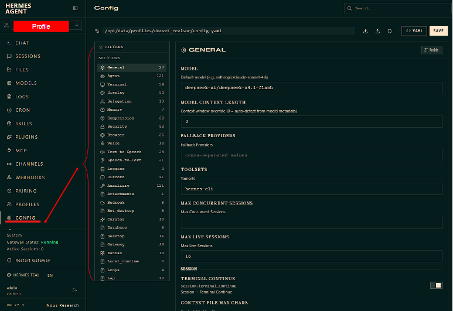


Antes mesmo de colocar a mão na massa, vamos fazer uma preparação inicial do ambiente do agente e listar/relembrar alguns comando bÁsicos que podemos utilizar durante o processo para extrair informações do profile.

### 1. Comandos Básico

```bash
hermes --version
hermes --help
hermes doctor                 # Check configuration and dependencies
hermes config show            # Show current configuration
hermes profile list           # List all profiles
hermes profile use            # Set sticky default profile
hermes profile show <perfil>  # Show profile details
```

### 2. Fazendo Backup

Faça backup antes de alterações relevantes:
```bash
hermes -p <perfil> backup
```

### 3. Preparar ambiente documental e saída de arquivos

Crie um workspace dedicado fora do diretório interno do Hermes, com subpastas de pesquisa, fontes arquivadas e entregáveis é um dos requisitos de segurança, para evitar de deixarmos os documentos dentro do ambiente (pasta local) Hermes.
Exemplo ilustrativo:

```text
adm-docs/
  protocols/       # estratégias e critérios de busca
  sources/         # PDFs, DOI, URL, data de acesso, metadados
  drafts/          # versões em elaboração
  deliverables/    # documentos aprovados para entrega
  evaluations/     # casos de avaliação e resultados
```

## 2. Criando o Workspace

### 1 Visão Geral do Terminal Backend
([link_doc](https://hermes-agent.nousresearch.com/docs/user-guide/configuration#terminal-backend-configuration))

*Terminal Backend Configuration* apresenta os backends disponíveis para definir onde os comandos de shell do agente realmente são executados. A tabela oficial lista **seis backends nativos** (*local, docker, ssh, modal, daytona, vercel_sandbox*) e a seção **Singularity/Apptainer** como backend de plugin (oficial), totalizando **sete abordagens** distintas. Segue a descrição prática de quando usar cada uma.
Podemos ter acesso a estas configurações via Dashboard ou pelo CLI
Pelo Dashboard acesse:

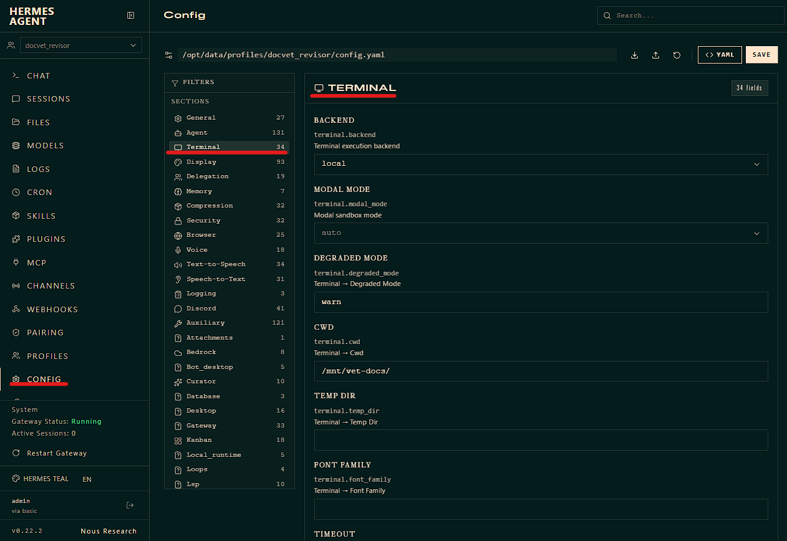

1. `local` — Máquina local do usuário ([link_doc](https://hermes-agent.nousresearch.com/docs/user-guide/configuration#local-backend))
**Onde roda:** diretamente no host, sem isolamento.
**Quando usar:** desenvolvimento, uso pessoal, primeiros passos e quando você confia no agente. É o padrão e "a opção mais segura para começar". Ideal para quem trabalha em máquina própria e quer que o agente acesse livremente `~/.ssh`, `git`, `gh`, `npm`, etc. — o HOME real é preservado (`home_mode: auto`).
**Cuidado:** o agente tem o mesmo acesso ao filesystem que sua conta de usuário; não há barreira de segurança.

2. `docker` — Contêiner Docker persistente ([link_doc](https://hermes-agent.nousresearch.com/docs/user-guide/configuration#docker-backend))
**Onde roda:** um único contêiner Docker de longa duração, compartilhado entre sessões, `/new`, reset e subagentes, com hardening (cap-drop ALL, no-new-privileges, PID limit).
**Quando usar:** quando você quer **sandboxing real** sem sair da máquina — CI/CD, experimentos com código não confiável, ou simplesmente evitar que o agente mexa no host. Bom equilíbrio entre segurança e conveniência: pacotes instalados, arquivos em `/workspace` e processos em background **persistem** entre chamadas e entre processos Hermes (via rótulos). Use `container_persistent: false` para isolamento por sessão (uma sandbox por conversa, descartada ao fechar).
**Ponto de atenção:** mounts via `docker_volumes` e `docker_run_as_host_user: true` se você precisa editar os arquivos no host sem `sudo chown`.

  Com o docker temos que habilitar a opção de *Docker Mount CWD to Workspace* em:

    ```text
    CINFIG
        Terminal
            DOCKER MOUNT CWD TO WORKSPACE     ->    `True`
    ```

  O que isso faz? Muda a condição de `false` para `true` dentro do arquivo `config.yaml` do profile ativo para ter acesso fora do sandbox do ambiente Hermes, dando condição para fazer uma apontamento a um diretório fora do docker. Mas ainda é necessário completar a configuração com outras informações (veja a documentação).

  ```yaml
  terminal:
    backend: docker
    docker_mount_cwd_to_workspace: true
  ```

3. `ssh` — Servidor remoto via SSH
**Onde roda:** em um servidor remoto, por SSH com ControlMaster (keepalive de 5 min); diretório de trabalho e variáveis exportadas persistem (`persistent_shell`).
**Quando usar:** desenvolvimento remoto, acesso a hardware potente (GPU, muitos núcleos) ou quando o código precisa rodar no ambiente de produção/staging. Requer `TERMINAL_SSH_HOST` e `TERMINAL_SSH_USER`. Também útil para isolar por **fronteira de rede**.

4. `modal` — Sandbox na nuvem Modal
**Onde roda:** VM isolada na nuvem Modal, com CPU/memória/disco configuráveis; snapshot/restore do filesystem entre sessões.
**Quando usar:** computação efêmera na nuvem, avaliações (evals), tarefas pesadas que você não quer rodar localmente e para as quais não quer manter um servidor SSH. Requer `MODAL_TOKEN_ID`/`MODAL_TOKEN_SECRET` ou `~/.modal.toml`. Preserva o filesystem (não processos vivos).

5. `daytona` — Workspace gerenciado Daytona
**Onde roda:** workspace gerenciado pela Daytona, com stop/resume em vez de delete.
**Quando usar:** ambientes de desenvolvimento gerenciados na nuvem, quando você quer a conveniência de um workspace persistente sem administrar infraestrutura. Requer `DAYTONA_API_KEY`. Limite de disco de 10 GiB (requisições acima são truncadas com aviso).

6. `vercel_sandbox` — MicroVM Vercel Sandbox
**Onde roda:** microVM na nuvem Vercel; filesystem com snapshot/restore.
**Quando usar:** execução na nuvem com persistência de filesystem baseada em snapshot, especialmente em deploys no Render, Railway, Docker ou hosts de longa duração. Requer autenticação por access token (`VERCEL_TOKEN`, `VERCEL_PROJECT_ID`, `VERCEL_TEAM_ID`) — o caminho suportado para produção; OIDC é só para desenvolvimento local pontual. Não suporta `container_disk` customizado.

7. `singularity` (plugin) — Contêiner Singularity/Apptainer
**Onde roda:** contêiner Singularity/Apptainer com `--containall --no-home`.
**Quando usar:** clusters HPC e máquinas compartilhadas onde Docker **não está disponível**. É um plugin oficial (instale com `hermes plugins install singularity`) e requer `apptainer` ou `singularity` no `$PATH`. Usa diretório scratch típico de HPC (`/scratch/$USER/...`) e converte imagens `docker://` para SIF em cache.

### 2 Regra prática de escolha
| Objetivo | Terminal Backend |
|---|---|
| Confiança total / simplicidade | `local` |
| Precisa de sandbox na própria máquina | `docker` |
| Precisa de hardware ou ambiente remoto específico | `ssh` |
| Precisa de compute efêmero na nuvem sem gerenciar servidor | `modal` |
| Quer workspace de dev gerenciado na nuvem | `daytona` |
| Deploy em nuvem com filesystem por snapshot | `vercel_sandbox` |
| Está em cluster HPC sem Docker | `singularity` |

> [!TIP]
**A documentação reforça**: em caso de dúvida, permaneca/volte para `local` (`hermes config set terminal.backend local`) e confirme que os comandos funcionam ali antes de migrar para outro backend. A configuração pode ser feita diretamente no arquivo `config.yaml` em `terminal.backend` (ou via `hermes config set terminal.backend <nome>`).

**Obs.**: Para uma configuração inicial, vamos iniciar pela *opção 1* com execução *"Local"* e depois migramos para a opção 2 que seria em um ambiente controlado por docker.

### 3 Apontamento do Diretorio para nosso Workspace
Podemos executar via CLI ou configurar via dashboard
por CLI:

```bash
# Se o profile não estiver ativo, ou seja, setup
hermes -p meuprofile config set terminal.cwd </home/user/projetos/meu-projeto>

# Se o profile já estiver ativo
hermes config set terminal.cwd </home/user/projetos/meu-projeto>
```

por dashboard:
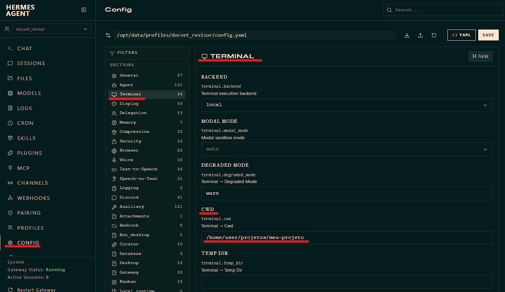

<br>

## 3. Versionamento de Documentos
Para esta etapa é extremamente importante mantermos e definirmos um fluxo de versão e revisão para cada documento que deve ser registrar:

 - autor/revisor,
 - versão,
 - data de corte,
 - escopo,
 - métodos de busca,
 - critérios de inclusão,
 - limitações e
 - histórico de alterações.

**Convenção inicial do versionamento**
(validar com o responsável técnico e o procedimento de qualidade da organização):

| Estado | Versão sugerida | Regra |
|---|---:|---|
| Rascunho | `0.1`, `0.2`… | Incrementar o segundo número em revisões editoriais ou de conteúdo ainda não aprovadas. |
| Aprovado | `1.0` | Primeira liberação após revisão e aprovação humana registradas. |
| Revisão aprovada | `1.1`, `1.2`… | Correções ou atualização sem mudança material das conclusões/recomendações. |
| Nova edição | `2.0` | Mudança material de escopo, evidência, conclusão, recomendação ou requisito regulatório. |

O registro de cada versão deve conter, no mínimo: **identificador/título, versão, estado, data, responsável pela edição, revisor/aprovador, resumo da alteração, data de corte da pesquisa e fontes novas/alteradas**.
A versão aprovada não deve ser sobrescrita: publique nova versão e preserve a anterior conforme política de retenção.
E para garantir este fluxo vamos adotar o seguinte critério inicial:

1. Criar uma *Skill* com os critério de controle dos documentos. A Skill orienta o agente sobre a convenção e os metadados.
2. Criar um diretório para as versões anteriores
2. Para o controle do vercionamento vamos utilizar um *repositório no GitHub*, mas exigindo aprovação antes de publicar, substituir a versão vigente ou mudar o estado para “aprovado” antes do "pull request".
<br>

### 1. Recurso exigido
Temos que verificar se já temos instalado em nosso sistema o *git* e o *GitHub CLI*

```bash
git --version   # verifica a existencia do git
gh --version    # verifica a existência do gh cli
```

* para instalação do [Git](https://git-scm.com/)
* para a instalação do [GitHub CLI](https://cli.github.com/)

> [!WARNING]
> Se o Hermes esta rodando em um conteiner docker a instalação do GitHub CLI deve ser feito por outro caminho.

<br>

### 2 Instando GitHub CLI para o Hermes dentro do conteiner

O cenário que temos é (**VM Ubuntu → Dokploy → contêiner Hermes**), para instalarmos o GitHub CLI dentro do contêiner Hermes podemos fazer de duas formas:

1. através da construir uma imagem derivada (**derived image**)
2. alterando o arquivo docker-compose.yaml e substituindo a função de **image:** por **build:**, garantindo que o Dockerfile com a instalação do gh esteja no mesmo repositório.
 tem duas considerações principais: como o `gh` não vem pré-instalado na imagem oficial, o método mais confiável é construir uma imagem derivada (derived image).

*Qual escolher?*
Na opção 1 basicamente é recriar a imagem com uma alteração, mas de forma manual e portanto teremos o inconveniente de termos que recriar esta imagem todas as vezes que for necessário a atualização ou um novo redeploy da aplicação.
Agora para deixarmos de forma automática, podemos incluir a instrução **build:** no arquivo docker-compose. Portanto vamos escolher a opção 2.
<br>

#### Passo 1: Escrever o Dockerfile
Crie um arquivo`Dockerfile` sem extenção :
- O método de instalação do gh acima segue o procedimento padrão do repositório oficial do GitHub CLI para **Ubuntu/Debian**, e também há precedentes na base de código do próprio Hermes de instalação do gh na camada apt da imagem base.
- Conteúdo do Dockerfile (baseado na documentação oficial do GitHub CLI )

```dockfile
FROM nousresearch/hermes-agent:latest

USER root

# Instalar GitHub CLI (repositório oficial apt)
RUN apt-get update && \
    apt-get install -y --no-install-recommends \
    curl \
    ca-certificates && \
    curl -fsSL https://cli.github.com/packages/githubcli-archive-keyring.gpg \
    -o /usr/share/keyrings/githubcli-archive-keyring.gpg && \
    chmod go+r /usr/share/keyrings/githubcli-archive-keyring.gpg && \
    echo "deb [arch=$(dpkg --print-architecture) signed-by=/usr/share/keyrings/githubcli-archive-keyring.gpg] https://cli.github.com/packages stable main" \
    > /etc/apt/sources.list.d/github-cli.list && \
    apt-get update && \
    apt-get install -y --no-install-recommends gh && \
    rm -rf /var/lib/apt/lists/*

USER hermes
```
<br>

#### Passo 2: Preparar os arquivos no repositório Git
Vamos criar um repositório, caso ainda não tenha, para que o Dokploy utilize para fazer a leitura dos arquivos. Vamos precisar ter dois arquivos na raiz do repo (ou no caminho que você define como Compose Path):

> **Dockerfile**: O arquivo que instala o gh.
>
> **docker-compose.yml**: O arquivo que orquestra o serviço.

<br>

#### Passo 3: Configurar o docker-compose.yml no Dokploy
Aqui está o ponto crucial. O Dokploy limpa o diretório do repositório a cada deploy (AutoDeploy). Isso significa que você não pode usar bind mounts com caminhos relativos do repositório (ex: ./config:/opt/data) para dados persistentes, pois eles serão perdidos.
Vamos alterar o no arquivo dentro do Dokploy, e o docker-compose.yml deve iniciar assim:

**ANTES**
```yaml
services:
  hermes:
    image: nousresearch/hermes-agent:v0.22.5
    restart: unless-stopped
    command: gateway run
    ports:
      - "9119:9119"   # Dashboard (acesso local via navegador)
      - "8642:8642"   # Gateway API (acesso para clientes externos)
    environment:
    ...<continua...>
```
**DEPOIS**
```yaml
services:
  hermes:
    build:
      context: .
      dockerfile: hermes-gh.Dockerfile
    restart: unless-stopped
    command: gateway run
    ports:
      - "9119:9119"   # Dashboard (acesso local via navegador)
      - "8642:8642"   # Gateway API (acesso para clientes externos)
    environment:
      - GH_TOKEN=${GH_TOKEN}   # para usar no GitHub CLI
      ...
      <continua...>
    # ... outras configurações (redes, portas, etc.) que você já tinha
```

O que mudou e por quê:
- **build:** substitui o **image:**. O Dokploy vai construir a imagem usando seu Dockerfile.
- apontamento do Token do GitHub para variável de ambiente.

> [!WARNING]
> Para o apontamento da **variável de ambiente** para o **GH_TOKEN**, registramos na opção **Enviroment** dentro do aplicativo no Dokploy:

<br>

#### Passo 4: Configurar o apontamento dos arquivos no Dokploy
> tutorial de referência [video](https://www.youtube.com/watch?v=j9r2mdzBZcQ)

Ainda dentro da aplicação e na seção **Geral** vamos fornecer o **Provider** para o Compose File, neste caso vamos optar por **GitHub**
<div align="left"> 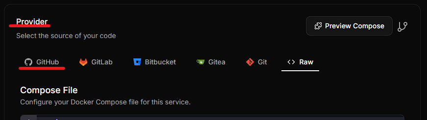 </div>
   
Caso ainda não tenhamos feito a configuração deste provider teremos que configurar e dar permição para o Dekploy acesse um repositório do GitHub e depois escolhemos a opção GitHub
<div align="left">
  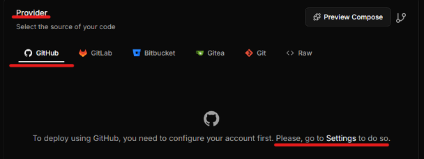
  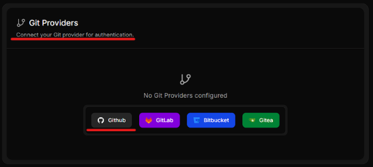
</div>

Na próxima janela vamos manter como está e clicar em **Create GitHub App**
<div align="left"> 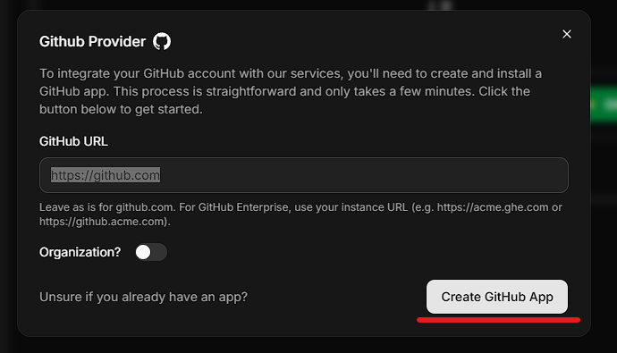 </div>

Caso não esteja conectado a sua conta irá aparecer a opção de loging ou caso contrário já aparece a opção de verificação, no meu caso como tenho o GitHub app no meu celular, a autorização será pelo meu app:
<div align="left">
  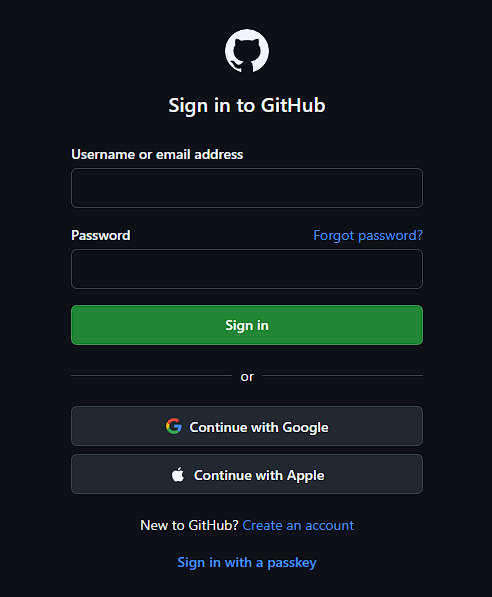
  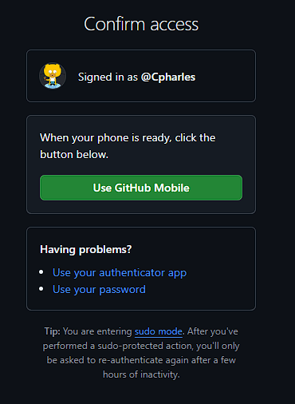
</div><br>

Aqui podemos dar um nome para identificarmos esta conecção, por padrão o Dokploy gera um aleatoriamente, depois confirme em **Create GitHub App...**
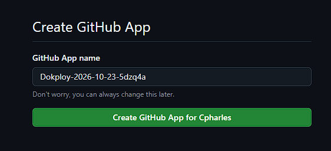

Retornamos para o Dokploy e agora podemos ver que temos a conecção e uma **Action Required**, vamos clicar no botão indicado para carregarmos a conecção. Uma nova tela **Install & Authorize** será apresentada. Vamo marcar a opção **only select repositories** e será apresentado um droplist com os repositórios do seu GitHub, selecione o repo do seu projeto ou o que tem os arquivos docker-compose file da nossa aplicação e finalize confirmando no botão de "Install & Authorize"
<div align="left">
  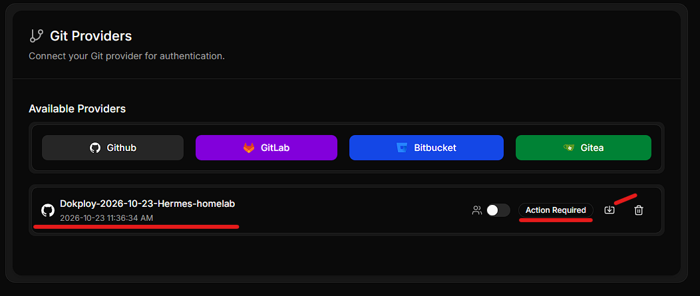
  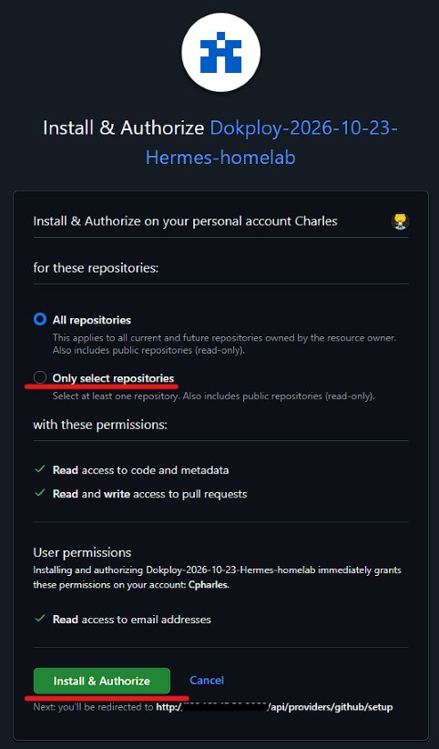
</div>

Agora vamos retornar para o nosso projeto em "Project" no menu do lado esquerdo, clique no projeto e entre no serviço do aplicativo, role até a área do "Provider", selecione novamente a opão GitHub e poderemos notar que agora temos um **GitHub Account**, vamos prencher os campos. Para o "Compose Path", coloque o caminho onde esta os arquivos docker-compose dentro do repo, no meu caso eu criei uma pasta "docker". Finalize **Salvando o Provider**.
<div align="left"> 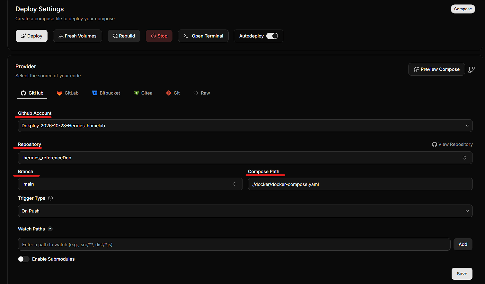 </div><br>

> [!NOTE]
> A configuração explicada até este ponto, foi para disponibilizar acesso ao Dokploy a um repositório específico no GitHub para fazer a clonagem dos arquivos do docker-compose file.

<br>

#### Passo 5: Permissão de Gerenciamento do Versionamento no GitHub
Para darmos acesso ao nosso agente para gerenciar o sistema de versionamento montado no GitHub, vamos precisar autenticar (permitir) que o GitHub CLI tenha acesso ao GitHub pelo agente para executar comandos de versionamento. Como nosso ambiente é headless (sem navegador ou seja um servidor), a forma mais recomendada é usar um **Personal Access Token (PAT)** através da variável de ambiente GH_TOKEN inserido no "**Enviroment**" do Dokploy.
Para este projeto estarei criando um novo repositório privado, por se tratar de documentação versionada de acesso restrito ao projeto.

**Gerando Token de acesso ao GitHub**
1. Faça login na sua conta do GitHub
2. Clique na sua foto do perfil no canto superior direito da página e selecione "**Settings**" (Configurações) no menu suspenso.
3. Na barra lateral esquerda, clique em "**Developer settings**" (Configurações de desenvolvedor)
4. Expanda Personal access tokens → clique em Fine-grained tokens.
5. Clique em Generate new token.
    <div align="left"> 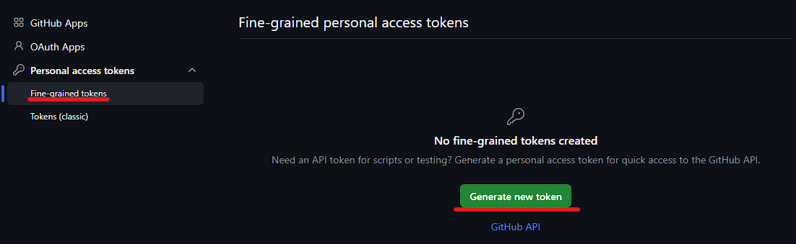 </div><br>
6. Preencha e selecione conforme abaixo:
    * **Token name**: Insira um nome descritivo, por exemplo hermes-agent-docs-repo.
    * **Expiration**: Selecione um período de validade razoável (por exemplo, 90 dias). O GitHub não recomenda definir como permanente; a política da organização pode até bloquear tokens permanentes .
    * **Resource owner**: Selecione o proprietário do repositório privado de destino (sua conta pessoal ou a organização correspondente).
    * **Repository access**: Selecione Only select repositories e, na lista suspensa, marque apenas aquele repositório privado de documentos que o agente precisa acessar. Não selecione "All repositories".
        <div align="left"> 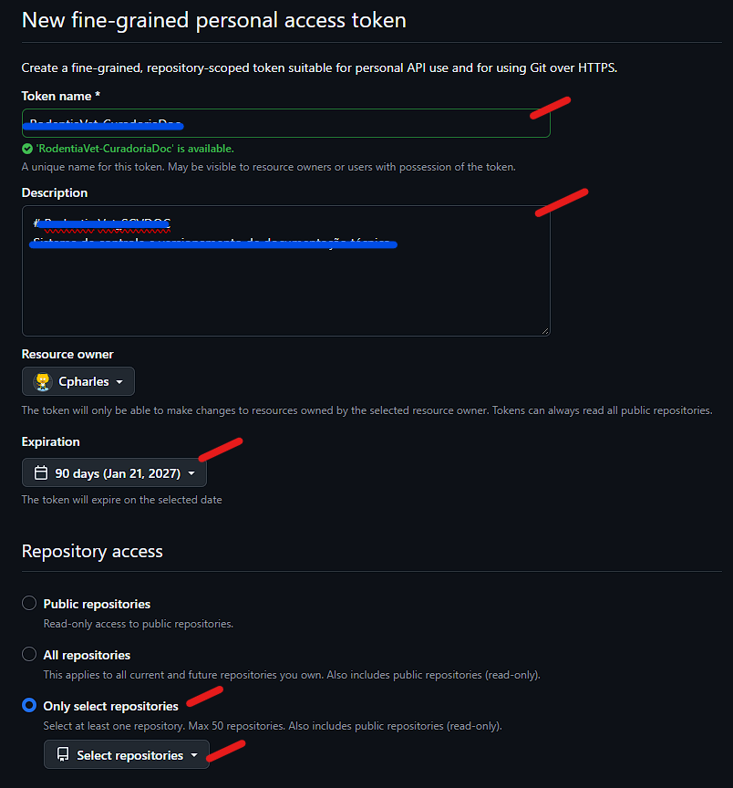 </div><br>
    * **Permissions**: Expanda Repository permissions, encontre Contents e defina como Read and write (o agente precisa fazer commit de alterações no repositório de documentos) . Se você não tiver certeza sobre outras permissões, não conceda; a abordagem de permissões mínimas é a mais segura.
        <div align="left">
          
          
        </div><br>

**Injetando o Token no Conteriner Hermes**
Não é preciso fazer login interativo com gh auth login dentro do contêiner. A documentação oficial do GitHub CLI afirma claramente que, para uso em automação/headless, recomenda-se usar diretamente a variável de ambiente GH_TOKEN.

1. No painel do Dokploy, entre na aplicação do tipo Docker Compose do Hermes.
2. Encontre a seção Environment.
3. Adicione uma variável de ambiente:
    `GH_TOKEN=Cole o token que você acabou de copiar`
    <div align="left"> 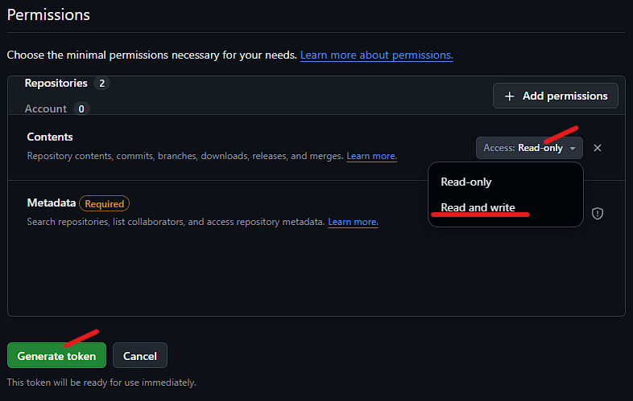 </div><br>
4. Salve e faça Deploy do serviço. Após a reinicialização do contêiner, o processo gh lerá automaticamente o GH_TOKEN do ambiente para completar a autenticação.
<br>

#### Passo 6: Verificar a Autenticação
1. Entre no contêiner Hermes (via terminal do Dokploy ou `docker exec -it <nome_do_contêiner> /bin/bash`) e execute:
```bash
gh auth status
```
Saída esperada:
```bash
github.com
  ✓ Logged in to github.com account Cpharles (GH_TOKEN)
  - Active account: true
  - Git operations protocol: https
  - Token: github_pat_************************************
```

2. A saída esperada mostrará que a autenticação foi bem-sucedida e indicará o escopo do token. Em seguida, você pode verificar o acesso ao repositório privado com:
```bash
gh repo view <proprietário>/<nome_do_repositório_privado>
```
Saída esperada:
```bash
Cpharles/<nome_do_repositório_privado>
Controle e gestão de documentos.... 

View this repository on GitHub: https://github.com/Cpharles/<nome_do_repositório_privado>
```
Se as informações do repositório forem exibidas normalmente, o gh está pronto para operar o repositório de documentos.

> [!NOTE]
> **Dúvidas**
> Antes mesmo de executar os comando, a primeira coisa que podemos perguntar é: Será que terei que fazer tudo do zero as configurações dos meus agentes?; Será que vou perder tudo que fiz até agora?
> A resposta é **NÃO**

Por que não perdemos que já fizamos com a reconstrução de uma imagem derivada?
 Reconstruir a imagem derivada não causará perda dos dados do agente. A chave está em: os dados de estado do Hermes (configuração, memórias, sessões, habilidades, etc.) não são armazenados na camada da imagem, mas sim no volume persistente /opt/data (linux). A reconstrução da imagem só substitui a árvore de código em /opt/hermes; o volume de dados é preservado durante a recriação do contêiner.
 A imagem em si é somente leitura e imutável (/opt/hermes pertence ao root, e o usuário de execução não pode modificá-la). A reconstrução da imagem derivada só altera a camada do sistema onde o gh está instalado; não afeta o /opt/data.

---

## 4. Visão Geral das Próximas Etapas

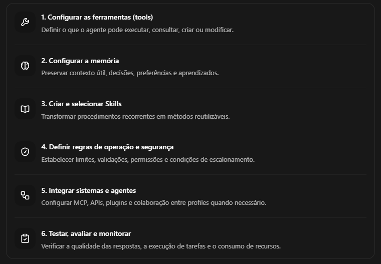

Vamos seguir uma sequência de *implementação* e *validação*, em vez de instalar todas as funcionalidades de uma só vez.

1. **Configurar as ferramentas (tools)**
    Definir o que o agente pode executar, consultar, criar ou modificar.
    - [ ] Provider (router de modelos) e Modelo validados
    - [ ] Describe e SOUL.md revisados
    - [ ] Ferramentas necessárias habilitadas

2. **Configurar a memória**
    Preservar contexto útil, decisões, preferências e aprendizados.
    - [ ] Memória configurada
    - [ ] Memória testada

3. **Criar e selecionar Skills**
    Transformar procedimentos recorrentes em métodos reutilizáveis.
    - [ ] Skills essenciais criadas e validadas
    - [ ] Instruções operacionais definidas

4. **Definir regras de operação e segurança**
    Estabelecer limites, validações, permissões e condições de escalonamento.
    - [ ] Permissões e autonomia definidas
    - [ ] Credenciais protegidas

5. **Integrar sistemas e agentes**
    Configurar MCP, APIs, plugins e colaboração entre profiles quando necessário.
    - [ ] Selecionar MCPs e APIs, quando necessários
    - [ ] MCPs e APIs testado e validados

6. **Testar, avaliar e monitorar**
    Verificar a qualidade das respostas, a execução de tarefas e o consumo de recursos.
    - [ ] Bateria de testes aprovada
    - [ ] Consumo de contexto e custo avaliados
    - [ ] Logs, backup e monitoramento planejados
    - [ ] Rotinas e delegação validadas, quando necessárias

---

## 5. Configurar as ferramentas (tools)

O `SOUL.md` define como o agente deve se comportar, mas as **ferramentas** (Tools) determinam o que ele consegue fazer de fato.
O Hermes disponibiliza ferramentas agrupadas por categorias, que podem ser habilitadas conforme a função do agente.

### 5.1 Estruturando as ferramentas para cada Agente

1. Liste as ferramentas disponíveis de um profile.
2. Habilite somente as ferramentas relevantes para a função do profile.
3. Desabilite ferramentas redundantes ou que não serão utilizadas. Podemos fazer esta configuração no Dashboard
4. Teste cada ferramenta individualmente antes de permitir fluxos autônomos.

> [!WARNING]
> Critério de otimização: não habilite todas as ferramentas apenas porque estão disponíveis. Muitas ferramentas aumentam o contexto enviado ao modelo e podem dificultar a seleção da ação correta. A própria documentação recomenda reduzir toolsets e skills desnecessários para diminuir o tamanho do prompt.

Para listarmos e configurarmos as Tools podemos acessar via Dashboard ou pelo terminal (pelo terminal o setup será para o profile ativo)
No Dashboard
<div align="left">
  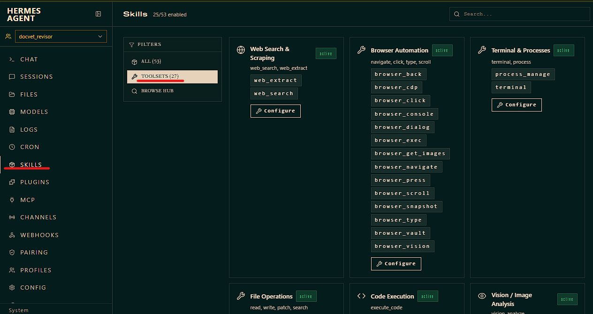
</div><br>

No terminal temos:
```bash
hermes --profile <profile_name> tools
hermes -p <perfil> tools --summary
```
Saída esperada:
<div align="left">
  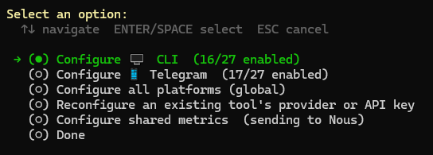
  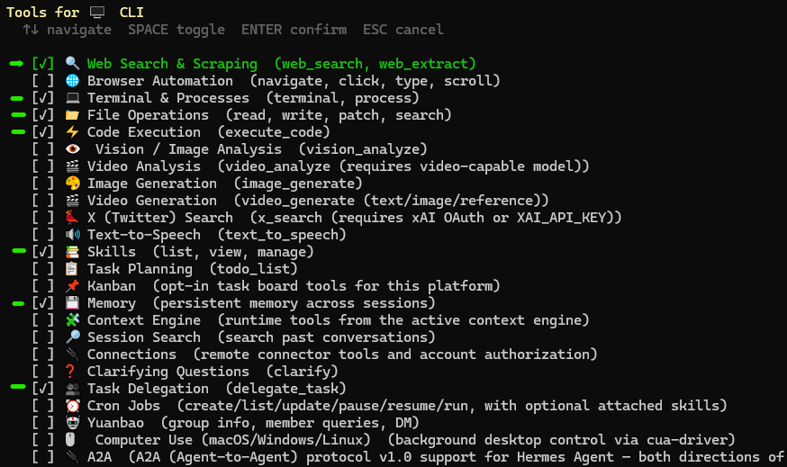
</div><br>

### 5.2 Selecionando Tools

Vamos começar com **pesquisa de fontes, leitura de arquivos e terminal com diretório** de trabalho restrito ao workspace.
Adicione navegador apenas para páginas dinâmicas ou quando extração textual falhar.

| Categoria                     | Aplicação                                                                           |
| ----------------------------- | ----------------------------------------------------------------------------------- |
| Web Search & Scraping         | Pesquisar fontes, validar informações e consultar documentação atualizada.          |
| File Operations               | Ler documentos, analisar dados e produzir arquivos.                                 |
| Terminal & Processes e Code Execution | Executar scripts, automatizar tarefas e processar dados.                    |
| Memory                        | Recuperar informações persistentes entre sessões.                                   |
| Task Delegation               | Encaminhar tarefas específicas para outros agentes, quando suportado e configurado. |
| MCP e integrações             | Conectar APIs, repositórios, bancos de dados e sistemas externos.                   |

Use a interface de `hermes tools` para selecionar o necessário e conferir o resumo. Os nomes e opções exatos de toolsets podem depender dos backends instalados. Para busca, a documentação corrente descreve escolha de backend via ferramenta `hermes tools` ou chaves `web.backend`, `web.search_backend` e `web.extract_backend`; exige credencial ou serviço suportado. Não presuma que adicionar uma chave à `.env` troca um backend já selecionado.

**Exemplo ilustrativo de configuração YAML** (escolha um backend realmente configurado; a sintaxe das chaves é documentada):

```yaml
web:
  search_backend: "<backend-de-busca>"
  extract_backend: "<backend-de-extração>"
  extract_char_limit: 30000
```

> [!WARNING]
> O limite padrão de extração documentado é 15.000 caracteres, ajustável em `web.extract_char_limit` (faixa documentada de 2.000–500.000). Aumente somente quando necessário; para conteúdo truncado, siga a indicação do Hermes para ler o texto completo salvo localmente.

Valide com uma tarefa de baixo risco: buscar uma diretriz pública sobre um tema delimitado, abrir a página primária e extrair o texto. Exija título, instituição/autores, data, URL, trecho de apoio e distinção entre fonte primária e resumo secundário. Não trate um resultado do buscador como evidência suficiente.

Fontes preferenciais para instruir o método de pesquisa: periódicos revisados por pares, PubMed/PMC, CAB Abstracts (se licenciado), repositórios institucionais e órgãos reguladores pertinentes à jurisdição (por exemplo, MAPA/Anvisa no Brasil, FDA/USDA nos EUA, EMA na UE). Disponibilidade de APIs e acesso a bases pagas não são presumidos.

---

## 6. Fornecendo Memória ao Agente

A memória é o que permite preservar informações úteis entre sessões. Ela não deve ser tratada como um depósito indiscriminado de todas as conversas.
Temos que entender que a memória está em três camadas de empilhamento
<div align="left">
  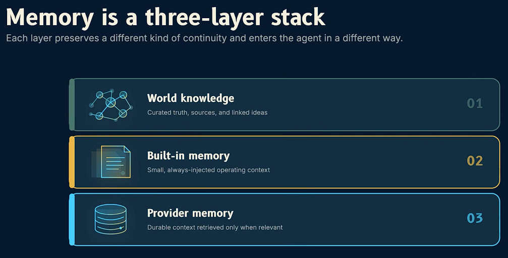
</div><br>

Quando falamos no **conhecimrnto real das coisa/mundo** (world knowledge), não podemos afirmar e nem definir que o conhecimento é uma **Memoria Operacional**. Mas por que?
<div align="left">
  
</div><br>

Porque na **Memória Operacional** o agente é direcionado à lembrar como trabalhar para nós através de tomadas ações e decisões com o contexto corrente, sendo assim, temos que separar a memória operacional em mais dois níveis: **Memória Integrada** (Built-in memory) e os **Provedores de Memória Dedicados** (Provider memory)
Para entendermos estas duas memórias vamos ver a arquitetura de uma Memória Operacional
<div align="left">
  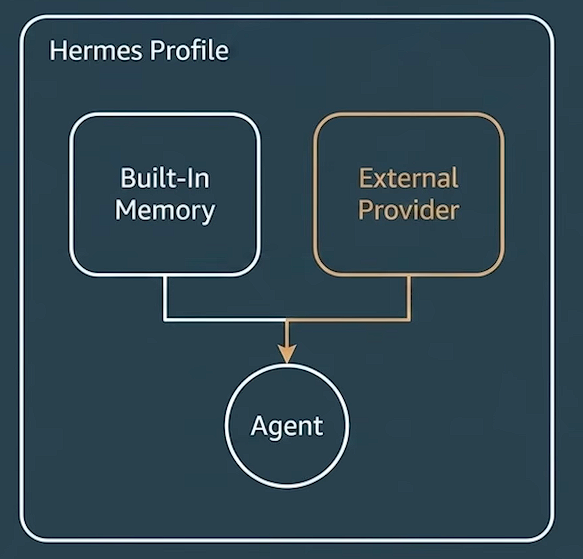
</div><br>

Resumindo de uma forma simples:
- Na camada de conhecimento (world knowledge como o Obsidian) é usado para construir o conhecimento de mundo que abrange cada projeto e agente que nós executamos; 
- Na camada da memória integrada (built-in Memory) é ótimas para chat simples de seção única;
- Na camada dos provedores de memória (provider memory) é ótimos para projetos complexos e fluxos continuos ou quando queremos um desempenho visivelmente melhor na recuperação do agente.

> [!TIP]
> Como a camada de conhecimento (world knowledge) tem um nível de complexidade maior, deixaremos para abordado em uma tese a parte.

### 6.1 Conceito de Memória Integrativa Vs Provedor de Memória
Vamos conceituar primeiramente a Memória Integrada (built-in memory) que já vem por padrão no Hermes 
A ideia aqui é separar conceitualmente três tipos de informação: |

| Tipo de Informação |
|---|
**Memória de identidade e contexto** <br> Função do agente, contexto recorrente, preferências de trabalho e informações estáveis relevantes.
**Memória de decisões** <br> Decisões anteriores, premissas adotadas, critérios definidos e razões para escolhas importantes.
**Memória procedural** <br> Procedimentos que funcionaram, sequências de execução e soluções reutilizáveis — muitas vezes mais bem representados por Skills.

<div align="left">
  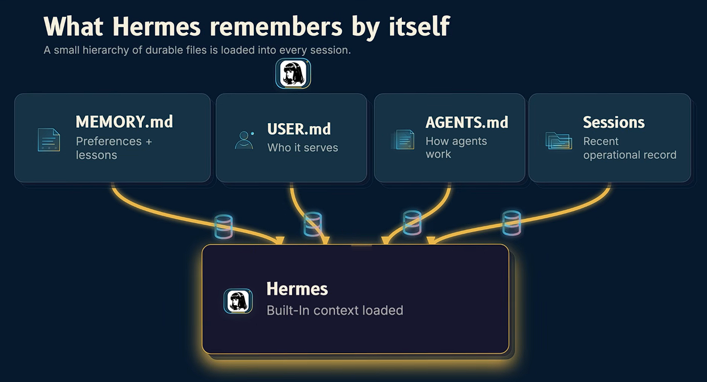
</div><br>

Hermes mantém memória nativa em `memories/MEMORY.md` e `memories/USER.md`, são os dois arquivos centrais da memória embutida (built-in), ou seja, as memórias proprietária do Hermes, com divisão clara de responsabilidades e **são carregadas como snapshot no início da sessão**.
Usado para:
- `MEMORY.md`: **Registra "o que o Agent aprendeu"** como idioma, estilo, formato de citação e preferências do usuário. O limite de caracter do documentado é de 1.375
- `USER.md`: **Registra "quem é você"** através de convenções de documentação, público-alvo, processo de revisão, caminhos estáveis do workspace e preferências técnicas recorrentes. O limite de caracter do documentado é de 2.200

> [!TIP] Um ponto de observação:
> A memória é injetada como um **snapshot congelado** no início da sessão. Isso significa que, mesmo que você ou o Agent modifiquem `MEMORY.md` ou `USER.md` durante a sessão, as alterações serão gravadas imediatamente no disco, mas **só terão efeito no system prompt da próxima nova sessão**. Se você não vir o efeito após a alteração, tente iniciar uma nova sessão (como usar `/new`) antes de verificar novamente.

| Dimensão | `USER.md` (Perfil do Usuário) | `MEMORY.md` (Notas do Agent) |
| :--- | :--- | :--- |
| **Propósito** | Armazenar suas informações pessoais e preferências | Armazenar fatos do ambiente, convenções de projeto e experiências |
| **Conteúdo Principal** | Nome, cargo, fuso horário, estilo de comunicação, hábitos de trabalho, nível técnico | Fatos do sistema operacional, configuração do projeto, peculiaridades de ferramentas, soluções alternativas eficazes |
| **Limite de Caracteres** | 1.375 caracteres (aproximadamente 500 tokens) | 2.200 caracteres (aproximadamente 800 tokens) |
| **Localização** | `~/.hermes/memories/USER.md` | `~/.hermes/memories/MEMORY.md` |

Como sabemos que a cada sessão (chat) o agente irá carregar a memória embutida (built-in interno), consumindo partes dos token e portanto a cada conversa, consequentemente disperdisando tokens e proporcionando ao modelo uma janela de contexto menor.
<div align="left">
  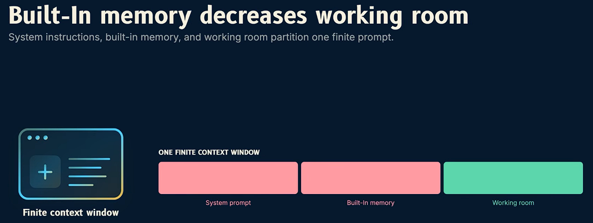
</div><br>

E é ai que entra o Provedor de Memória real, que é uma camada externa que armazena e recupera fatos em tempo de execução ou quando o agente precisa entre execução, ao invés de incerir a cada conversa. Isso ajuda a manter o seu contexto enxuto e o espaço de memoria preciso para quando precisarmos dele.
<div align="left">
  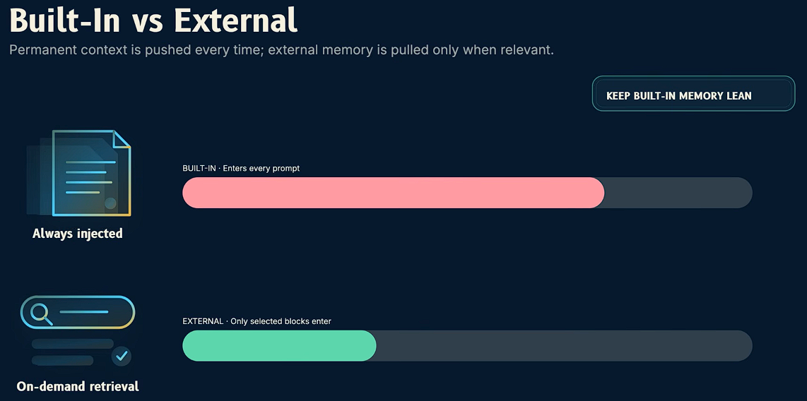
</div><br>

### 6.2 Ações recomendadas

- Não usar memória como repositório bibliográfico ou banco de conhecimento clínico; fatos científicos precisam de fontes atuais e verificáveis em cada documento.
- Não guardar dados pessoais/sensíveis de pacientes, credenciais ou texto extenso de artigos.
- Verifique se a memória persistente e o perfil do usuário estão habilitados na configuração.
- Defina limites de tamanho para evitar excesso de contexto.
- Estabeleça critérios para salvar apenas informações duradouras e úteis.
- Revise a memória periodicamente e remova informações obsoletas.
- Considere aprovação humana para gravações de memória durante a fase inicial de testes.

### 6.3 Configurando a Memória

**Verificando o status da memoria em um profile:**

```bash
hermes -p <perfil> memory status
```

1. Temos que verificar em Tools se a opção para **MEMORY** esta habilitada
2. Depois no menu lateral esquerdo em **CONFIG** temos a opção **Memory**

<div align="left">
  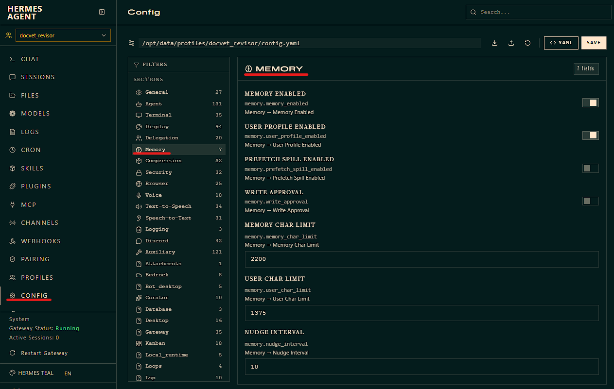
</div><br>

### 6.4 Como verificar as diferenças após a aplicação

Para confirmar se as alterações foram aplicadas em um Profile específico, você pode usar os seguintes métodos:

1.  **Verificar diretamente os arquivos**: Este é o método mais direto. Navegue até o diretório `~/.hermes/memories/` e verifique o conteúdo dos dois arquivos.
    *   **Atenção**: Se você estiver usando um Profile específico (por exemplo, `-p <nome_do_profile>`), o caminho pode ser `~/.hermes/profiles/<nome_do_profile>/memories/`.
2.  **Usar comandos de linha de comando**: O Hermes fornece comandos para visualizar o status da memória.
    *   Execute `hermes memory status` para ver o status geral da memória.
    *   Execute `hermes journey list` para listar os IDs de nós da memória, que podem incluir o status de fragmentação dos arquivos de memória.
3.  **Confirmar dentro da sessão**: Em uma nova sessão, você pode usar comandos como `/memory` (dependendo da versão) para visualizar o status da memória ou usar `/context` para verificar se o conteúdo da memória foi injetado no contexto.

Teste prático: informe uma preferência não sensível ao agente, encerre a sessão, inicie outra e verifique se ele consegue recuperá-la corretamente.

### 6.5 Aprimorando a Memória
Se houver necessidade real de busca semântica entre muitas sessões, avalie um **Provedor de Memória Externo** após definir governança e localização dos dados, partrido para a execução do `hermes memory setup`.
Os provedores de memória externos são aditivos à memória embutida/nativa (built-in interno) e somente um provedor de memória externo fica ativo por vez. Considere para um agente individual de produção documental, comece pela memória embutida (built-in) e só acrescente provedor quando houver caso de uso demonstrado.
Ver documentação sobre ["Aprimorando a Memória do Agente com Provider Memory"](provider-memory.md)

---

## 7. Definir, Selecionar e Criar Skills

[Documentação Skills - Hermes - Oficial](https://hermes-agent.nousresearch.com/docs/reference/skills-catalog)
[Catalogo de Skills - Hermes - Oficial](https://hermes-agent.nousresearch.com/docs/skills)
[Catálogo de Skills - Hermes Atlas (comunidade Brasil)](https://hermesatlas.com/skills/)

Esta é uma das etapas com maior potencial de melhoria operacional.
Uma Skill não é apenas uma descrição da personalidade. Ela deve funcionar como um procedimento reutilizável para realizar determinada classe de tarefa.
Por exemplo, para um profile de pesquisa técnica veterinária, você poderia criar:

| Skill                     | Objetivo                                                             |
| ------------------------- | -------------------------------------------------------------------- |
| `pesquisa-bibliografica`  | Localizar e selecionar fontes científicas relevantes.                |
| `avaliacao-de-fontes`     | Avaliar autoridade, atualidade, metodologia e limitações das fontes. |
| `extracao-de-evidencias`  | Extrair achados, dados, limitações e referências de documentos.      |
| `relatorio-tecnico`       | Estruturar resultados com metodologia, evidências e referências.     |
| `verificacao-de-citacoes` | Conferir se as citações sustentam as afirmações correspondentes.     |

Cada Skill deve ter instruções claras, critérios de entrada, etapas de execução, condições de erro e formato de saída.
A configuração para ativar/desativar e instalar as Skills é feito somente pelo Dashboard em `SKILL -> ALL -> CATEGORIES`
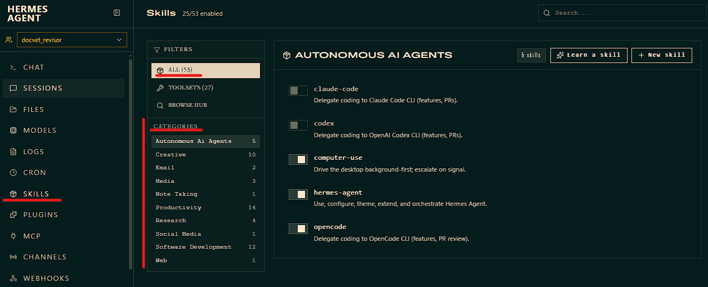<br>

Telo terminal podemos fazer consultas, verificar o status, instalar/deletar
```bash
hermes --profile <profile_name> skills list
```
Saida esperada no terminal:
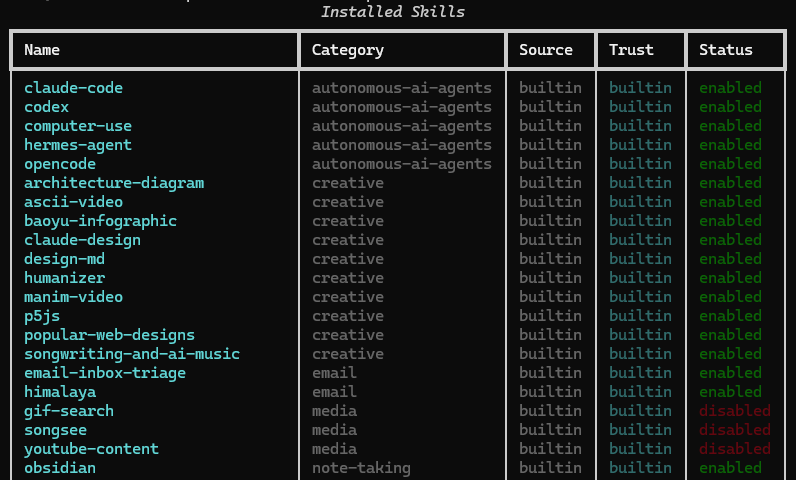<br>

Para facilitar podemos executar um script para ativar/desativar de forma mais rápida, similar ao script para ativação das Tools.
Descarregue o script skill-config.mjs em uma pasta dentro do ambinete Hermes e execute:

```bash
npm run skill-config
```
Saida esperada durante a execução do script:
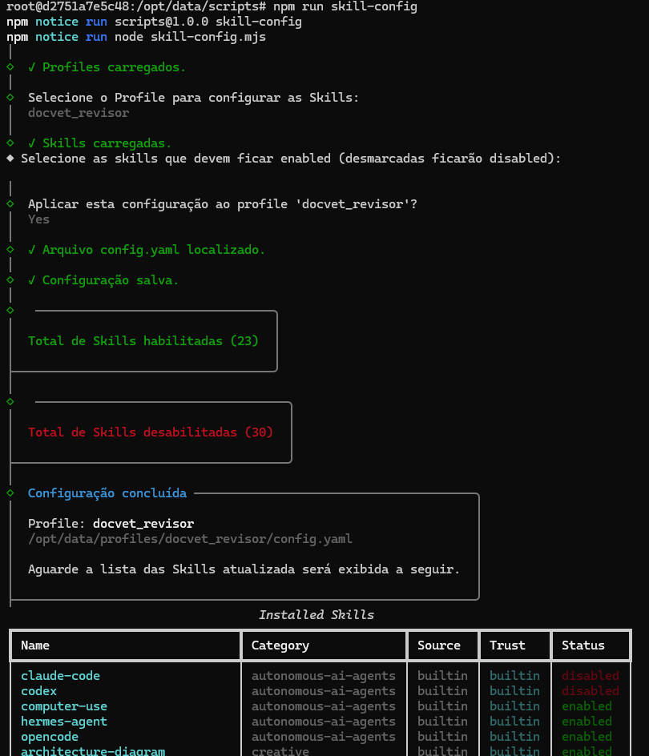<br>

### Boas práticas

- Comece com duas ou três Skills essenciais, não dezenas.
- Utilize carregamento sob demanda para procedimentos especializados.
- Evite repetir integralmente o `SOUL.md` dentro de cada Skill.
- Inclua exemplos de resultados corretos e incorretos.
- Teste cada Skill com tarefas reais antes de adicioná-la ao fluxo de produção.

O sistema de Skills do Hermes usa carregamento progressivo de contexto: as instruções especializadas podem ser disponibilizadas quando necessárias, em vez de manter todo o conteúdo carregado o tempo inteiro.

## 8. Definir regras de operação e segurança

O `SOUL.md` deve definir a identidade e o comportamento. As instruções operacionais devem definir como o trabalho é executado.

Recomendo que o agente tenha regras explícitas para os seguintes pontos:

- Objetivo: qual resultado precisa entregar.
- Escopo: quais tarefas pode e não pode executar.
- Método de trabalho: sequência padrão de análise e execução.
- Fontes: quais fontes são preferenciais e como resolver divergências.
- Validação: como conferir resultados antes de entregá-los.
- Formato de saída: estrutura, nível de detalhe, tabelas, referências e arquivos.
- Incerteza: quando declarar que não há evidência suficiente.
- Escalonamento: quando deve perguntar ao usuário ou solicitar revisão de outro agente.

Um exemplo de procedimento geral seria:

```
1. Interpretar o objetivo e identificar as restrições.
2. Verificar se existem informações suficientes.
3. Selecionar as ferramentas e Skills necessárias.
4. Executar a tarefa por etapas.
5. Validar os resultados e suas fontes.
6. Conferir se todos os requisitos foram atendidos.
7. Entregar o resultado e declarar limitações relevantes.
```

Esse fluxo deve ser adaptado à função do profile, e não repetido cegamente em todas as tarefas.

Importante: não confunda instruções de identidade com instruções de execução. Se você colocar regras detalhadas demais no `SOUL.md`, pode acabar misturando personalidade, procedimentos e políticas de segurança em um único arquivo difícil de manter.

### 4-1. Estabelecer regras de segurança e autonomia

Antes de permitir que o agente modifique arquivos, execute comandos ou opere sistemas externos, defina os limites da sua autonomia.

A documentação do Hermes descreve mecanismos de proteção como autorização de usuários, aprovação de comandos perigosos, controles de escrita, isolamento de execução e filtragem de credenciais.
Sugiro três níveis operacionais:
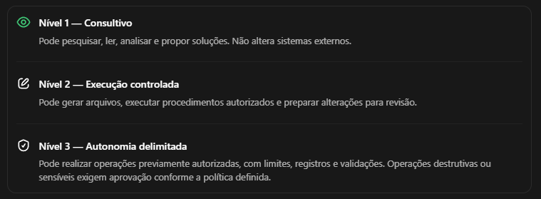

Para começar, recomendo o nível 1 ou 2. Só aumente a autonomia depois de comprovar que o agente respeita as restrições.

Não considere uma instrução no prompt suficiente para proteger credenciais, dados ou infraestrutura. Use também os controles técnicos de permissões e isolamento disponíveis.

## 9. Integrar sistemas e agentes: MCP, APIs e plugins
[Catalogo de Plugins - Hermes - Oficial](https://hermes-agent.nousresearch.com/docs/plugins)

Essa etapa só é necessária quando o agente precisa acessar recursos além das ferramentas já disponíveis.

O MCP (Model Context Protocol) permite conectar o Hermes a servidores que expõem ferramentas externas. É útil para integrar sistemas sem precisar implementar cada integração como uma ferramenta nativa.

Exemplos de integração:

- GitHub: consultar issues, repositórios e pull requests.
- Banco de dados: consultar informações estruturadas.
- APIs corporativas: obter dados de sistemas internos.
- Serviços de arquivos: pesquisar e processar documentos.
- Outros agentes: integrar etapas de um fluxo de trabalho, conforme os mecanismos de comunicação disponíveis.

### Procedimento recomendado

1. Identifique uma necessidade concreta de integração.
2. Escolha o servidor MCP ou a API apropriada.
3. Configure autenticação e credenciais.
4. Exponha apenas as ferramentas necessárias.
5. Teste a conexão e as permissões.
6. Verifique o comportamento diante de falhas e indisponibilidade.

Exemplo ilustrativo de configuração MCP:

```
mcp_servers:
  github:
    command: "npx"
    args:
      - "-y"
      - "@modelcontextprotocol/server-github"
    env:
      GITHUB_PERSONAL_ACCESS_TOKEN: "${GITHUB_TOKEN}"
    tools:
      include:
        - list_issues
        - create_issue
```

Esse exemplo ilustra a estrutura e a seleção de ferramentas, não uma configuração pronta para copiar sem verificar a compatibilidade com a versão instalada e o mecanismo de gerenciamento de credenciais. Nunca coloque tokens reais em arquivos compartilhados ou no `SOUL.md`.

## 10. Testar, avaliar e monitorar

Um profile configurado não é necessariamente um profile confiável. É preciso medir se ele realmente executa bem sua função.

Crie um conjunto de 10 a 20 tarefas representativas, incluindo casos comuns, casos ambíguos e situações em que o agente deveria se recusar a agir ou pedir esclarecimentos.

| Critério             | O que avaliar                                              |
| -------------------- | ---------------------------------------------------------- |
| Precisão             | As informações e conclusões estão corretas?                |
| Aderência ao escopo  | O agente permanece dentro da sua função?                   |
| Uso de ferramentas   | Escolhe as ferramentas adequadas?                          |
| Qualidade das fontes | As fontes realmente sustentam as conclusões?               |
| Consistência         | Produz resultados semelhantes para tarefas equivalentes?   |
| Segurança            | Respeita permissões e limites de autonomia?                |
| Eficiência           | Evita chamadas, etapas e consumo de tokens desnecessários? |
| Formato              | Entrega o resultado no padrão esperado?                    |

Estabeleça critérios objetivos de aprovação. Por exemplo, exija 100% de conformidade nos testes críticos de segurança e uma meta mínima de qualidade para as tarefas usuais, antes de liberar o agente para produção.

Registre falhas e corrija primeiro a causa: instruções incompletas, Skill inadequada, ferramenta mal configurada, contexto insuficiente ou escolha de modelo. Não tente resolver todo problema simplesmente aumentando o tamanho do `SOUL.md`.

---

## 11. Atingindo o nível máximo de performance

### A. Otimizar custo, contexto e desempenho

Depois que o agente estiver funcional, comece a otimização propriamente dita.
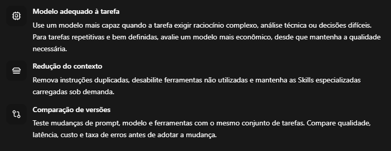

Para inspecionar o ambiente, os comandos a seguir são bons pontos de partida, conforme o suporte da sua versão:

```
hermes profile show NOME_DO_PROFILE
hermes doctor
hermes prompt-size
hermes logs
```

A documentação oficial descreve esses recursos de inspeção e diagnóstico; o comando de tamanho do prompt é especialmente útil para identificar excesso de contexto.

### B. Configurar rotinas automáticas e monitoramento

Se o agente precisar trabalhar continuamente, avalie rotinas agendadas (cron jobs), notificações e processos de verificação periódica.

Exemplos:

- Pesquisar atualizações em fontes técnicas.
- Gerar um relatório periódico.
- Verificar tarefas pendentes.
- Executar uma rotina de auditoria.
- Informar falhas ou solicitar intervenção humana.

Não automatize antes de validar a execução manual. Cada rotina precisa ter frequência definida, condições de execução, tratamento de falhas e limites de repetição. Evite tarefas que possam gerar custos ou alterações externas repetidamente sem supervisão.

### C. Integrar o profile a outros agentes

Como você está trabalhando com profiles especializados no Hermes, eu deixaria a colaboração entre agentes para depois de validar cada profile individualmente.

Uma arquitetura possível seria:
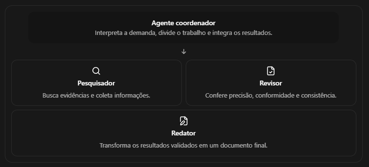

Para esse modelo funcionar, cada agente precisa ter:

- Responsabilidade claramente delimitada.
- Formato padronizado para receber e entregar informações.
- Critérios objetivos de conclusão.
- Regras para lidar com resultados incompletos ou conflitantes.
- Um mecanismo explícito de delegação e retorno dos resultados.

Não presuma que criar três profiles automaticamente estabelece um pipeline. A orquestração precisa ser implementada e testada pelo mecanismo de delegação ou integração escolhido.

---

### Checklist final de operacionalização

Use esta lista para acompanhar o desenvolvimento do seu profile.

#### Progresso de implementação
Configuração
[ ] Model e provider validados
[ ] describe e SOUL.md revisados
[ ] Ferramentas necessárias habilitadas

Conhecimento
[ ] Memória configurada e testada
[ ] Skills essenciais criadas e validadas
[ ] Instruções operacionais definidas

Segurança e integração
[ ] Permissões e autonomia definidas
[ ] MCPs e APIs testados, quando necessários
[ ] Credenciais protegidas

Produção
[ ] Bateria de testes aprovada
[ ] Consumo de contexto e custo avaliados
[ ] Logs, backup e monitoramento planejados
[ ] Rotinas e delegação validadas, quando necessárias
