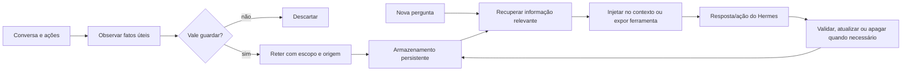
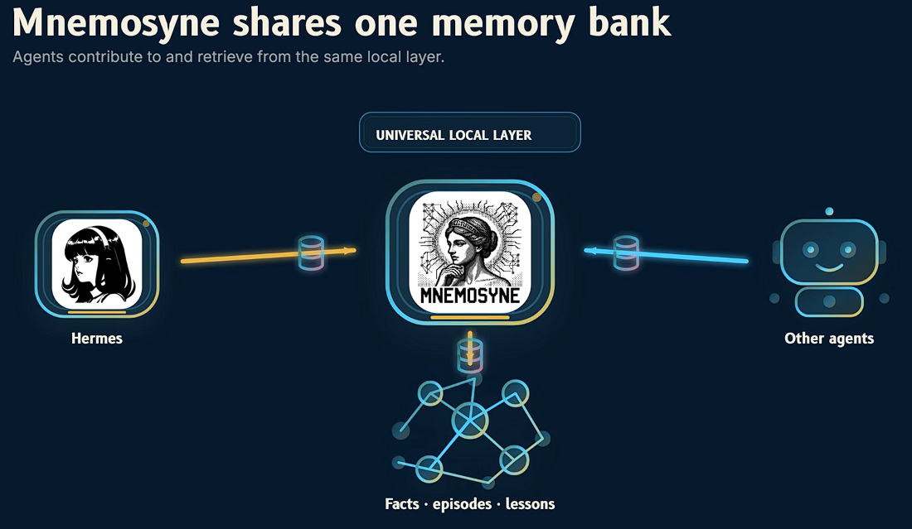
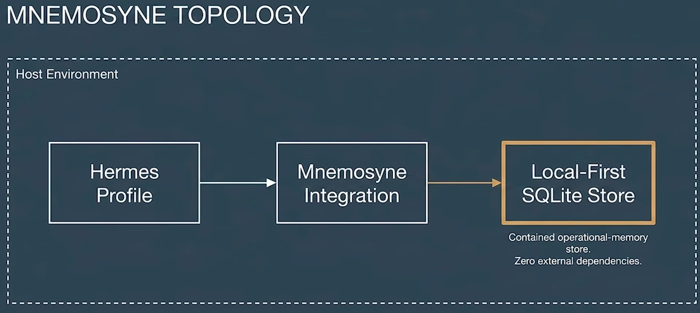
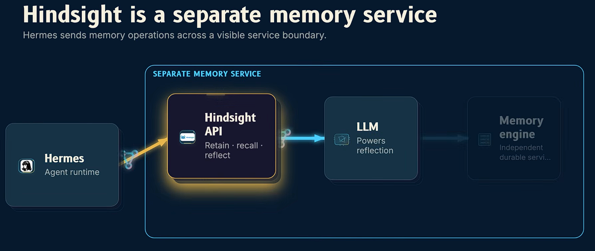
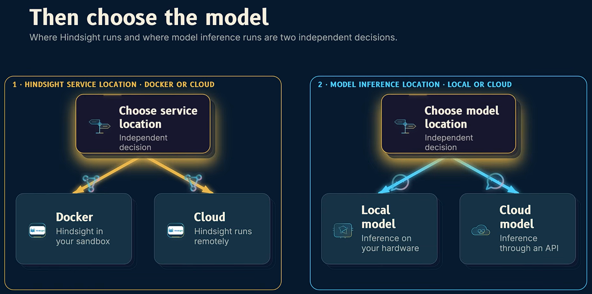
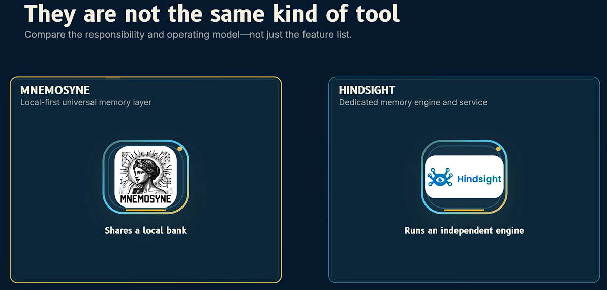
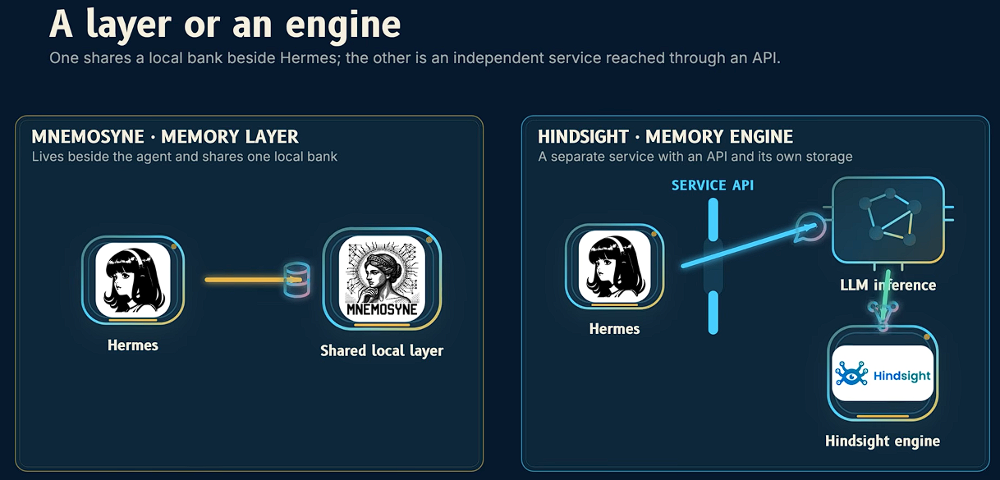
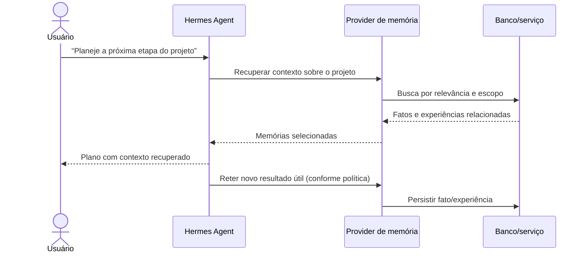
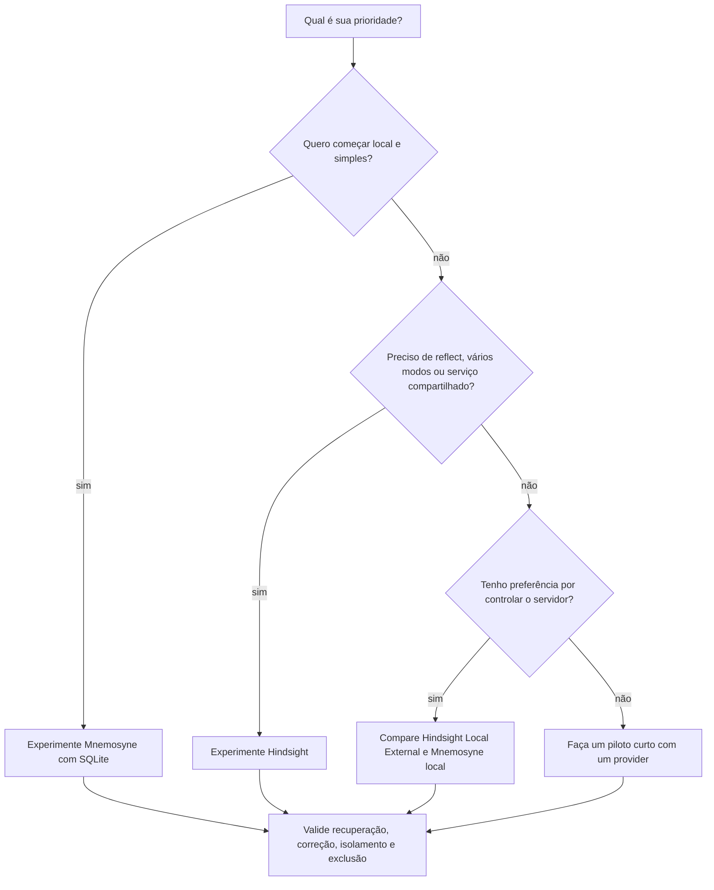

# Aprimorando a Memória do Agente com Provider Memory

> Guia didático e prático baseado nos projetos [Mnemosyne](https://github.com/mnemosyne-oss/mnemosyne) e [Hindsight](https://github.com/vectorize-io/hindsight), e na documentação atual de integração com Hermes. Consultado em 25/10/2026.

## Para quem é este guia

Ao terminar, você deverá conseguir explicar o que é memória para um agente, distinguir memória de contexto e de RAG, comparar Mnemosyne com Hindsight, escolher um caminho para Hermes Agent e fazer uma instalação inicial verificável.

## 1. A ideia básica

Um modelo de linguagem não se lembra automaticamente de uma conversa encerrada. Em cada chamada, ele recebe uma janela de contexto: as instruções, mensagens e dados que o aplicativo escolhe enviar. O provedor de memória de um agente é uma camada externa que seleciona e guarda informações úteis para chamadas futuras.

Uma analogia: contexto é a mesa de trabalho aberta agora; memória é o arquivo que pode ser consultado depois. Uma janela maior permite colocar mais coisas na mesa, mas não decide por si só o que merece ser guardado nem recupera automaticamente um fato de semanas atrás.

| Conceito | O que faz | Exemplo no Hermes |
|---|---|---|
| Contexto | Informação enviada ao modelo nesta chamada | As últimas mensagens e instruções do sistema |
| Memória de curto prazo | Mantém continuidade durante uma sessão | Uma nota de trabalho temporária |
| Memória de longo prazo | Guarda fatos, preferências e experiências entre sessões | “Prefiro respostas em português e exemplos em Python” |
| RAG | Busca trechos em documentos ou bases externas para responder uma pergunta | Procurar em manuais e trazer parágrafos relevantes |
| Perfil/instruções | Preferências estáveis que devem orientar muitas interações | Tom, idioma, regras recorrentes |

RAG e memória se sobrepõem: ambos podem recuperar informação. Uma distinção útil é que RAG costuma começar com documentos fornecidos; memória de agente também pode transformar interações em fatos estruturados, atualizar conhecimento ao longo do tempo e recuperar experiências ou preferências. O nome do produto não garante que ele faça isso bem; a política de gravação e recuperação é que importa.

## 2. O ciclo de memória

Um sistema prático normalmente executa quatro operações:

1. **Observar:** identificar um fato, preferência, objetivo ou evento que possa importar no futuro.
2. **Reter:** persistir a informação com origem, data, categoria e escopo quando possível.
3. **Recuperar:** buscar apenas o que ajuda na tarefa atual.
4. **Usar e revisar:** incorporar o resultado, corrigir informação desatualizada e remover o que não deve mais existir.



### Tipos de informação

| Tipo | Exemplo | Frequência de atualização | Cuidado |
|---|---|---:|---|
| Perfil | Idioma preferido | Baixa | Deve ser fácil de corrigir |
| Preferência | “Prefiro listas curtas” | Média | Pode depender da situação |
| Fato de projeto | “O serviço usa PostgreSQL” | Média/alta | Relacionar ao projeto certo |
| Experiência | “A migração falhou por causa do timezone” | Variável | Guardar causa e resultado, não só o transcript |
| Objetivo em andamento | “Preparar a demonstração até sexta” | Alta | Expirar ou marcar como concluído |
| Dado sensível | Credenciais, saúde, finanças | — | Evitar guardar sem necessidade e consentimento claro |

Uma boa memória é útil, correta, recuperável e editável. Guardar cada frase da conversa não é o objetivo: isso aumenta custo, ruído e risco de recuperar algo irrelevante.

## 3. Como comparar as opções

### Mnemosyne

Mnemosyne é apresentado pelo projeto como uma camada local-first, não exige de um LLM para funcionar, baseada em SQLite e roda incrivelmente rápido, com integração específica para Hermes e interfaces para outros agentes. A vantagem central é reduzir dependência de um serviço remoto e manter o armazenamento na máquina. A busca semântica pode exigir embeddings extras; o perfil mínimo e o perfil com modelos locais têm requisitos de memória diferentes.

<div align="left">
  
  
</div><br>


### Hindsight

Hindsight está entre os melhores atualmente, por usar as operações **retain**, **recall** e **reflect**: guardar informação, recuperar memórias relevantes e sintetizar uma resposta a partir delas. O projeto oferece execução Cloud, local incorporada ao Hermes e instância local/remota própria. A integração atual é um plugin do catálogo Hermes; (nota: documentação alerta que o antigo pacote isolado `hindsight-hermes` está obsoleto). A execução local incorporada ainda pode depender de um provedor de LLM para extração/síntese; “local” não implica automaticamente ausência de chamadas externas em toda configuração.

<div align="left">
  
  
</div><br>

| Critério | Mnemosyne | Hindsight |
|---|---|---|
| Modelo de integração Hermes | Provider/plugin Mnemosyne, instalado via pacote dedicado | Plugin nativo do catálogo Hermes |
| Armazenamento/execução | SQLite local; perfis opcionais ampliam embeddings e recursos | Cloud, daemon local incorporado ou servidor externo |
| Operações centrais | Memória persistente, busca e ferramentas adicionais conforme provider | `retain`, `recall`, `reflect`, além de recursos de conhecimento |
| Infraestrutura inicial | Baixa no perfil básico; pode aumentar com embeddings locais | Cloud é simples, local requer daemon/recursos; externo requer servidor |
| Privacidade | Boa opção quando o banco e modelos permanecem locais; verifique a configuração de embeddings | Depende do modo: Cloud envia dados ao serviço; local reduz essa dependência, mas confira o LLM configurado |
| Melhor encaixe provável | Uso individual, simplicidade e prioridade em armazenamento local | Fluxos mais ricos, reflexão, múltiplos modos de implantação ou serviço compartilhado |
| Ponto de atenção | A qualidade semântica e requisitos variam conforme extras/configuração | Mais componentes e decisões de implantação; plugin antigo não deve ser seguido |

<div align="left">
  
  
</div><br>


### Gráfico qualitativo para orientar a escolha

Escala didática de 1 a 5, não é benchmark nem avaliação independente. “Simplicidade” representa o caminho de menor infraestrutura descrito nos projetos; “riqueza de operações” representa as operações explicitamente documentadas.

| Dimensão | Mnemosyne | Hindsight |
|---|---:|---:|
| Armazenamento local simples | █████ 5 | ███ 3 |
| Opções de implantação | ███ 3 | █████ 5 |
| Riqueza explícita de operações | ███ 3 | █████ 5 |
| Baixa dependência de infraestrutura | █████ 5 | ██ 2 |

Escolha **Mnemosyne** se sua prioridade inicial for começar localmente com uma base SQLite e integração voltada ao Hermes. Avalie **Hindsight** se precisar de `reflect`, múltiplos bancos, Cloud/servidor ou da experiência de memória integrada ao plugin Hermes. Nenhuma opção é universalmente superior.

## 4. Uma conversa do Hermes com memória



Há duas formas de o provider ajudar: **injeção automática de contexto** (o provider busca antes da resposta) e **ferramentas disponíveis ao modelo** (o Hermes decide chamar recall/retain). Uma integração pode combinar as duas. Se a memória não aparece, verifique provider ativo, disponibilidade e modo configurado.

---

## 5. Aplicação prática: Mnemosyne

### Documentação de consulta

[Mnemosyne - Site](https://mnemosyne.site/pt/); [Mnemosyne - GitHub](https://github.com/mnemosyne-oss/mnemosyne?tab=readme-ov-file); [Mnemosyne - blog](https://www.glukhov.org/ai-systems/hermes/mnemosyne-memory/#installing-mnemosyne-into-hermes)

### Passo 1 — confirmar o ambiente

Abra um terminal onde `hermes` esteja disponível e confira a versão e o perfil ativo. Anote o diretório `HERMES_HOME` se você usa um perfil não padrão; isso define onde o provider, a configuração e os dados podem ser instalados.

### Passo 2 — escolher o perfil de recursos

| Perfil documentado | Quando considerar | Impacto aproximado publicado pelo projeto |
|---|---|---:|
| `mnemosyne-memory` | Baixa memória ou embeddings via serviço externo | ~50 MB |
| `mnemosyne-memory[embeddings]` | Embeddings locais em desktop com recursos moderados | ~800 MB |
| `mnemosyne-memory[all]` | Recursos locais completos, inclusive componentes de consolidação | ~1,5 GB |

Esses valores são estimativas do projeto, não garantias para toda máquina. Confirme também o requisito de RAM livre e se o modelo de embeddings usado exige uma API externa ou pacote local.

### Passo 3 — instalar o provider Hermes

A documentação lista `mnemosyne-hermes` para a integração Hermes. Para o fluxo direto, a orientação é instalar o pacote do provider junto com o perfil base escolhido e então configurar o provider. Em ambientes gerenciados ou com instalação persistente via wrapper, siga a seção correspondente no [guia oficial Hermes](https://github.com/mnemosyne-oss/mnemosyne/blob/main/docs/hermes-integration.md); não misture ambientes Python sem conferir qual deles o Hermes usa.

```bash
pip install --upgrade mnemosyne-hermes
```

Se você escolheu embeddings locais, instale também o extra compatível indicado no README, por exemplo `mnemosyne-memory[embeddings]`. O provider `mnemosyne-hermes` é a integração Hermes; ele não substitui a seleção do perfil de recursos desejado.

### Passo 4 — selecionar no Hermes

```bash
hermes config set memory.provider mnemosyne
```

Reinicie o gateway ou inicie uma nova sessão, conforme seu modo de execução. A documentação atual separa provider externo e memória interna do Hermes. **Não use `hermes tools disable memory` para trocar de provider**: isso desativa o conjunto de ferramentas de memória. Mantenha a memória interna como referência/rollback enquanto valida a migração.

### Passo 5 — confirmar provider e ferramentas

```bash
hermes memory status
hermes tools list
```

Confirme no status que Mnemosyne é o provider ativo e está disponível. Na lista de ferramentas, procure os nomes `mnemosyne_...`; o inventário do runtime é a fonte confiável para a versão instalada. Se o provider não estiver disponível, revise o perfil/Hermes home, a instalação no ambiente Python correto e reinicie.

### Passo 6 — testar com dados não sensíveis

1. Em uma sessão, informe uma preferência explícita e persistente, por exemplo: “Para este projeto, prefiro exemplos em Python”.
2. Comece outra sessão e pergunte: “Qual linguagem prefiro para exemplos neste projeto?”
3. Pergunte de modo indireto: “Como devo formatar um exemplo de código?”
4. Corrija a memória se a resposta estiver errada e verifique se a correção persiste.
5. Teste isolamento: guarde uma preferência ligada ao projeto A e pergunte sobre o projeto B.
6. Teste exclusão/limpeza usando as ferramentas documentadas para sua versão.

Não considere o primeiro teste como prova suficiente. Faça perguntas diretas e indiretas, teste fatos conflitantes e observe se contexto de um projeto vaza para outro.

### Passo 7 — operar com segurança

- Faça backup do banco SQLite antes de atualizações importantes; identifique o caminho real da base na configuração do seu perfil, sem presumir um diretório padrão.
- Não memorize senhas, tokens, chaves privadas ou dados pessoais sensíveis sem uma necessidade clara.
- Use escopo por usuário/projeto quando o provider oferecer essa capacidade.
- Defina uma forma de corrigir e apagar informações; teste-a.
- Após atualizar Hermes ou o provider, rode `hermes memory status` e repita os testes básicos.

## 6. Aplicação prática: Hindsight

O caminho documentado atual é usar o plugin do catálogo Hermes. Há três modos; escolha um antes de configurar:

| Modo | Onde os dados e operações rodam | Requisitos principais |
|---|---|---|
| Cloud | Serviço Hindsight | Chave de API |
| Local Embedded | Daemon local iniciado pelo Hermes | Chave para um LLM suportado para extração/síntese; o daemon é gerenciado localmente |
| Local External | Instância Hindsight que você já executa | URL do servidor e, se configurada, autenticação |

### Passo 1 — instalar o plugin do catálogo

```bash
hermes plugins install hindsight
```

Confirme a instalação/ativação quando o Hermes perguntar. Em scripts, a documentação também descreve a opção `--enable`. Evite instruções antigas que instalem o pacote Python separado `hindsight-hermes`: a página atual de integração declara esse plugin obsoleto.

### Passo 2 — executar o assistente de configuração

```bash
hermes memory setup
```

Selecione `hindsight` como provider e escolha Cloud, Local Embedded ou Local External conforme sua necessidade. O assistente pode oferecer uma memória inicial de exemplo; revise-a e pule se não fizer sentido para seu agente.

### Passo 3 — completar credenciais ou endpoint

- **Cloud:** obtenha a chave da conta Hindsight e mantenha-a em armazenamento de segredo/arquivo `.env` do Hermes conforme o assistente indicar. Não a cole em conversas nem a grave como memória.
- **Local Embedded:** escolha um provedor e modelo de LLM para extração/síntese. Pode ser um endpoint local compatível, mas confirme que o modelo tem qualidade e recursos para esse trabalho.
- **Local External:** informe URL e autenticação da instância existente. Restrinja exposição de rede e proteja o endpoint.

### Passo 4 — revisar comportamento e banco

Hindsight documenta `memory_mode` como `hybrid` (contexto automático e ferramentas), `context` (injeção automática sem ferramentas) ou `tools` (ferramentas sem injeção automática). Para começar, use o padrão sugerido pelo assistente e observe o comportamento. Cada perfil Hermes pode ter sua configuração; bancos podem ser separados por perfil/usuário conforme a configuração.

### Passo 5 — validar

```bash
hermes memory status
hermes tools list
```

Confirme que `hindsight` está ativo e disponível. Faça o mesmo roteiro de preferência, pergunta na sessão seguinte, correção, isolamento e exclusão da seção Mnemosyne. Para Hindsight, uma memória pode exigir ao menos um ciclo de `retain` para aparecer em `recall`; a extração pode envolver uma chamada de LLM.

### Passo 6 — decidir o que fazer com a memória nativa do Hermes

Hermes também tem arquivos de memória próprios. A documentação de Hindsight permite manter ambos durante a transição; em algumas configurações, entradas gravadas na memória nativa também são copiadas para bancos Hindsight. Desativar os arquivos internos pode remover as ferramentas nativas de memória. Antes de mudar flags como `memory_enabled`, confirme o comportamento na versão atual e faça backup. Evite duas fontes concorrentes sem uma política clara para correções e exclusões.

## 7. Como escrever boas memórias

Compare estas versões:

| Ruim | Melhor |
|---|---|
| Guardar a conversa inteira “sobre o projeto” | “Projeto Atlas: usa PostgreSQL; produção roda em UTC. Confirmado em 2026-10-25.” |
| “Usuário gosta de tecnologia” | “Prefere explicações técnicas passo a passo, em português, com exemplos executáveis.” |
| Guardar uma intenção sem prazo | “Preparar demo do projeto Atlas até 2026-11-03; status: em andamento.” |
| Memorizar uma hipótese como verdade | “Hipótese: erro pode estar ligado ao timezone; ainda não confirmado.” |

Prefira uma frase atômica por fato, sinalize incerteza, associe-a ao escopo correto e inclua uma data quando a informação puder mudar. Se o sistema oferece tags, use poucas categorias consistentes, por exemplo `project:atlas`, `preference`, `decision`.

## 8. Avaliar se a memória está ajudando

Monte um conjunto pequeno de 10 a 20 perguntas baseadas no seu uso real. Para cada uma, registre a resposta esperada, se a memória foi recuperada, se estava correta e se era do escopo certo.

| Indicador | Pergunta que responde |
|---|---|
| Precisão | As memórias recuperadas são relevantes? |
| Cobertura | O sistema encontra fatos importantes que deveriam estar guardados? |
| Atualidade | Correções substituem fatos antigos? |
| Isolamento | A informação de outro usuário/projeto fica fora da resposta? |
| Custo/latência | Quanto tempo e chamadas extras cada turno exige? |
| Controle | Consigo inspecionar, corrigir e apagar? |

Não compare números de benchmark sem verificar versão, conjunto de dados, metodologia e configuração. O README de Mnemosyne contém uma ressalva explícita de que seus números BEAM referem-se a uma versão anterior e que resultados sem metodologia reproduzível foram retirados; trate benchmarks como evidência contextual, não como garantia do resultado no seu Hermes.

## 9. Árvore de decisão rápida



## 10. Plano de aprendizagem passo a passo

1. **Entenda contexto e memória:** explique por que uma conversa passada não está automaticamente na janela atual.
2. **Teste memória manualmente:** escreva 5 fatos que realmente ajudariam seu Hermes e marque escopo e prazo.
3. **Escolha um provider:** use a tabela e priorize uma necessidade concreta, não uma promessa de benchmark.
4. **Instale em um perfil de teste:** evite começar com dados sensíveis ou todos os projetos.
5. **Faça o teste de duas sessões:** guardar, encerrar, perguntar, corrigir.
6. **Teste bordas:** contradição, informação desatualizada, isolamento e exclusão.
7. **Observe o uso real por alguns dias:** veja se as memórias aparecem quando ajudam e ficam fora quando não ajudam.
8. **Ajuste o modo de recuperação e a política de retenção:** reduza ruído antes de aumentar a quantidade armazenada.
9. **Faça backup e documente a reversão:** mantenha instruções para retornar ao provider anterior.
10. **Só então migre o uso cotidiano:** confirme status, ferramentas e backups depois de cada atualização.

## 11. Limites e boas práticas

- Uma memória recuperada pode estar errada, incompleta ou desatualizada. O agente deve distinguir fato lembrado de inferência.
- Busca semântica não garante encontrar tudo; termos, embeddings, filtros e configuração alteram os resultados.
- A automação de retenção pode registrar informação que não deveria ser persistida. Revise a política e teste exclusão.
- Modo local não é sinônimo de segurança total: arquivos locais precisam de controle de acesso e backup protegido; modelos configurados remotamente ainda podem receber dados.
- Não mantenha dois providers escrevendo sem saber qual é a fonte oficial e como conflitos são resolvidos.
- Requisitos, comandos, nomes de provider e recursos podem mudar. Reconfira as páginas oficiais antes de cada instalação ou atualização.

---

Caso tenha vindo do documento `optimizing_profile.md` sobre o tópico memória e queira [retornar de onde parou](optimizing_profile_5.md#aprimorando-a-memória)

## 12. Fontes consultadas

1. Vídeo indicado: [Improved AI Memory? 🧠 Full Hermes Tutorial (Mnemosyne & Hindsight)](https://youtu.be/R1TNGOZAOZs). A página acessível nesta consulta expôs o título, mas não a transcrição; portanto, o documento não atribui falas ou timestamps ao apresentador.
2. [Mnemosyne — README oficial](https://github.com/mnemosyne-oss/mnemosyne)
3. [Mnemosyne — integração oficial com Hermes](https://github.com/mnemosyne-oss/mnemosyne/blob/main/docs/hermes-integration.md)
4. [Hindsight — README oficial](https://github.com/vectorize-io/hindsight)
5. [Hindsight — integração oficial com Hermes](https://github.com/vectorize-io/hindsight/blob/main/hindsight-docs/docs-integrations/hermes.md)
6. [Hindsight — servidor MCP](https://github.com/vectorize-io/hindsight/blob/main/skills/hindsight-docs/references/developer/mcp-server.md)

---

**Resumo em uma frase:** memória de IA é um ciclo controlado de selecionar, guardar, recuperar, corrigir e apagar informação útil; para Hermes, Mnemosyne tende a favorecer uma implantação local enxuta, enquanto Hindsight oferece um conjunto mais amplo de operações e opções de execução.


