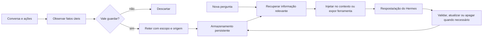
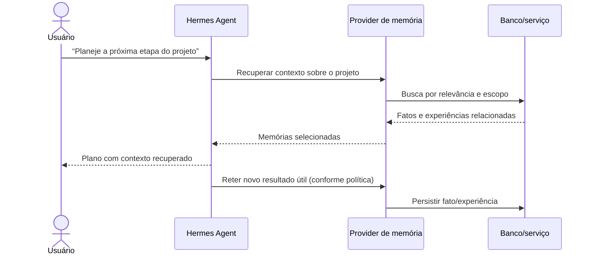
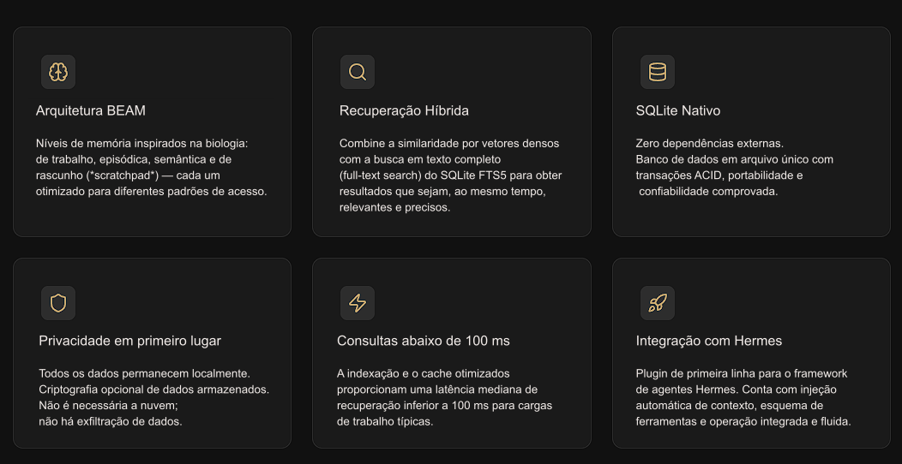
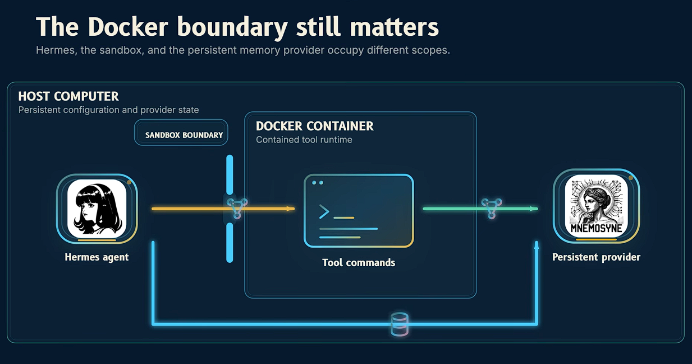
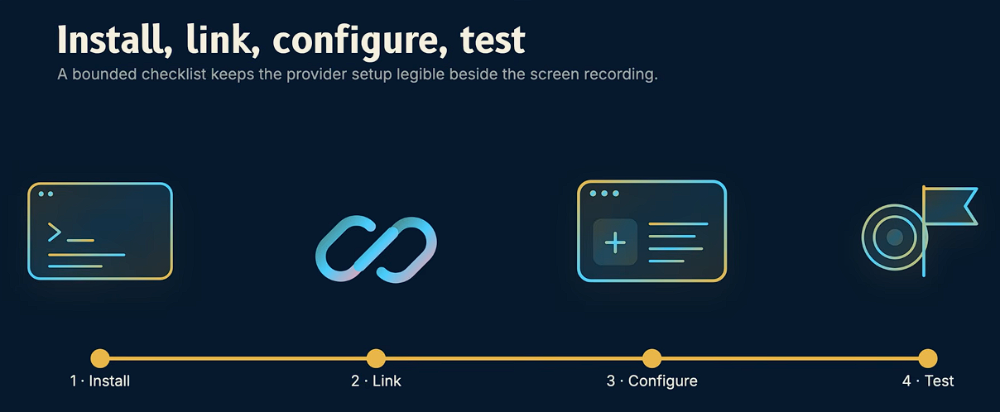
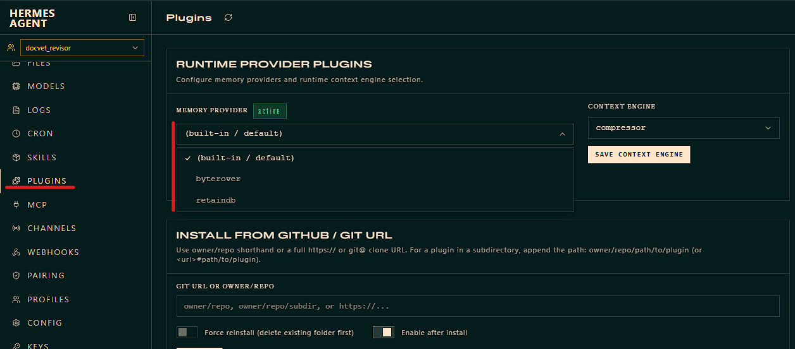
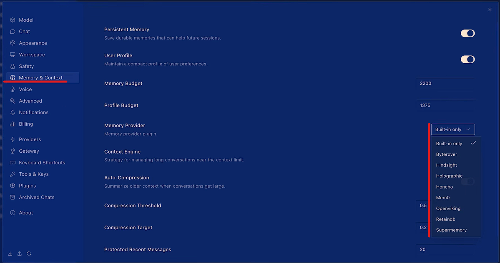
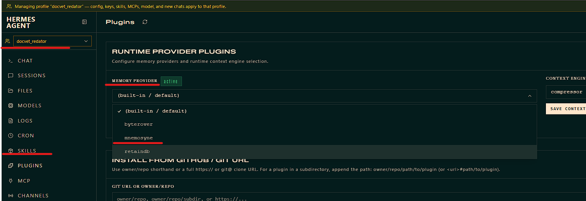
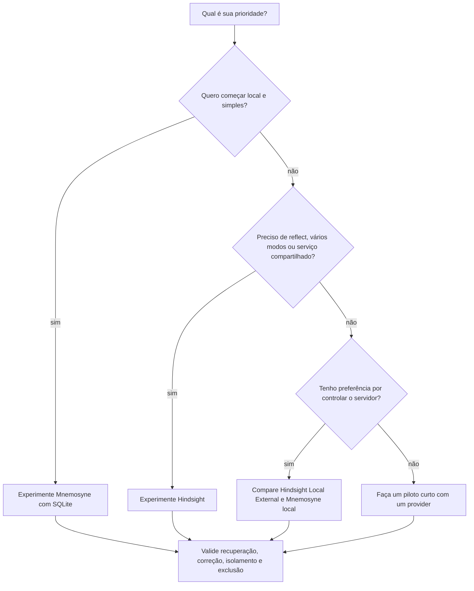

# Aprimorando a Memória do Agente com Memory Provider

> Guia didático e prático baseado nos projetos [Mnemosyne](https://github.com/mnemosyne-oss/mnemosyne) e [Hindsight](https://github.com/vectorize-io/hindsight), e na documentação atual de integração com Hermes. Consultado em 25/10/2026.

## Conteúdo
<!-- toc -->

<!-- tocstop -->

## Para quem é este guia

Ao terminar, você deverá conseguir explicar o que é memória para um agente, distinguir memória de contexto e de RAG, comparar Mnemosyne com Hindsight, escolher um caminho para Hermes Agent e fazer uma instalação inicial verificável.

## 1. A ideia básica

Um modelo de linguagem não se lembra automaticamente de uma conversa encerrada. Em cada chamada, ele recebe uma janela de contexto: as instruções, mensagens e dados que o aplicativo escolhe enviar. O provedor de memória de um agente é uma camada externa que seleciona e guarda informações úteis para chamadas futuras.

Uma analogia: contexto é a mesa de trabalho aberta agora; memória é o arquivo que pode ser consultado depois. Uma janela maior permite colocar mais coisas na mesa, mas não decide por si só o que merece ser guardado nem recupera automaticamente um fato de semanas atrás.

| Conceito | O que faz | Exemplo no Hermes |
|---|---|---|
| Contexto | Informação enviada ao modelo nesta chamada | As últimas mensagens e instruções do sistema |
| Memória de curto prazo | Mantém continuidade durante uma sessão | Uma nota de trabalho temporária |
| Memória de longo prazo | Guarda fatos, preferências e experiências entre sessões | “Prefiro respostas em português e exemplos em Python” |
| RAG | Busca trechos em documentos ou bases externas para responder uma pergunta | Procurar em manuais e trazer parágrafos relevantes |
| Perfil/instruções | Preferências estáveis que devem orientar muitas interações | Tom, idioma, regras recorrentes |

RAG e memória se sobrepõem: ambos podem recuperar informação. Uma distinção útil é que RAG costuma começar com documentos fornecidos; memória de agente também pode transformar interações em fatos estruturados, atualizar conhecimento ao longo do tempo e recuperar experiências ou preferências. O nome do produto não garante que ele faça isso bem; a política de gravação e recuperação é que importa.

## 2. O ciclo de memória

Um sistema prático normalmente executa quatro operações:

1. **Observar:** identificar um fato, preferência, objetivo ou evento que possa importar no futuro.
2. **Reter:** persistir a informação com origem, data, categoria e escopo quando possível.
3. **Recuperar:** buscar apenas o que ajuda na tarefa atual.
4. **Usar e revisar:** incorporar o resultado, corrigir informação desatualizada e remover o que não deve mais existir.



### Tipos de informação

| Tipo | Exemplo | Frequência de atualização | Cuidado |
|---|---|---:|---|
| Perfil | Idioma preferido | Baixa | Deve ser fácil de corrigir |
| Preferência | “Prefiro listas curtas” | Média | Pode depender da situação |
| Fato de projeto | “O serviço usa PostgreSQL” | Média/alta | Relacionar ao projeto certo |
| Experiência | “A migração falhou por causa do timezone” | Variável | Guardar causa e resultado, não só o transcript |
| Objetivo em andamento | “Preparar a demonstração até sexta” | Alta | Expirar ou marcar como concluído |
| Dado sensível | Credenciais, saúde, finanças | — | Evitar guardar sem necessidade e consentimento claro |

Uma boa memória é útil, correta, recuperável e editável. Guardar cada frase da conversa não é o objetivo: isso aumenta custo, ruído e risco de recuperar algo irrelevante.

## 3. Como comparar as opções

### Mnemosyne

Mnemosyne é apresentado pelo projeto como uma camada local-first, não exige de um LLM para funcionar, baseada em SQLite e roda incrivelmente rápido, com integração específica para Hermes e interfaces para outros agentes. A vantagem central é reduzir dependência de um serviço remoto e manter o armazenamento na máquina. A busca semântica pode exigir embeddings extras; o perfil mínimo e o perfil com modelos locais têm requisitos de memória diferentes.

<div align="left">
  
  
</div><br>


### Hindsight

Hindsight está entre os melhores atualmente, por usar as operações **retain**, **recall** e **reflect**: guardar informação, recuperar memórias relevantes e sintetizar uma resposta a partir delas. O projeto oferece execução Cloud, local incorporada ao Hermes e instância local/remota própria. A integração atual é um plugin do catálogo Hermes; (nota: documentação alerta que o antigo pacote isolado `hindsight-hermes` está obsoleto). A execução local incorporada ainda pode depender de um provedor de LLM para extração/síntese; “local” não implica automaticamente ausência de chamadas externas em toda configuração.

<div align="left">
  
  
</div><br>

| Critério | Mnemosyne | Hindsight |
|---|---|---|
| Modelo de integração Hermes | Provider/plugin Mnemosyne, instalado via pacote dedicado | Plugin nativo do catálogo Hermes |
| Armazenamento/execução | SQLite local; perfis opcionais ampliam embeddings e recursos | Cloud, daemon local incorporado ou servidor externo |
| Operações centrais | Memória persistente, busca e ferramentas adicionais conforme provider | `retain`, `recall`, `reflect`, além de recursos de conhecimento |
| Infraestrutura inicial | Baixa no perfil básico; pode aumentar com embeddings locais | Cloud é simples, local requer daemon/recursos; externo requer servidor |
| Privacidade | Boa opção quando o banco e modelos permanecem locais; verifique a configuração de embeddings | Depende do modo: Cloud envia dados ao serviço; local reduz essa dependência, mas confira o LLM configurado |
| Melhor encaixe provável | Uso individual, simplicidade e prioridade em armazenamento local | Fluxos mais ricos, reflexão, múltiplos modos de implantação ou serviço compartilhado |
| Ponto de atenção | A qualidade semântica e requisitos variam conforme extras/configuração | Mais componentes e decisões de implantação; plugin antigo não deve ser seguido |

<div align="left">
  
  
</div><br>


### Gráfico qualitativo para orientar a escolha

Escala didática de 1 a 5, não é benchmark nem avaliação independente. “Simplicidade” representa o caminho de menor infraestrutura descrito nos projetos; “riqueza de operações” representa as operações explicitamente documentadas.

| Dimensão | Mnemosyne | Hindsight |
|---|---:|---:|
| Armazenamento local simples | █████ 5 | ███ 3 |
| Opções de implantação | ███ 3 | █████ 5 |
| Riqueza explícita de operações | ███ 3 | █████ 5 |
| Baixa dependência de infraestrutura | █████ 5 | ██ 2 |

Escolha **Mnemosyne** se sua prioridade inicial for começar localmente com uma base SQLite e integração voltada ao Hermes. Avalie **Hindsight** se precisar de `reflect`, múltiplos bancos, Cloud/servidor ou da experiência de memória integrada ao plugin Hermes. Nenhuma opção é universalmente superior.

## 4. Uma conversa do Hermes com memória



Há duas formas de o provider ajudar: **injeção automática de contexto** (o provider busca antes da resposta) e **ferramentas disponíveis ao modelo** (o Hermes decide chamar recall/retain). Uma integração pode combinar as duas. Se a memória não aparece, verifique provider ativo, disponibilidade e modo configurado.

---

## 5. Aplicação prática: Mnemosyne

### - Documentação de consulta

Sites oficiais do projeto -> [Mnemosyne - Site](https://mnemosyne.site/pt/); [Mnemosyne - GitHub](https://github.com/mnemosyne-oss/mnemosyne?tab=readme-ov-file)
[Documentação](https://docs.mnemosyne.site/getting-started/quick-start)
[Mnemosyne - blog](https://www.glukhov.org/ai-systems/hermes/mnemosyne-memory/#installing-mnemosyne-into-hermes)

**PORQUE UTILIZAR MNEMOZYNE**
<div align="left">
  
</div><br>

### - Introdução
A ídeia principal aqui é montarmos o Mnemosyne fora do ambiente principal do Hermes caso contrario nosso Mnemozyne vai morrer quando efetuarmos a atualização do Hermes, pois quando atualizamos o ambiente de gerenciamento virtual do Hermes no container é recriado e tudo dentro dele é perdido. É o mesmo principio que utilizamos para o volume de dados persistente para o Hermes, criado fora do container, normalmente em uma pasta `./opt/data`

<div align="left">
  
</div><br>

### Passo 1 — Confirmar o ambiente
Assim como a maioria dos memorys provider o Mnemozyne também não é um provedor integrado no Hermes e sim um plugin, portanto temos que instalar de uma forma um pouco mais manual. Vamos optar pela instalação usando o Mnemozyne como um pluging do Hermes, mas ele também será reconhecido como um provedor de memória, ([documentação de ref](https://docs.mnemosyne.site/api/hermes-plugin#hermes-plugin))
Abra um terminal onde `hermes` esteja disponível e confira a versão e o perfil ativo.

> [!WARNING]
> Como estamos trabalhando com Docker e o Hermes esta rodando dentro de um container, a instalação precisa ser feita no mesmo ambiente Python que o Hermes utiliza internamente.

```bash
#entra no container do Hermes
docker ps
docker exec -it <id_container> /bin/bash

# executamos o comando para ver o status atual das configurações da memória
hermes memory status

# saída esperada
Memory status
────────────────────────────────────────
  Built-in (MEMORY.md / USER.md):
    Memory injection:   enabled ✓
    User profile:       enabled ✓
    Memory tool:        enabled ✓
  Provider:  (none — built-in only)

  Installed plugins:
    • byterover  (API key / local)
    • retaindb  (API key / local)
```

Podemos notar que não temos um provider memory, estamos somente como memória interna (built-in)  
Agora todas as execuções de comando será dentro do container do Hemres, então anote o diretório `HERMES_HOME` principalmente se você usa um perfil não padrão; isso será importante para definirmos onde o provider, a configuração e os dados podem ser instalados.

```bash
pwd   # verifica a localização atual

# temos que estar no diretório raiz root e depois entra no diretório /opt
# listamos o conteúdo da pasta ./opt
ls -a1

# saída
.
..
data
hermes
```
Podemos verificar que temos nesta pasta `./opt/` duas outras pastas `data` e `hermes`
`./opt/data/` -> é onde temos o volume dos dados percistentes, onde esta as informações e configurações dos agentes e tudo mais que configuramos no hermes
`./opt/hermes/` -> é justamente o sistema volátil, este se perde quando executamos a atualização do hermes, pois o container vai montar toda esta pasta novamente.

<br>

### Passo 2 — Escolher o perfil de recursos para o Mnemosyne

| Perfil documentado | Quando considerar | Impacto aproximado publicado pelo projeto |
|---|---|---:|
| `mnemosyne-memory` | Baixa memória ou embeddings via serviço externo | ~50 MB |
| `mnemosyne-memory[embeddings]` | Embeddings locais em desktop com recursos moderados | ~800 MB |
| `mnemosyne-memory[all]` | Recursos locais completos, inclusive componentes de consolidação | ~1,5 GB |

<br>

### Passo 3 - Criar o ambiente venv independente

O interpretador do Python é um link simbólico que aponta para o Python do sistema /usr/local/bin/python3, e não um interpretador independente da venv do Hermes em `/opt/hermes/.venv/bin`. Neste caso não é possível usar diretamente esse python que aponta para o sistema para criar a venv, porque pode causar incompatibilidade na versão do interpretador Python, resultando em falha silenciosa no carregamento de dependências compiladas (como numpy, onnxruntime), e a recuperação vetorial sempre retornará pontuação zero.
 Execute os seguintes comandos (dentro do container):

```bash
# 1-Definem variáveis de ambiente no shell atual, não executam nenhuma instalação ou alteração de arquivo
export HERMES_HOME=/opt/data   # ajuste conforme sua configuração real
VENV="$HERMES_HOME/.mnemosyne/venv"


# 2-Criar venv independente (usando o python do sistema, mas o caminho da venv está fora do Hermes)
python3 -m venv "$VENV"
"$VENV/bin/python" -m pip install --upgrade pip
"$VENV/bin/python" -m pip install 'mnemosyne-memory[embeddings]' mnemosyne-hermes
```

**- Onde a venv realmente é criada**
Com as variáveis que definimos no item 1 do bloco de comandos:

`HERMES_HOME=/opt/data`
`VENV="$HERMES_HOME/.mnemosyne/venv"` → ou seja, VENV aponta para `**/opt/data/.mnemosyne/venv**`

Portanto, o comando `python3 -m venv "$VENV"` cria toda a estrutura da venv (pastas bin, lib, pyvenv.cfg, etc.) em `/opt/data/.mnemosyne/venv`.

**- Como verificar se a venv foi criada corretamente**
Execute um destes comandos:
```bash
ls -la /opt/data/.mnemosyne/venv

# saida esperada
.
..
.gitignore
bin
include
lib
lib64
pyvenv.cfg

# podemos ainda confirmar  que o interpretador da venv existe
/opt/data/.mnemosyne/venv/bin/python --version

# saida esperada
Python 3.14.9
```
</br>

### Passo 4 — Instalar e registrar o Mnemosyne como provider 

Para o fluxo direto, a orientação é instalar o pacote do provider junto com o perfil base escolhido (passo 2) e então configurar o provider.

<div align="left">
  
</div><br>

Podemos verificar no dashboard do Hermes que antes da instalação do Mnemosyne, só temos disponível o "built-in | default"

<div align="left">
  
  
</div><br>

Para garantir que estamos atribuindo todas as configurações para o profile correto, ative-o ante de iniciar
```bash
hermes profile use <profile_name>
```

**Instalando Mnemosyne no seu próprio ambiente**
```bash
# 3-Registrar o plugin com o instalador oficial do wrapper (não é necessário criar link manualmente)
"$VENV/bin/mnemosyne-hermes" install --mode wrapper --python "$VENV/bin/python"

# saída esperada
  Profile docvet_revisor: linked /opt/data/profiles/docvet_revisor/plugins/mnemosyne
Installed. Wrapper directory at /opt/data/plugins/mnemosyne
  Python: /opt/data/.mnemosyne/venv/bin/python
  Site-packages: /opt/data/.mnemosyne/venv/lib/python3.14/site-packages
  Skill: Installed bundled skill at /opt/data/skills/memory/mnemosyne-memory-override/SKILL.md.
Done. Next steps:
  hermes config set memory.provider mnemosyne
  hermes memory status


# 4-Configurar o provider memory como Mnemosyne
hermes config set memory.provider mnemosyne

#saída esperada:
✓ Set memory.provider = mnemosyne in /opt/data/config.yaml


# 5-Reiniciar o dateway
hermes gateway restart

# 6-Habilitando o Plugin hermes-mnemosyne
hermes plugins enable hermes-mnemosyne
```

**Por que esta é a abordagem correta**
* O instalador `--mode wrapper` irá automaticamente em `$HERMES_HOME/plugins` registrar o plugin, você não precisa mais criar o link simbólico manualmente.
* A venv independente está fora da venv gerenciada do Hermes, então a atualização do Hermes não a apagará.
* `mnemosyne-memory[embeddings]` fornece a biblioteca principal e funcionalidade de vetor, enquanto `mnemosyne-hermes` é apenas uma camada de wrapper e deve ser instalado junto.

<br>

### Passo 5 — Verificação e validação

Podemos verificar o status do nosso provider memory "Mnemosyne". E aqui podemos notar que temos a confirmação da criação do nosso bando de dados e que esta como "default", ou seja, qualquer agente que for apontado para esta memória vai ter acesso ao banco de dados.
**Obs.:** DB só será criado após a primeira utilização, antes disso, se entrarmos no endereço `/opt/data/mnemosyne/`, vamos notar que ainda não temos `/data/mnemosyne.db`
```bash
hermes tools list | grep mnemosyne
"$VENV/bin/mnemosyne" stats

# saída esperada
Mnemosyne Stats

  Total memories: 0
  Working memory: 0
  Episodic memory: 0
  Knowledge triples: 0

  Banks: default
  DB path: /opt/data/mnemosyne/data/mnemosyne.db
```

Se executarmos novamente o comando de status da memória disponível no Hermes, agora podemos observar que além da memória interna (built-in) temos também o provider memory com o Mnemosyne:
```bash
hermes memory status
# ou executar para um profile especifico
hermes --profile <profile_name> memory status

emory status
────────────────────────────────────────
  Built-in (MEMORY.md / USER.md):
    Memory injection:   enabled ✓
    User profile:       enabled ✓
    Memory tool:        enabled ✓
  Provider:  mnemosyne

  mnemosyne config:
    auto_sleep: True
    profile_isolation: False
    shared_surface_read: False
    sleep_threshold: 50
    vector_type: int8
    default_scope: global
    ignore_patterns: 1 configured
    skip_contexts: cron,flush,subagent,background,skill_loop
    sync_roles: []
    shared_surface_path: data/shared/mnemosyne.db

  Plugin:    installed ✓
  Status:    available ✓

  Installed plugins:
    • byterover  (API key / local)
    • retaindb  (API key / local)
    • mnemosyne  (local) ← active
```

### Passo 6 — Adicionando outros profiles para usar o Mnemosyne

Não é necessário executar novamente o comando completo de instalação para cada profile. Para outros profiles, a abordagem mais segura e recomendada pela documentação oficial é criar manualmente um **link simbólico (symlink)** apontando para o diretório wrapper já instalado.
Antes de criar o link simbólico, vá até o dashboard do Hermes, *selecione o profile* desejado e depois no painel **PLUGIN** selecione o **Mnemosyne** em **MEMORY PROVIDER**, em seguida role a tela para baixo até encontrar o botão **SAVE MEMORY PROVIDER** e confirme a auteração.

<div align="left">
  
</div><br>

Para garantir que estamos atribuindo todas as configurações para o profile correto, ative-o ante de iniciar
```bash
hermes profile use <profile_name>
```

Eexecute os seguintes comandos dentro do container:
```bash
# 1. Defina o caminho do profile que deseja adicionar
PROFILE=/opt/data/profiles/<profile_name>
TARGET="$PROFILE/plugins/mnemosyne"

# 2. Verifica e garanta que o diretório plugins do profile exista
mkdir -p "$PROFILE/plugins"

# 3. Crie o link simbólico apontando para o wrapper base já instalado
ln -s /opt/data/plugins/mnemosyne "$TARGET"

# 4-Habilitando o Plugin hermes-mnemosyne
hermes plugins enable hermes-mnemosyne

# 5. Verificação o status do memory provider para o profile
ls -la /opt/data/profiles/<profile_name>/plugins/mnemosyne

hermes --profile <profile_name> memory status
```

**Por que não executar install novamente**
A documentação oficial indica explicitamente que, para múltiplos profiles que compartilham a mesma side venv, cada profile pode criar um symlink apontando para o wrapper base já verificado, sem necessidade de executar novamente o instalador. Executar novamente install não só é redundante, como pode, em caso de descuido, sobrescrever acidentalmente um destino de plugin já existente (embora o instalador tenha proteção contra isso, criar o link manualmente é mais controlável).

> [!WARNING]
> O link simbólico (symlink) para múltiplos profiles, na versão atual no dashboard web do Hermes, não pode ser configurado de forma confiável; recomenda-se fortemente que você ainda o faça através da linha de comando (terminal).

<br>

### Passo 7 — Configuração das variáveis do Memory Provider

Temos dois lugares que podemos fazer as configurações corretas de uso do memory provider:
1. Pelo arquivo `config.yaml` no bloco `memory:` em CONFIG -> (botão) <>YAML (todos os parametros)
2. Pelo Dashboard do Hermes em PLUGIN -> MEMORY PROVIDER (para alguns parametros)
3. Pelo comando via terminal `hermes memory setup` (para alguns parametros)

Vamos optar por configurar pelo arquivo `config.yaml`

#### 🔴 Deve ser alterado (afeta diretamente a correção funcional)

`memory.memory_enabled: true` → Recomenda-se alterar para `false`
`user_profile_enabled: false` → Recomenda-se alterar para `false`
Esta é a questão mais crítica na sua configuração atual. A documentação oficial do Mnemosyne afirma claramente: quando o Mnemosyne está ativo, o armazenamento de memória embutido do Hermes (MEMORY.md/USER.md) deve ser desativado para evitar duplicação de armazenamento e desperdício de tokens. Após a alteração, a ferramenta de memória embutida (built-in) do Hermes são destivadas, mas todas as ferramentas do Mnemosyne (como mnemosyne_remember, mnemosyne_recall) continuam funcionando normalmente.

> [!WARNING]
> Não execute `hermes tools disable memory`, isso desativará tanto a ferramenta de memória embutida quanto todas as ferramentas do Mnemosyne (ambas compartilham o mesmo toolset). A abordagem correta é modificar o config.yaml:

`memory.mnemosyne.profile_isolation: false` → Escolha conforme a necessidade, não é obrigatório alterar
* **false** (default): todos os profiles compartilham um único banco de dados SQLite, com memórias interoperáveis entre si.
* **true**: cada profile usa um arquivo SQLite independente, com isolamento de memória.


#### 🟢 Manter (os valores padrão já são razoáveis)

`auto_sleep: true` — Manter ativado. A consolidação automática de memória (sleep) é a chave para o Mnemosyne transferir memórias de trabalho para memórias episódicas, mantendo assim a recuperação eficiente. Desativar fará com que as memórias de trabalho se acumulem, afetando o desempenho a longo prazo.

`sleep_threshold: 50` — Manter. Este é o valor padrão, indicando que o sleep é acionado automaticamente após 50 entradas na memória de trabalho. A menos que você gere um volume extremamente alto de memórias diariamente (nesse caso pode reduzir para 30 para consolidar mais cedo), manter o padrão é suficiente.

`vector_type: int8` — Manter. Este é o tipo de vetor padrão do Mnemosyne, com menor uso de armazenamento e velocidade de recuperação suficiente. Trocar para float32 aumentará precisão marginalmente, mas consumirá muito mais memória e espaço em disco, com baixo custo-benefício.

`reflect: {disabled_for_cron: True, max_calls_per_session: 3}` — Manter. Limitar a reflexão a 3 vezes por sessão e desativá-la em tarefas agendadas (cron) evita ciclos infinitos de auto-reflexão consumindo tokens, uma proteção razoável.

`skip_contexts: cron,flush,subagent,background,skill_loop` — Manter. Não injetar memória nesses contextos evita interferência desnecessária e desperdício de tokens, especialmente em fluxos de trabalho em background ou subagentes.

`sync_roles: [''user'']` — Manter. Sincronizar apenas mensagens do usuário para o Mnemosyne, não do assistente, reduz ruído e chamadas de ferramentas desnecessárias.


#### 🟡 Ajustável conforme preferência (não afeta correção, apenas experiência)

`default_scope: session` → Considere alterar para global
* **session** (atual): memórias visíveis apenas na sessão atual, expiram após a sessão terminar.
* **global**: memórias visíveis em todas as sessões, duradouras.
Se você espera que o agente se lembre de fatos de longo prazo (como "o usuário prefere respostas em português"), session fará com que essas informações desapareçam após reiniciar a sessão. Nesse caso, altere para global. Se você usa o Mnemosyne apenas como scratchpad temporário dentro de uma sessão, mantenha session.

`write_classifier: 'off'` — Manter off. O classificador de escrita adiciona uma chamada extra de LLM antes de cada escrita de memória para determinar se deve armazenar, aumentando latência e consumo de tokens. Desativá-lo permite que o agente armazene diretamente; a menos que você tenha exigências extremas de precisão de memória, não é necessário ativar.

`shared_surface_read: false e shared_surface_path` — Manter o padrão. A superfície compartilhada é usada para cenários de compartilhamento de memória entre múltiplos agentes; se você usa apenas um agente, não precisa ativar.


#### ⚪ Não recomendado alterar (a menos que tenha necessidades específicas)

`memory_char_limit: 2200` / `user_char_limit: 1375`: estes são os limites de caracteres para injeção da memória embutida do Hermes no prompt do sistema. Como você alterará memory_enabled para false, estes dois valores não terão mais efeito. Se no futuro você reativar a memória embutida, precisará reavaliar.

`nudge_interval: 10`: frequência com que o Hermes lembra o agente de usar a memória. O valor padrão de 10 é razoável; diminuir aumenta a sobrecarga de lembretes, aumentar pode fazer o agente esquecer de usar a memória.

`prefetch_spill_enabled: false`: funcionalidade experimental; manter desativado.

#### Resumo dos pontos de atenção:

| Ação | Item | Valor recomendado |
|------|------|----------|
| **Alteração obrigatória** | `memory_enabled` | `false` |
| **Alteração obrigatória** | `user_profile_enabled` | `false` |
| **Ajustável conforme necessidade** | `profile_isolation` | `true` (se isolamento necessário) |
| **Ajustável conforme necessidade** | `default_scope` | `global` (se memória de longo prazo necessária) |
| Manter | todos os outros itens | valores atuais |

Após a alteração, reinicie o gateway com `hermes gateway restart` e use `hermes tools list | grep mnemosyne` para confirmar que as ferramentas estão carregadas normalmente.

<br>

### Passo 8 — Testar com dados não sensíveis

1. Em uma sessão, informe uma preferência explícita e persistente, por exemplo: “Para este projeto, prefiro exemplos em Python”.
2. Comece outra sessão e pergunte: “Qual linguagem prefiro para exemplos neste projeto?”
3. Pergunte de modo indireto: “Como devo formatar um exemplo de código?”
4. Corrija a memória se a resposta estiver errada e verifique se a correção persiste.
5. Teste isolamento: guarde uma preferência ligada ao projeto A e pergunte sobre o projeto B.
6. Teste exclusão/limpeza usando as ferramentas documentadas para sua versão.

Não considere o primeiro teste como prova suficiente. Faça perguntas diretas e indiretas, teste fatos conflitantes e observe se contexto de um projeto vaza para outro.

### Passo 9 — Operar com segurança

- Faça backup do banco SQLite antes de atualizações importantes; identifique o caminho real da base na configuração do seu perfil, sem presumir um diretório padrão.
- Não memorize senhas, tokens, chaves privadas ou dados pessoais sensíveis sem uma necessidade clara.
- Use escopo por usuário/projeto quando o provider oferecer essa capacidade.
- Defina uma forma de corrigir e apagar informações; teste-a.
- Após atualizar Hermes ou o provider, rode `hermes memory status` e repita os testes básicos.

<br>

---
---


## 6. Aplicação prática: Hindsight

O caminho documentado atual é usar o plugin do catálogo Hermes. Há três modos; escolha um antes de configurar:

| Modo | Onde os dados e operações rodam | Requisitos principais |
|---|---|---|
| Cloud | Serviço Hindsight | Chave de API |
| Local Embedded | Daemon local iniciado pelo Hermes | Chave para um LLM suportado para extração/síntese; o daemon é gerenciado localmente |
| Local External | Instância Hindsight que você já executa | URL do servidor e, se configurada, autenticação |

### Passo 1 — instalar o plugin do catálogo

```bash
hermes plugins install hindsight
```

Confirme a instalação/ativação quando o Hermes perguntar. Em scripts, a documentação também descreve a opção `--enable`. Evite instruções antigas que instalem o pacote Python separado `hindsight-hermes`: a página atual de integração declara esse plugin obsoleto.

### Passo 2 — executar o assistente de configuração

```bash
hermes memory setup
```

Selecione `hindsight` como provider e escolha Cloud, Local Embedded ou Local External conforme sua necessidade. O assistente pode oferecer uma memória inicial de exemplo; revise-a e pule se não fizer sentido para seu agente.

### Passo 3 — completar credenciais ou endpoint

- **Cloud:** obtenha a chave da conta Hindsight e mantenha-a em armazenamento de segredo/arquivo `.env` do Hermes conforme o assistente indicar. Não a cole em conversas nem a grave como memória.
- **Local Embedded:** escolha um provedor e modelo de LLM para extração/síntese. Pode ser um endpoint local compatível, mas confirme que o modelo tem qualidade e recursos para esse trabalho.
- **Local External:** informe URL e autenticação da instância existente. Restrinja exposição de rede e proteja o endpoint.

### Passo 4 — revisar comportamento e banco

Hindsight documenta `memory_mode` como `hybrid` (contexto automático e ferramentas), `context` (injeção automática sem ferramentas) ou `tools` (ferramentas sem injeção automática). Para começar, use o padrão sugerido pelo assistente e observe o comportamento. Cada perfil Hermes pode ter sua configuração; bancos podem ser separados por perfil/usuário conforme a configuração.

### Passo 5 — validar

```bash
hermes memory status
hermes tools list
```

Confirme que `hindsight` está ativo e disponível. Faça o mesmo roteiro de preferência, pergunta na sessão seguinte, correção, isolamento e exclusão da seção Mnemosyne. Para Hindsight, uma memória pode exigir ao menos um ciclo de `retain` para aparecer em `recall`; a extração pode envolver uma chamada de LLM.

### Passo 6 — decidir o que fazer com a memória nativa do Hermes

Hermes também tem arquivos de memória próprios. A documentação de Hindsight permite manter ambos durante a transição; em algumas configurações, entradas gravadas na memória nativa também são copiadas para bancos Hindsight. Desativar os arquivos internos pode remover as ferramentas nativas de memória. Antes de mudar flags como `memory_enabled`, confirme o comportamento na versão atual e faça backup. Evite duas fontes concorrentes sem uma política clara para correções e exclusões.

## 7. Como escrever boas memórias

Compare estas versões:

| Ruim | Melhor |
|---|---|
| Guardar a conversa inteira “sobre o projeto” | “Projeto Atlas: usa PostgreSQL; produção roda em UTC. Confirmado em 2026-10-25.” |
| “Usuário gosta de tecnologia” | “Prefere explicações técnicas passo a passo, em português, com exemplos executáveis.” |
| Guardar uma intenção sem prazo | “Preparar demo do projeto Atlas até 2026-11-03; status: em andamento.” |
| Memorizar uma hipótese como verdade | “Hipótese: erro pode estar ligado ao timezone; ainda não confirmado.” |

Prefira uma frase atômica por fato, sinalize incerteza, associe-a ao escopo correto e inclua uma data quando a informação puder mudar. Se o sistema oferece tags, use poucas categorias consistentes, por exemplo `project:atlas`, `preference`, `decision`.

## 8. Avaliar se a memória está ajudando

Monte um conjunto pequeno de 10 a 20 perguntas baseadas no seu uso real. Para cada uma, registre a resposta esperada, se a memória foi recuperada, se estava correta e se era do escopo certo.

| Indicador | Pergunta que responde |
|---|---|
| Precisão | As memórias recuperadas são relevantes? |
| Cobertura | O sistema encontra fatos importantes que deveriam estar guardados? |
| Atualidade | Correções substituem fatos antigos? |
| Isolamento | A informação de outro usuário/projeto fica fora da resposta? |
| Custo/latência | Quanto tempo e chamadas extras cada turno exige? |
| Controle | Consigo inspecionar, corrigir e apagar? |

Não compare números de benchmark sem verificar versão, conjunto de dados, metodologia e configuração. O README de Mnemosyne contém uma ressalva explícita de que seus números BEAM referem-se a uma versão anterior e que resultados sem metodologia reproduzível foram retirados; trate benchmarks como evidência contextual, não como garantia do resultado no seu Hermes.

## 9. Árvore de decisão rápida



## 10. Plano de aprendizagem passo a passo

1. **Entenda contexto e memória:** explique por que uma conversa passada não está automaticamente na janela atual.
2. **Teste memória manualmente:** escreva 5 fatos que realmente ajudariam seu Hermes e marque escopo e prazo.
3. **Escolha um provider:** use a tabela e priorize uma necessidade concreta, não uma promessa de benchmark.
4. **Instale em um perfil de teste:** evite começar com dados sensíveis ou todos os projetos.
5. **Faça o teste de duas sessões:** guardar, encerrar, perguntar, corrigir.
6. **Teste bordas:** contradição, informação desatualizada, isolamento e exclusão.
7. **Observe o uso real por alguns dias:** veja se as memórias aparecem quando ajudam e ficam fora quando não ajudam.
8. **Ajuste o modo de recuperação e a política de retenção:** reduza ruído antes de aumentar a quantidade armazenada.
9. **Faça backup e documente a reversão:** mantenha instruções para retornar ao provider anterior.
10. **Só então migre o uso cotidiano:** confirme status, ferramentas e backups depois de cada atualização.

## 11. Limites e boas práticas

- Uma memória recuperada pode estar errada, incompleta ou desatualizada. O agente deve distinguir fato lembrado de inferência.
- Busca semântica não garante encontrar tudo; termos, embeddings, filtros e configuração alteram os resultados.
- A automação de retenção pode registrar informação que não deveria ser persistida. Revise a política e teste exclusão.
- Modo local não é sinônimo de segurança total: arquivos locais precisam de controle de acesso e backup protegido; modelos configurados remotamente ainda podem receber dados.
- Não mantenha dois providers escrevendo sem saber qual é a fonte oficial e como conflitos são resolvidos.
- Requisitos, comandos, nomes de provider e recursos podem mudar. Reconfira as páginas oficiais antes de cada instalação ou atualização.

---

Caso tenha vindo do documento `optimizing_profile.md` sobre o tópico memória e queira [retornar de onde parou](optimizing_profile_5.md#aprimorando-a-memória)

## 12. Fontes consultadas

1. Vídeo indicado: [Improved AI Memory? 🧠 Full Hermes Tutorial (Mnemosyne & Hindsight)](https://youtu.be/R1TNGOZAOZs). A página acessível nesta consulta expôs o título, mas não a transcrição; portanto, o documento não atribui falas ou timestamps ao apresentador.
2. [Mnemosyne — README oficial](https://github.com/mnemosyne-oss/mnemosyne)
3. [Mnemosyne — integração oficial com Hermes](https://github.com/mnemosyne-oss/mnemosyne/blob/main/docs/hermes-integration.md)
4. [Hindsight — README oficial](https://github.com/vectorize-io/hindsight)
5. [Hindsight — integração oficial com Hermes](https://github.com/vectorize-io/hindsight/blob/main/hindsight-docs/docs-integrations/hermes.md)
6. [Hindsight — servidor MCP](https://github.com/vectorize-io/hindsight/blob/main/skills/hindsight-docs/references/developer/mcp-server.md)

---

**Resumo em uma frase:** memória de IA é um ciclo controlado de selecionar, guardar, recuperar, corrigir e apagar informação útil; para Hermes, Mnemosyne tende a favorecer uma implantação local enxuta, enquanto Hindsight oferece um conjunto mais amplo de operações e opções de execução.


