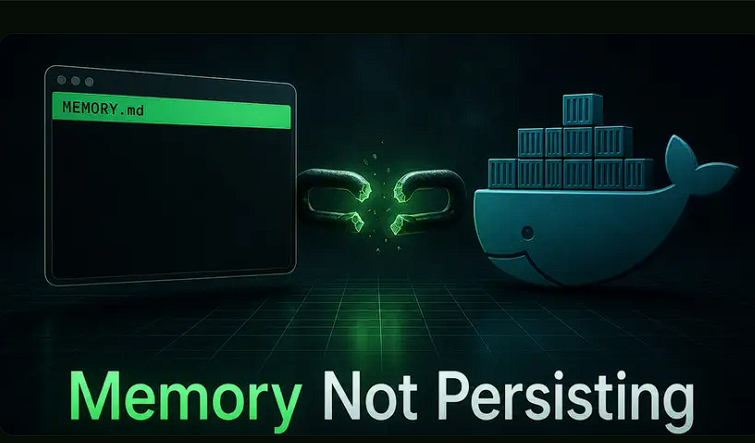

# Hermes Agent não lembra das conversas: como resolver

**Tags:** Hermes · Memory · Troubleshooting · Docker

---




Hermes Agent esquecendo do seu projeto entre sessões? Causas comuns e correções para volumes de memória ausentes, truncamento de contexto e confusão por chat.

---

## Seu agente devia se lembrar

Na segunda você contou ao Hermes Agent sobre seu projeto. Na quarta ele se apresenta como se nunca tivessem se falado. A promessa de memória persistente é o motivo principal para você ter escolhido um agente auto-hospedado em vez do ChatGPT, e agora parece a mesma ferramenta amnésica só que com mais passos de configuração.

A boa notícia é que o sistema de memória do Hermes Agent é simples o bastante para ser diagnosticado por fora. MEMORY.md e USER.md são arquivos markdown puros em disco. Se o agente não lembra, uma de quatro coisas está acontecendo, e cada uma tem uma correção específica.

## Como a memória do Hermes Agent realmente funciona

Antes de diagnosticar, ajuda entender o formato do que está quebrado.

O Hermes Agent grava dois tipos de memória no diretório de dados (normalmente `~/.hermes/memories/`):

- **MEMORY.md** — notas curadas pelo agente sobre seus projetos, preferências e fluxos de trabalho. Limitado a cerca de 2.200 caracteres, para forçar o modelo a priorizar.
- **USER.md** — um perfil estável de quem você é: papel, stack técnica e estilo de comunicação.

No início de cada sessão, o agente lê os dois arquivos e os injeta no system prompt. Durante a sessão, ele os atualiza automaticamente com base no que vocês conversaram. Quando a sessão termina, os arquivos ficam em disco.

Essa última frase é toda a promessa. Se os arquivos não estão em disco após um restart, a memória não está persistindo. Se estão lá e o agente ainda esquece, é outro problema. São dois bugs diferentes.

Para uma visão mais ampla do próprio sistema de memória, veja como funcionam memória e skills do Hermes Agent. Este post trata só dos modos de falha.

## Causa 1: O volume de dados não está montado

Essa é, de longe, a causa mais comum. Sintoma: o agente funciona bem por toda uma conversa, lembra de tudo que você disse cinco minutos atrás, depois o contêiner reinicia e ele esquece que você existe.

O que está acontecendo: os arquivos de memória estão sendo escritos dentro da camada gravável do contêiner, e não em um volume persistente. Quando você faz `docker stop` e `docker start`, essa camada sobrevive. Quando você faz `docker rm` (ou `docker compose down`, ou o host reinicia e recria o contêiner), a camada gravável é destruída e o MEMORY.md morre junto.

Confira primeiro: o diretório de memória realmente existe no seu host?

```bash
ls -la ~/.hermes/memories/
```

Se esse diretório está vazio ou sumiu depois do agente rodar por um tempo, o contêiner não está gravando lá.

A correção: monte `~/.hermes` como volume. Em `docker run`:

```bash
docker run -v ~/.hermes:/root/.hermes ...
```

No `docker-compose.yml`:

```yaml
services:
  hermes:
    volumes:
      - ~/.hermes:/root/.hermes
```

Depois da mudança, recrie o contêiner (não só reinicie) e confirme que o diretório de memórias começa a se popular no host conforme você usa o agente. O guia de Docker do Hermes Agent cobre o compose completo.

## Causa 2: Volume montado, mas permissões erradas

Você montou o volume, o diretório existe no host, mas os arquivos continuam vazios ou os logs do agente mencionam "permission denied" na hora de gravar.

O contêiner e o host compartilham o mesmo espaço numérico de UID, e por padrão nada concilia esses números. Se o seu agente roda como UID 1000 dentro do contêiner e o diretório do host pertence ao root, a gravação falha silenciosamente. Em Fedora, RHEL e outras distros com SELinux, a gravação é negada mesmo quando as permissões Unix padrão permitiriam, e o Docker não vai avisar.

Confira a propriedade:

```bash
ls -ln ~/.hermes/memories/
```

**Correção, Docker puro:** deixe o diretório do host gravável pelo mesmo UID que o contêiner usa:

```bash
sudo chown -R $(id -u):$(id -g) ~/.hermes
```

**Correção, hosts com SELinux:** adicione o rótulo `:Z` ao mount do volume para o Docker reetiquetá-lo para acesso do contêiner:

```yaml
volumes:
  - ~/.hermes:/root/.hermes:Z
```

**Correção, Docker rootless:** o "root" do contêiner é mapeado para o seu UID no host via user namespaces, não para o UID 0 real. O `chown` acima já cobre esse caso, mas o modelo mental confunde quem tenta `sudo` no arquivo e continua falhando.

## Causa 3: A janela de contexto está cheia, não o arquivo de memória

Sintoma: o MEMORY.md está em disco, tem as notas do seu projeto, `cat` mostra o conteúdo, e o agente ainda age como se não lembrasse. Isso não é um bug de memória. É um bug de janela de contexto disfarçado de memória.

O Hermes Agent lê MEMORY.md e USER.md no system prompt no início da sessão, mas também carrega o histórico da conversa atual na mesma janela de contexto. Se o tamanho combinado ultrapassar o limite do modelo, os tokens mais antigos são truncados primeiro. Mesmo antes do limite duro, aparece o efeito "lost in the middle": modelos recuperam informação de forma confiável do começo e do fim do contexto, e muito menos do meio.

Ou seja, o arquivo de memória pode estar presente e correto, mas no turno 30 de uma conversa longa o modelo recebeu uma versão truncada ou enterrada no meio e se comporta como se nunca a tivesse visto.

**Diagnóstico:**

- Compare as janelas de contexto dos modelos. Cheque qual modelo você configurou. Um modelo de janela pequena vai bater no limite antes que um de 200k ou 1M tokens.
- Confira o tamanho de `MEMORY.md`. Se está perto do teto de 2.200 caracteres, tudo bem. Se uma versão antiga do Hermes deixou crescer até 20k, corte.
- Olhe o comprimento da sessão atual. Sessões únicas longas sofrem mais com isso do que sessões curtas e frequentes.

**Correções:**

- Troque para um modelo com janela de contexto maior na sua config.
- Corte o MEMORY.md à mão se ele passou do teto.
- Reinicie a sessão periodicamente. O Hermes lê a memória do zero no início da sessão, então uma sessão nova carrega MEMORY.md e USER.md em um contexto limpo.

O mesmo modo de falha está descrito de outro ângulo no guia de troubleshooting do Telegram, na parte "as mensagens chegam mas o agente ignora o conteúdo". É o mesmo bug de base em canais diferentes.

## Causa 4: Confusão entre memória por chat e memória global

Alguns deployments rodam um processo de Hermes Agent por chat do Telegram, outros compartilham memória entre chats. Se você contou algo ao agente em um DM privado e ele não sabe disso quando você entra em um grupo, o que existe é um desencontro de escopo, não um bug de persistência.

**Diagnóstico:**

- Leia a sua config. Se existir um padrão de diretório de dados por chat, a memória é escopada por chat por design.
- Se você está em um setup auto-hospedado com um único `~/.hermes` compartilhado entre chats, a memória é global e a causa está em outro lugar.
- Se você está rodando vários processos do Hermes contra o mesmo home para atender chats diferentes, você tem outro problema: dois processos escrevendo no mesmo MEMORY.md se sobrescrevem e o arquivo termina em um estado que nenhum deles gravou. Não faça isso.

**Correção:** decida qual modelo você quer e configure para bater. A maioria dos operadores auto-hospedados quer memória global (um você, um agente, todos os chats). Deployments multiusuário ou multitenant normalmente querem isolamento por chat. Os dois são válidos, mas não são intercambiáveis.

## Recuperando depois de um restart mal-sucedido

Se o MEMORY.md ficou corrompido, foi truncado a zero bytes ou tem conteúdo ilegível depois de um crash ou desligamento ruim, o caminho de recuperação é direto porque é um simples arquivo markdown.

1. **Pare o agente antes de tocar no arquivo.** Um agente em execução pode sobrescrever a sua tentativa de recuperação.
2. **Procure backups.** Se você seguiu as recomendações em migrando o Hermes Agent para uma nova máquina, você já tem snapshots periódicos de `~/.hermes`. Restaure o snapshot bom mais recente.
3. **Edite à mão se precisar.** MEMORY.md é markdown. Abra num editor de texto, remova a parte corrompida e salve. Não há esquema a cumprir.
4. **Ligue o agente e confirme** que a memória recuperada aparece na próxima sessão.

Se você não tinha backups, este é o momento de configurar. Um `tar czf hermes-backup-$(date +%F).tar.gz ~/.hermes` diário no cron leva segundos e te dá um caminho real de recuperação para o próximo incidente.

## Quando parar de debuggar e delegar a infraestrutura

Toda correção deste post é um pequeno ajuste em como o contêiner está ligado. Nenhuma é difícil isolada. O que queima tempo é descobrir isso no dia em que o agente esquece um projeto de duas semanas no meio de uma conversa e você percebe que o volume nunca foi montado, as permissões estavam erradas e não há backup para voltar.

Se você prefere nunca mais ver um "permission denied" num log do Hermes, a Hermify roda um Hermes Agent gerenciado no Telegram com os mesmos MEMORY.md e USER.md, montados do jeito certo, com backup noturno e restauração em um clique. A sua memória continua sua (os arquivos são criptografados em repouso e podem ser baixados), e o debug de mount de volume deixa de ser problema seu.

Para uma visão mais ampla de como o trade-off de deployment se resolve, veja hospedagem do Hermes Agent versus auto-hospedagem.

Comece com a Hermify e pule de vez o checklist de persistência de memória.

## Fontes

### Lance seu próprio agente Hermes

Traga sua chave de API, conecte o Telegram e tenha um agente de IA que evolui sozinho no ar em 60 segundos.

[Começar agora](https://www.hermify.io/pt)